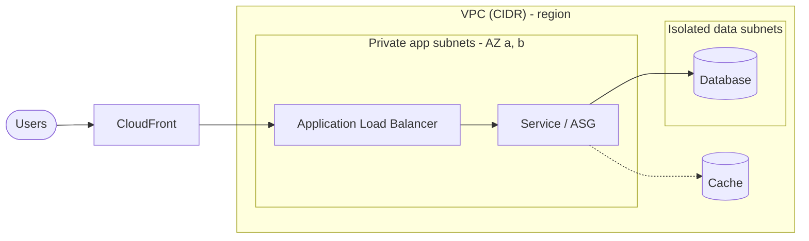

# Templates

Three templates live here. Copy the relevant block, fill every field, delete the `<!-- instructions -->` comments, and never leave a
placeholder in a finished report. Use `Not available — <reason>` for data you could not obtain; never invent values.

- **Part A** — Finding record (one per finding, stored in `reports/aws-well-architected/findings.md`)
- **Part B** — Register conventions (IDs, fingerprints, statuses, history, update rules)
- **Part C** — Review report skeleton (one dated file per account per review in `reports/aws-well-architected/reviews/`)

Conventions used throughout: **[Confirmed]** = directly observed · **[Inferred]** = reasoned from indirect evidence ·
**[Measured]** = from AWS data (state source and period) · **[Estimated]** = derived (state formula, price source, assumptions) · **[Not quantified]**.
Timestamps are UTC ISO-8601. Never include secret values, keys, tokens or user data; redact as `<redacted>`.

---

## Part A — Finding record

```markdown
### AWS-WA-NNN — <Concise finding title (what is wrong, where)>

| Field | Value |
|---|---|
| **ID** | AWS-WA-NNN |
| **Severity** | CRITICAL \| HIGH \| MEDIUM \| LOW \| INFORMATIONAL |
| **Type** | Confirmed issue \| Potential concern (needs verification) |
| **Confidence** | High \| Medium \| Low — <one-line reason> |
| **Severity rationale** | Impact <Severe \| Significant \| Moderate \| Minor> · Likelihood <Likely \| Possible \| Unlikely> · modifiers <none \| non-prod −1 \| compensating control −1 …> (cost findings: share of spend) |
| **Pillar** | Operational Excellence \| Security \| Reliability \| Performance Efficiency \| Cost Optimization |
| **Category** | <slug from references/assessment-framework.md §7> |
| **Account** | <account-id> (<alias or "no alias">) · profile `<profile>` · environment <prod/non-prod/unknown> |
| **Region** | <region \| global> |
| **Workload** | <workload/application name, or "account-wide"> |
| **AWS service** | <service> |
| **Resource(s)** | <IDs/ARNs; group long lists: "14 volumes — see Appendix A"> |
| **Status** | Open \| In Progress \| Resolved \| Accepted Risk \| False Positive \| Superseded |
| **First seen** | YYYY-MM-DD (<review file>) |
| **Last seen** | YYYY-MM-DD (<review file>) |
| **Fingerprint** | `<account-id>/<region or global>/<service>/<category>/<resource scope>` |
| **Re-check (read-only)** | `<one read-only command, with --profile, that shows whether the condition still exists>` or `digest <SIGNAL-ID>` |
| **Detected by** | SIG <ID> (digest) \| manual inspection |
| **WA best practice** | <verified ID such as SEC02-BP04> \| — |
| **Related** | <other finding IDs, anti-pattern ID (AP-nn)> |

**Description**
<What was found and why it matters in this workload. Two to five sentences. State the requirement or assumption the judgement rests on.>

**Evidence**
- <Observation 1 — field/value, resource, region, UTC time, read-only API used> [Confirmed]
- <Metric: namespace/metric/statistic/period/window and result> [Measured]
- <Reasoned link, with the reasoning> [Inferred]

**Business impact**
<Consequence for users/revenue/compliance/risk if left as is. Say "Unknown — criticality not established" rather than guessing.>

**Technical impact**
<Failure, exposure, performance or operational consequence; blast radius; likelihood.>

**Recommended remediation**
1. <Specific change>
2. <Verification step: how to confirm it worked>
*Do not do / alternatives considered:* <what was rejected and why>

**Implementation complexity:** Low (config change, no downtime) \| Medium (planned change + testing) \| High (re-architecture / migration)
**Trade-offs / risks:** <downtime, cost, performance, reversibility, dependencies>

**Cost impact** *(required for Cost Optimization findings; otherwise "None expected" or the cost of remediation)*
| Item | Detail |
|---|---|
| Current configuration | |
| Observed utilisation | <metric, window> [Measured] |
| Current estimated spend | <amount + basis> [Measured]/[Estimated] |
| Proposed alternative | |
| Estimated potential savings | <amount or range, label, assumptions, price source/date> |
| Risks / trade-offs | |

**References**
- <Official AWS documentation URL> — <what it confirms>

**History**
| Date | Review | Event | Note |
|---|---|---|---|
| YYYY-MM-DD | <review file> | Opened | Severity <S>, confidence <C> |
```

---

## Part B — Register conventions (`reports/aws-well-architected/findings.md`)

**IDs.** `AWS-WA-NNN`, zero-padded, allocated from the `Next ID` counter at the top of the register, strictly increasing, **never reused or renumbered** (even for false positives or superseded findings). Update the counter whenever you allocate.

**Fingerprint and duplicate check.** Fingerprint = `account-id/region-or-global/service/category/resource-scope`, all lower-case except resource IDs, separated by `/`
(never `|`: pipes split Markdown table cells even inside backticks). Before creating any finding, search the register for the same fingerprint or the same resource/condition in another wording. If found, update that finding (Last seen, evidence, status, history); do not create a second one. Group multiple resources with the same root cause into one finding (list them) rather than one finding per resource. For a cross-cutting anti-pattern, create one anti-pattern finding and link the underlying findings in *Related*.

**Statuses.**
| Status | Meaning | Who/what sets it |
|---|---|---|
| Open | Condition observed and not addressed | review (new, or re-opened) |
| In Progress | Remediation under way | only on the user's statement; record who/when in history |
| Resolved | Later review shows the condition no longer exists | only on fresh evidence in a later review; note the evidence |
| Accepted Risk | Owner knowingly accepts it | only on the user's explicit statement; record approver role, date, and review/expiry date if given |
| False Positive | Investigation shows the finding was wrong | review, with explanation of what was misread |
| Superseded | Merged into another finding | review; link to the surviving ID |

If a Resolved finding reappears, set it back to **Open**, add a history row "Re-opened", keep the original ID.
A finding that was not re-checked in a review keeps its status; do not mark it Resolved because it was not seen. If an account/region/area was not in scope or lacked permissions that time, note "not re-assessed" in history.

**Severity changes** are logged in history with the reason (new evidence, changed criticality, compensating control). Do not silently edit severity.

**History is append-only.** Never delete or rewrite earlier rows. Reviews in `reviews/` are immutable once finalised; their names carry the UTC start timestamp, so re-runs never collide.

**Register file layout** (the seed file already follows this; keep it):
1. Header: purpose, `Next ID`, `Last updated` (UTC), links.
2. Review log table (date · account · alias · review file · opened/updated/resolved counts).
3. Legend.
4. Summary counts (by severity × status).
5. Register table (one row per finding, sorted by severity then ID): `| ID | Severity | Pillar | Account | Region | Service | Finding | Status | First seen | Last seen |`
6. Finding details: Part A records in ID order.

The summary and register tables sit between `<!-- BEGIN:SUMMARY … -->`/`<!-- END:SUMMARY -->` and `<!-- BEGIN:REGISTER … -->`/`<!-- END:REGISTER -->`
markers and are **generated**: edit only the finding records, then run

```bash
python3 -I .claude/skills/aws-well-architected-review/scripts/register.py next-id reports/aws-well-architected/findings.md   # before allocating IDs
python3 -I .claude/skills/aws-well-architected-review/scripts/register.py rebuild reports/aws-well-architected/findings.md   # regenerate tables, Next ID, Last updated
python3 -I .claude/skills/aws-well-architected-review/scripts/register.py check   reports/aws-well-architected/findings.md   # must report 0 problems
```

`check` validates required fields, allowed values, dates, duplicate IDs and fingerprints, Superseded/Accepted Risk rules, history rows, leftover placeholders and secret-like strings.

---

## Part C — Review report skeleton

File: `reports/aws-well-architected/reviews/YYYY-MM-DDTHHMMZ-<account-alias>-review.md` — the UTC timestamp of the review start, e.g. `2026-11-12T0715Z-divi-ai-stg-review.md`
(alias missing → the profile name without `-readonly`/`-admin` suffix if the user confirms it, else `account-<12-digit-id>`; cross-account summary → `YYYY-MM-DDTHHMMZ-cross-account-review.md`; if the name exists, add `-2`, `-3`… and never overwrite.)

````markdown
# AWS Well-Architected Review — <alias or account id>

| | |
|---|---|
| **Report status** | In progress \| Final |
| **Assessment date (UTC)** | YYYY-MM-DD |
| **Inspection started / finished (UTC)** | <timestamp> / <timestamp> |
| **Reviewer** | Claude Code skill `aws-well-architected-review` (read-only) |
| **Findings register** | [`../findings.md`](../findings.md) |

<!-- IN PROGRESS ONLY — keep updated after each stage; keep a final copy as "Assessment coverage" in §10. -->
### Progress tracker
| Stage | Status (Not started · In progress · Done · Partial · Blocked · Skipped) | Notes |
|---|---|---|
| 1 Scope confirmation, register check | | |
| 2 Collector run (evidence dir, status, counts) | | |
| 3 Digest, workload map, questionnaire | | |
| 4 Re-verification of open findings | | |
| 5 Targeted deep dives | | |
| 6 Analysis (pillars, anti-patterns, service selection, reliability/performance, cost) | | |
| 7 Validation gate | | |
| 8 Reporting (register rebuild/check, lint-review) | | |

## 1. Executive Summary

**Account details**
| Account ID | Alias | Profile | Environment | Identity (role/assumed) | Regions assessed | Inspected (UTC) |
|---|---|---|---|---|---|---|

**Scope:** <accounts, regions, workloads in scope; out of scope; depth (quick/standard/deep); sampling basis and collector caps if any>
**Evidence:** collected <UTC timestamp> by `collect.py` <version> (<n> calls: ok/absent/denied/error); metrics window <n days | not collected>; cost data <collected | not collected>. Raw evidence stayed in the session scratchpad.
**Since the last review** (<previous review file> | first review): <new / resolved / re-opened / unchanged counts; notable changes in the environment>.
**Workloads assessed:** <list with one-line purpose and criticality (stated vs assumed)>

**Overall architectural assessment**
<Three to six sentences, honest and specific: maturity, biggest strengths, biggest risks, and whether complexity matches the need.>

| Pillar | Rating | One-line summary |
|---|---|---|
| Operational Excellence | Strong \| Adequate \| Needs improvement \| Weak \| Not assessed | |
| Security | | |
| Reliability | | |
| Performance Efficiency | | |
| Cost Optimization | | |

*Rating scale:* **Strong** — meets or exceeds the workload's needs, minor gaps only · **Adequate** — meets current needs with moderate gaps · **Needs improvement** — material gaps relative to the workload's needs · **Weak** — serious gaps or exposure · **Not assessed** — insufficient access or data.

**Findings at a glance**
| Severity | New | Existing (still open) | Resolved this review | Total open |
|---|---|---|---|---|
| CRITICAL | | | | |
| HIGH | | | | |
| MEDIUM | | | | |
| LOW | | | | |
| INFORMATIONAL | | | | |

**Major concerns:** <up to five, each with finding ID>
**Highest-priority recommendations:** <ranked list with finding IDs, expected benefit, complexity>

## 2. Architecture Overview

**Workload summary** — <what the system does, who uses it, how traffic flows>

**Major AWS services in use**
| Domain | Services (counts) | Notes |
|---|---|---|

**Architecture diagram** (solid arrows = [Confirmed]; dashed = [Inferred])


**Component relationships and dependencies**
| From | To | Relationship | Basis |
|---|---|---|---|
| | | | [Confirmed] / [Inferred] |

**Failure paths** — <e.g. loss of one AZ, loss of the database, loss of a dependency: effect, detection, recovery, expected RTO/RPO vs requirement>

**Confirmed vs inferred architecture:** <what was directly observed; what was inferred and why; open questions for the owners>

## 3. Five-Pillar Assessment

<!-- Repeat this block for each pillar. -->
### 3.1 Operational Excellence
**Overall assessment:** <rating + 2–4 sentences>
**Positive observations:** <bullets>
**Identified gaps:** <bullets with finding IDs; confirmed vs potential>
**Anti-patterns:** <AP references>
**Recommendations:** <ranked bullets with IDs>

### 3.2 Security
### 3.3 Reliability
### 3.4 Performance Efficiency
### 3.5 Cost Optimization

## 4. Architecture Anti-Patterns

<!-- One entry per anti-pattern, using the 7-point format from references/architecture-anti-patterns.md. If none found, say so and list the patterns specifically checked. -->
### AP: <name> — <title> (AWS-WA-NNN · Severity · Confidence)
1. **What it is:**
2. **Where it exists:** (account / region / resources — [Confirmed]/[Inferred])
3. **Why it is a problem:**
4. **Impact:** operational · reliability · performance · financial
5. **Recommended improvement:**
6. **Implementation complexity:**
7. **Trade-offs and risks:**

## 5. Service Selection and Configuration Review

| Component | Service / configuration | Workload requirement | Assessment (Appropriate · Misconfigured · Questionable · Inappropriate) | Rationale and evidence | Alternative considered | Finding |
|---|---|---|---|---|---|---|

<Narrative on the notable choices; justification of multiple databases/clusters/LBs; items needing owner input.>

## 6. Reliability and Performance Assessment

**Single points of failure and fault isolation:**
**Scaling behaviour and capacity headroom** (include quota proximity):
**Bottlenecks and saturation** (metrics with window):
**Resilience weaknesses** (retries, timeouts, health checks, coupling, graceful degradation):
**Backup, recovery and DR** (RPO/RTO stated vs demonstrated, restore tests):
**If demand 2×/10×:** <first bottleneck and mitigation>

| Area | Observation | Evidence | Risk | Finding |
|---|---|---|---|---|

## 7. Cost Optimization Assessment

**Spend context:** <period, total, top services, trend, commitment coverage/utilisation> — [Measured] with source, or "Not available — <reason>".
| Finding | Resource(s) | Current config | Utilisation | Current spend | Proposed | Est. saving / month | Basis | Risks | Complexity |
|---|---|---|---|---|---|---|---|---|---|

**Waste (idle/unused):** — **Over-provisioning:** — **Inefficient service choices:** — **Data transfer:** — **Pricing model:** — **Governance:**
**Total opportunity** (non-overlapping findings only; excluded overlaps listed): <range, labelled>
**Considered but not recommended:** <optimisations rejected for reliability/security reasons>

## 8. Consolidated Findings Register

| ID | Severity | Pillar | Account | Region | Service | Finding | Status |
|---|---|---|---|---|---|---|---|

*Full finding records:* [`../findings.md`](../findings.md)
**Changes in this review:** New: <IDs> · Updated: <IDs> · Resolved: <IDs> · Re-opened: <IDs> · Not re-assessed: <IDs/areas>

## 9. Prioritized Remediation Roadmap

| Horizon | ID | Action (containment or fix) | Score | Why now | Complexity | Dependencies | Benefit / risk reduced |
|---|---|---|---|---|---|---|---|
| **Immediate (0–7 days)** | | | | | | | |
| **Short term (1–4 weeks)** | | | | | | | |
| **Medium term (1–3 months)** | | | | | | | |
| **Long term (3+ months)** | | | | | | | |

<Score and horizons per framework §10 (severity × confidence ÷ complexity; dependencies first; group into work packages). Mention required change windows, approvals, and who must confirm what. All changes are for the account owners to make; none were made by this review.>

## 10. Assessment Limitations

**Access ledger (missing permissions / unavailable services)**
| Area | API / permission | Result | Assessment impact |
|---|---|---|---|

**Unavailable metrics:** (e.g. no CloudWatch agent → memory not assessed; short history)
**Missing workload context:** (unanswered questions, assumed criticality/RTO/RPO)
**Unavailable cost data:**
**Assumptions made:**
**Areas requiring manual verification:** (application-level behaviour, on-prem links, third-party tools, organisational processes, items not visible via AWS APIs)
**Coverage and sampling:** (accounts, regions, resources examined vs total; collector caps hit)

| Pillar / area | Assessed | Partially (why) | Not assessed (why) |
|---|---|---|---|
| Operational Excellence | | | |
| Security | | | |
| Reliability | | | |
| Performance Efficiency | | | |
| Cost Optimization | | | |
| Sustainability | | | Out of scope unless requested |
**Method limits:** point-in-time read-only snapshot; the read-only guard cannot prove the session's IAM role was read-only.

## 11. Sources and References

- AWS Well-Architected Framework — https://docs.aws.amazon.com/wellarchitected/latest/framework/welcome.html
- <Per recommendation: official AWS documentation URL — what it supports (note if not re-verified in this session)>

## 12. Overall Conclusion

<Honest assessment of strengths, weaknesses and maturity; whether the architecture fits the stated requirements; the three changes that most improve risk or efficiency; what to re-assess and when.>

## Appendix A — Resource lists (as needed)
## Appendix B — Evidence and commands (read-only; no secrets)
<Collector version and options from manifest.json; call counts by status; denied APIs (digest coverage tables); manual commands used in Phase 3.
Run `register.py lint-review <this file> --register ../findings.md` before setting the status to Final.>
````
