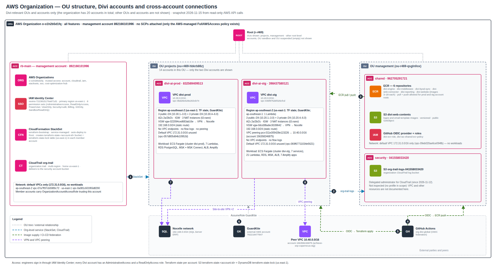
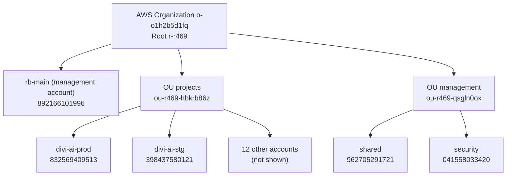
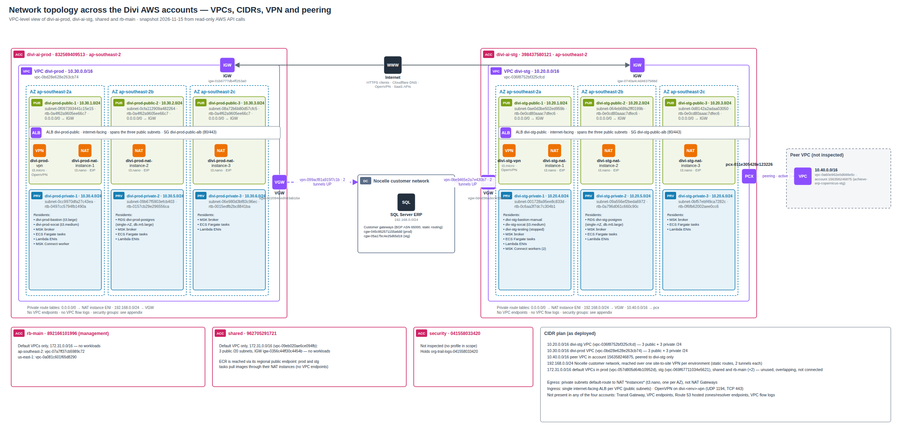

# Divi on AWS — Organization, OU structure and network

| | |
|---|---|
| **Scope** | The AWS Organization that contains the Divi accounts: management account, OUs, the Divi accounts (`divi-ai-prod`, `divi-ai-stg`), the `shared` and `security` accounts, and the VPC network of each. |
| **Snapshot** | 2026-11-15 (UTC). Read-only AWS API calls only (profiles `rb-main-readonly`, `divi-ai-prod-readonly`, `divi-ai-stg-readonly`, `shared-readonly`). |
| **Nature** | Descriptive. This page records what is deployed and how the accounts connect. It is **not** a review: no risk ratings or recommendations. |
| **Not covered** | Other accounts and OUs in the organization (20 accounts in total; only the Divi-relevant ones are shown). The `security` account was not inspected (no profile in scope). |

Related pages: [Prod architecture](02-divi-prod-architecture.md) · [Staging architecture](03-divi-stg-architecture.md) · [Security-group appendix](04-appendix-security-groups.md)

---

## 1. Organization and OU structure

*Diagram source: `diagrams/00-aws-organization-ou-structure.drawio` (editable in draw.io). Numbers in the diagram match the table in section 3.*

*Mermaid is a plain-text fallback of the tree. Confluence does not render Mermaid without a macro; use the PNG or the `.drawio` file.*

### 1.1 Accounts

| Account name | Account ID | Parent | What lives there | Regions with resources |
|---|---|---|---|---|
| `rb-main` | 892166101996 | Root | Management account. AWS Organizations, IAM Identity Center, StackSet administration, organization CloudTrail trail. **No workloads.** | us-east-1 (Identity Center, StackSet stack `ah-terraform-bootstrap`, Terraform lock table) |
| `divi-ai-prod` | 832569409513 | OU `projects` | Production Divi platform (VPC `divi-prod`, ECS, Lambda, RDS, MSK, ALB, Amplify). | ap-southeast-2 (workload); us-east-1 (Terraform state lock table, `GuardKiteRole` stack, StackSet stack) |
| `divi-ai-stg` | 398437580121 | OU `projects` | Staging Divi platform (VPC `divi-stg`) with the main staging stack plus the `beta` and `v3` variants. Holds real data and users. | ap-southeast-2 (workload); ap-southeast-1 (1 Lambda `Achieve-AI-User-Lambda`); us-east-1 (Terraform lock table, `GuardKiteRole` stack) |
| `shared` | 962705291721 | OU `management` | Container images (6 ECR repositories), the GitHub OIDC roles that push them, a small public-assets bucket (`divi-web-contents`). **No VPC workloads.** | ap-southeast-2 (ECR, S3); us-east-1 (Terraform lock table) |
| `security` | 041558033420 | OU `management` | Organization CloudTrail log bucket `org-trail-logs-041558033420`; delegated administrator for CloudTrail (since 2026-11-12). *Not inspected.* | not inspected |

Naming note: the account is called `divi-ai-prod` / `divi-ai-stg`, while all resources inside use the Terraform prefix `divi-prod` / `divi-stg`.

### 1.2 Organization-level configuration

| Item | Value |
|---|---|
| Organization ID / feature set | `o-o1h2b5d1fq` · all features enabled |
| Root | `r-r469` |
| Service control policies | None attached to the Root, to OUs `projects` / `management`, or to the Divi, shared or security accounts. The only SCP that exists is the AWS-managed `FullAWSAccess`. No tag, backup or AI-opt-out policies exist. |
| Trusted service access | `account`, `cloudtrail`, `iam`, `member.org.stacksets.cloudformation`, `sso`, `cost-optimization-hub.bcm` |
| Delegated administrators | `security` (041558033420) for `cloudtrail.amazonaws.com`, since 2026-11-12 |
| IAM Identity Center | Instance `ssoins-7223815176a971d1`, primary region us-east-1, started 2023-01-01. Permission sets: `AdministrativeAccess`, `ReadOnlyAccess`, `PowerUserAccess`, `ViewOnlyAccess`, `SecurityAudit`, `Billing`, `S3OnlyAccess`, `SandboxReadOnlyAccess`. Each Divi account has an `-admin` (AdministrativeAccess) and a `-readonly` (ReadOnlyAccess) sign-in role. |
| Organization trail | `org-trail` — organization trail, multi-region, home region us-east-1, delivered to S3 bucket `org-trail-logs-041558033420` in the `security` account. |
| StackSet | `terraform-bootstrap` — service-managed, automatic deployment, target = Root. Description "Create resources for Terraform". Creates in each member account (us-east-1): S3 bucket `terraform-state-<account-id>` and DynamoDB table `terraform-state-lock` (plus optional IAM users, disabled via parameters). |
| Cross-account admin role | `OrganizationAccountAccessRole` exists in the member accounts and trusts the management account. |

## 2. Network overview

*Diagram source: `diagrams/01-network-topology.drawio`.*

### 2.1 CIDR plan

| CIDR | Used for | Where |
|---|---|---|
| `10.20.0.0/16` | VPC `divi-stg` | divi-ai-stg |
| `10.30.0.0/16` | VPC `divi-prod` | divi-ai-prod |
| `10.40.0.0/16` | Peer VPC `vpc-0a60e962e0d688e5c` | Account 156358246875 (`achieve-erp-copernicus-stg`), peered to `divi-stg` only |
| `192.168.0.0/24` | Nocelle customer network (SQL Server ERP) | Reached from both `divi-prod` and `divi-stg` over one site-to-site VPN each |
| `172.31.0.0/16` | Default VPCs | prod `vpc-057d805d64b10952d`, stg `vpc-069f67711034e5621`, shared `vpc-09eb020ae6ce094fb`, rb-main `vpc-07a7ff37cb5989c72` (ap-southeast-2) and `vpc-0a081c601f65d8290` (us-east-1). Unused by the workloads and not interconnected. |

Not present in any of the four accounts: Transit Gateway, VPC endpoints (gateway or interface), Route 53 hosted zones or resolver endpoints, VPC flow logs, NAT Gateways. Public DNS is on Cloudflare (per the platform overview).

### 2.2 VPC `divi-prod` — account divi-ai-prod

| Item | Value |
|---|---|
| VPC | `divi-prod` · `vpc-0bd28e628e263cb74` · `10.30.0.0/16` · ap-southeast-2 |
| Internet gateway | `igw-01b6777db4ff253a0` (`divi-prod`) |
| Virtual private gateway | `vgw-022094ced683ab16e` (`divi-prod-nocelle`), attached to the VPC |
| Site-to-site VPN | `vpn-099acf81a915f7c1b` (`divi-prod-nocelle`) · IPsec · static routing · route `192.168.0.0/24` · both tunnels UP at snapshot · customer gateway `cgw-045c852571155a6dd` (BGP ASN 65000 recorded; customer IP not shown here) |
| Egress | Three **NAT instances** (not NAT Gateways), one per AZ, `t3.nano`, AMI `ami-062900c135ab91582`, source/dest check disabled, Elastic IP each |
| Ingress | One internet-facing ALB `divi-prod-public` in the three public subnets; OpenVPN instance `divi-prod-vpn` (`t3.micro`, Elastic IP, UDP 1194 and TCP 443) |

| Subnet | Subnet ID | AZ | CIDR | Route table | Default route |
|---|---|---|---|---|---|
| `divi-prod-public-1` | `subnet-0f097393441c15e15` | ap-southeast-2a | 10.30.1.0/24 | `rtb-0a4f62a9605ee66c7` (`divi-prod-public`, shared by all 3 public subnets) | `0.0.0.0/0` → IGW |
| `divi-prod-public-2` | `subnet-0cfa112909a482264` | ap-southeast-2b | 10.30.2.0/24 | same | same |
| `divi-prod-public-3` | `subnet-08a72b6b80d57cfc5` | ap-southeast-2c | 10.30.3.0/24 | same | same |
| `divi-prod-private-1` | `subnet-0cc9970dfa27c43ea` | ap-southeast-2a | 10.30.4.0/24 | `rtb-0497cc5794fb1490a` | `0.0.0.0/0` → NAT instance 1 (`eni-0b6ae2acc6c925cea`); `192.168.0.0/24` → VGW |
| `divi-prod-private-2` | `subnet-09b67f5903efcb403` | ap-southeast-2b | 10.30.5.0/24 | `rtb-0157cb29e296556ca` | `0.0.0.0/0` → NAT instance 2 (`eni-04cd29c40d5991487`); `192.168.0.0/24` → VGW |
| `divi-prod-private-3` | `subnet-06e980d3bf83c96ec` | ap-southeast-2c | 10.30.6.0/24 | `rtb-0015edfb2bc8841ba` | `0.0.0.0/0` → NAT instance 3 (`eni-0bfa26bf862b18d6a`); `192.168.0.0/24` → VGW |

NAT instances: `divi-prod-nat-instance-1` `i-0a27a839069489edc` (2a), `-2` `i-02fc9e15f5e13142f` (2b), `-3` `i-0678fc3e8fbd4364c` (2c). All launched 2026-11-02.

### 2.3 VPC `divi-stg` — account divi-ai-stg

| Item | Value |
|---|---|
| VPC | `divi-stg` · `vpc-036f8752bf325cfcd` · `10.20.0.0/16` · ap-southeast-2 |
| Internet gateway | `igw-0740a4c4d4837588d` (`divi-stg`) |
| Virtual private gateway | `vgw-0dcd38adec9339642` (`divi-stg-nocelle`), attached |
| Site-to-site VPN | `vpn-0be9465e2a7e430b7` (`divi-stg-nocelle`) · IPsec · static routing · route `192.168.0.0/24` · both tunnels UP · customer gateway `cgw-05a17bc4e25d65d19` (BGP ASN 65000 recorded) |
| VPC peering | `pcx-011e305428e123226` · **active** · `divi-stg` (398437580121) ↔ `vpc-0a60e962e0d688e5c` (156358246875, `10.40.0.0/16`). Private route tables route `10.40.0.0/16` to the peering. |
| Egress / ingress | Three NAT instances (`t3.nano`), ALB `divi-stg-public`, OpenVPN instance `divi-stg-vpn` — same pattern as prod |

| Subnet | Subnet ID | AZ | CIDR | Route table | Routes |
|---|---|---|---|---|---|
| `divi-stg-public-1` | `subnet-0ae0d3be502ed959b` | ap-southeast-2a | 10.20.1.0/24 | `rtb-0e0cd80aaac7dfec6` (`divi-stg-public`, shared) | `0.0.0.0/0` → IGW |
| `divi-stg-public-2` | `subnet-064eb68fa2ff0199b` | ap-southeast-2b | 10.20.2.0/24 | same | same |
| `divi-stg-public-3` | `subnet-0d8142a2adaa03050` | ap-southeast-2c | 10.20.3.0/24 | same | same |
| `divi-stg-private-1` | `subnet-001728a95ee8c833d` | ap-southeast-2a | 10.20.4.0/24 | `rtb-0c6aa3f7dc7c304b1` | `0.0.0.0/0` → NAT 1 (`eni-0d22d64465b67c85e`); `192.168.0.0/24` → VGW; `10.40.0.0/16` → pcx |
| `divi-stg-private-2` | `subnet-09a556ef2beda6972` | ap-southeast-2b | 10.20.5.0/24 | `rtb-0a796d061c660c90c` | `0.0.0.0/0` → NAT 2 (`eni-0efa233810e073218`); VGW; pcx |
| `divi-stg-private-3` | `subnet-0bf57ebf49ca7282c` | ap-southeast-2c | 10.20.6.0/24 | `rtb-0f6fb62002aee0cc6` | `0.0.0.0/0` → NAT 3 (`eni-0be9a1adc59fe8df9`); VGW; pcx |

NAT instances: `divi-stg-nat-instance-1` `i-02d5512184adea65f` (2a), `-2` `i-0976e342269d2bcec` (2b), `-3` `i-051f98ee6337aa84f` (2c).

### 2.4 `shared` and `rb-main`

| Account | VPC | Detail |
|---|---|---|
| `shared` 962705291721 | Default VPC `vpc-09eb020ae6ce094fb` · `172.31.0.0/16` | 3 public `/20` subnets (2a `172.31.0.0/20`, 2b `172.31.32.0/20`, 2c `172.31.16.0/20`), IGW `igw-0356c44ff30c4454b`. No instances, NAT, VPN or endpoints. The ECR repositories are regional service endpoints, not VPC resources: prod and staging tasks pull images across the internet through their NAT instances. |
| `rb-main` 892166101996 | Default VPCs only: ap-southeast-2 `vpc-07a7ff37cb5989c72`, us-east-1 `vpc-0a081c601f65d8290` (both `172.31.0.0/16`) | No workloads. |
| `security` 041558033420 | Not inspected | — |

### 2.5 How traffic leaves and enters each VPC

- **Inbound users:** Internet → IGW → ALB (public subnets) → Lambda target groups (host-header rules) or IP target groups for Fargate services. Static front ends are served by AWS Amplify outside the VPC.
- **Outbound from private subnets:** default route to the NAT instance in the same AZ → IGW → internet. This path carries OpenAI calls, image pulls from the shared ECR, Intrim BYOD SQL logins, and the staging `debezium-dug` connection to its SQL Server in ap-southeast-1.
- **Customer ERP (Nocelle):** private route `192.168.0.0/24` → VGW → IPsec VPN. The Debezium MSK Connect connector connects to the `socat` relay host's private IP in `private-1` on port 1433, which forwards over the VPN (the connector target is verified from its configuration; the relay role of `socat` is inferred).
- **Engineers:** OpenVPN instance `divi-<env>-vpn` in `public-1`.

## 3. Cross-account and external connections

| # | Connection | From → To | Mechanism and evidence |
|---|---|---|---|
| 1 | Terraform bootstrap | `rb-main` → all member accounts | StackSet `terraform-bootstrap` (service-managed, auto-deploy, Root target). Stack instance in us-east-1 in each member account. |
| 2 | Audit logging | all accounts → `security` | Organization trail `org-trail` delivers to `org-trail-logs-041558033420`. |
| 3 | Container images | `shared` ⇄ prod, stg | Six ECR repositories in `shared` carry a repository policy with statements `AccountsPull` (BatchGetImage, GetDownloadUrlForLayer, BatchCheckLayerAvailability) and `AccountsPush` (PutImage, InitiateLayerUpload, UploadLayerPart, CompleteLayerUpload) whose principals are the **prod and stg account roots**. ECS tasks in both accounts pull from here. Repositories: `divi-engine` (29 images), `divi-sink-connector` (15), `divi-reporting` (15), `divi-middleware` (13), `divi-website` (20), `divi-byod-sync` (3); tags mutable, scan-on-push off, AES-256 encryption, lifecycle policy present on all six. |
| 4 | CI push to ECR | GitHub → `shared` | OIDC provider `token.actions.githubusercontent.com` in `shared`. Role `divi-ecr-role` (17 trusted subjects): `divi-middleware`, `divi-reporting-agent`, `divi-engine-v2`, `divi-website`, `divi-sink-connector` on `main` and release tags (`v*`); `divi-engine-v2` also on branches `development_without_mt`, `nocelle-test-stg`, `intrim-test-stg` (the staging variant builds); and one repository from a **different GitHub organization** (`AchieveERP-InventoryPWA`, environments `cpn-dev`, `cpn-qa`, `dug-pre-prod`). Role `divi-iac-shared-ecr-policy` trusts `divi-iac-shared` on `main`. |
| 5 | CI deploy | GitHub → prod, stg | OIDC provider in each account. `divi-prod-iac-base` / `divi-stg-iac-base` trust `divi-iac-base` (`main` and `v*` tags). `divi-prod-iac-service` (16 subjects) trusts the service repositories on `v*` release tags (`divi-ui`, `divi-auth`, `divi-tracker`, `divi-financials`, `divi-performance-tracking`, `divi-engine-v2`, `divi-reporting-agent`, `divi-sink-connector`, `divi-middleware`, `divi-middleware-glue`, `divi-website` (also environment `prod`), `reporting-agent-framework`, `admin-portal`, `admin-portal-backend`). `divi-stg-iac-service` (28 subjects) trusts the same repositories on `main` plus the feature branches `intrim-test-stg` and `nocelle-test-stg`, and also `divi-infra`, `divi-ui-concept`, `divi-iac-resource-scheduler`. Both service roles additionally carry a wildcard subject covering every repository of the `divi-global` organization. |
| 6 | Third-party access | external account 782218477847 → prod, stg | IAM role `GuardKite` trusts the external account root; CloudFormation stack `GuardKiteRole` (us-east-1) in both accounts. Purpose not documented in the accounts. |
| 7 | Customer VPN | prod VGW, stg VGW ↔ Nocelle `192.168.0.0/24` | One site-to-site VPN per environment (`vpn-099acf81a915f7c1b`, `vpn-0be9465e2a7e430b7`), static routing, 2 tunnels each (all UP at snapshot). |
| 8 | VPC peering | `divi-stg` ↔ account 156358246875 | `pcx-011e305428e123226`, active; peer VPC `vpc-0a60e962e0d688e5c` `10.40.0.0/16`. The peer account was not inspected. |
| 9 | Workforce access | IAM Identity Center → all accounts | Permission sets listed in 1.2. |
| 10 | Member-account admin | `rb-main` → all members | `OrganizationAccountAccessRole`. |

## 4. How to refresh this page

All values come from read-only calls: `organizations list-*`, `ec2 describe-*`, `ecr get-repository-policy`, `iam list-roles`, `cloudformation list-stack-sets`, `sso-admin list-*`. The generator for the diagrams is in `diagrams/source/` and has no AWS dependency; edit the values in the builder scripts and re-run them.
