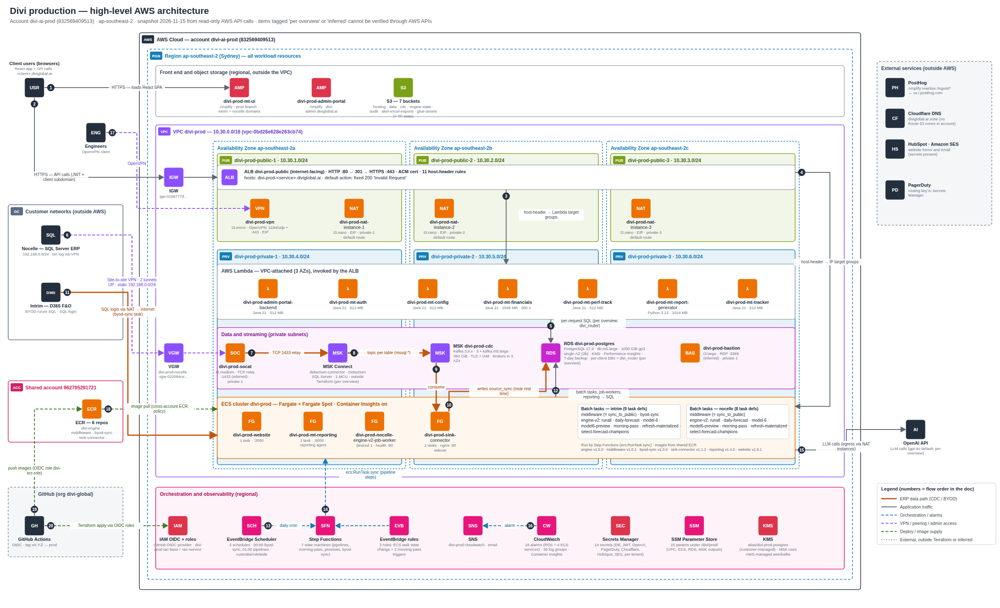
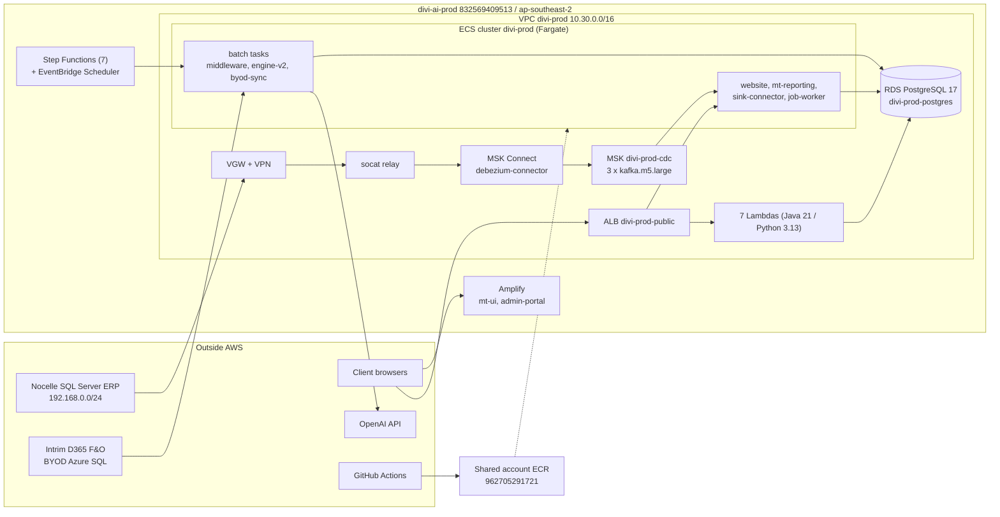

# Divi production — AWS architecture (`divi-ai-prod`)

| | |
|---|---|
| **Account** | `divi-ai-prod` · 832569409513 · OU `projects` · management account 892166101996 |
| **Region** | ap-southeast-2 (Sydney), three AZs. us-east-1 holds only the Terraform lock table and two CloudFormation stacks. |
| **Snapshot** | 2026-11-15 (UTC) from read-only AWS API calls. Items tagged *per overview* come from the platform overview document and cannot be verified through AWS APIs; items tagged *inferred* are deduced from names, ports or configuration. |
| **Nature** | Descriptive only — what is deployed and how it connects. No health, risk or cost assessment. |
| **Terraform prefix** | `divi-prod` (account is named `divi-ai-prod`) |

Related pages: [Organization and network](01-organization-and-network.md) · [Staging](03-divi-stg-architecture.md) · [Security-group appendix](04-appendix-security-groups.md)

---

## 1. Architecture diagram

*Editable source: `diagrams/02-divi-prod-architecture.drawio` (AWS icon set, opens in draw.io). Colour key: orange = ERP data path, grey = application traffic, blue dashed = orchestration, purple dashed = VPN / admin access, green dashed = deploy / image supply.*

### 1.1 Flow legend (numbers in the diagram)

| # | Flow | What happens |
|---|---|---|
| 1 | Front end | Client browsers load the React app from AWS Amplify (`divi-prod-mt-ui`, domains `intrim.diviglobal.ai`, `nocelle.diviglobal.ai`; admin portal `divi-admin.diviglobal.ai`). |
| 2 | API calls | Browsers call the APIs over HTTPS through the internet gateway to the ALB. Each request carries a JWT and the client subdomain (*per overview*). |
| 3 | ALB → Lambda | Host-header rules route to seven Lambda target groups. |
| 4 | ALB → Fargate | Host-header rules route to four IP target groups (website, reporting agent, sink-connector nginx, nocelle job-worker health). |
| 5 | Lambda → RDS | Lambdas open per-request SQL connections to PostgreSQL; the client database is chosen via the `divi_router` lookup (*per overview*). |
| 6 | Customer VPN | Site-to-site VPN from the Nocelle network (`192.168.0.0/24`) to VGW `vgw-022094ced683ab16e` (2 tunnels, static route). |
| 7 | CDC relay | VGW route → `divi-prod-socat` (`private-1`) → MSK Connect connector reaches SQL Server on TCP 1433 through it (connector target verified; relay role *inferred*). |
| 8 | CDC capture | MSK Connect connector `debezium-connector` (Debezium SQL Server) publishes one topic per table (`mssql.*`) to MSK. |
| 9 | CDC consume | ECS service `divi-prod-sink-connector` consumes the topics. |
| 10 | CDC write | The sink-connector writes the client's `source_sync` schema in RDS in near real time (*per overview*). |
| 11 | BYOD pull | ECS task `divi-prod-intrim-byod-sync` logs in to Intrim's BYOD Azure SQL (D365 F&O) over the internet via NAT and writes `source_sync`. |
| 12 | Batch and workers | Batch tasks, the job-worker and the reporting agent read and write RDS. |
| 13 | Schedule | EventBridge Scheduler starts the state machines: byod-sync at 00:00 and the pipelines at 01:00, timezone `Australia/Adelaide`. |
| 14 | Orchestration | Step Functions run the ECS tasks (`ecs:runTask.sync`). |
| 15 | LLM calls | Engine, reporting agent and mapping tool call the OpenAI API (*per overview*) via the NAT instances. |
| 16 | Alarms | CloudWatch alarms notify SNS topic `divi-prod-cloudwatch` (email subscription). |
| 17 | Engineer access | OpenVPN client → `divi-prod-vpn` instance in `public-1`. |
| 18 | Image pull | ECS pulls images from the shared account's ECR (cross-account repository policy). |
| 19 | Image push | GitHub Actions pushes images to the shared ECR through OIDC role `divi-ecr-role`. |
| 20 | Deploy | GitHub Actions assumes `divi-prod-iac-base` / `divi-prod-iac-service` through OIDC and runs Terraform. |

*Mermaid is a plain-text fallback. It has not been render-tested; the PNG and `.drawio` are the reference.*

---

## 2. Component inventory

### 2.1 Networking

| Resource | Name / ID | Detail |
|---|---|---|
| VPC | `divi-prod` `vpc-0bd28e628e263cb74` | `10.30.0.0/16`; 3 public + 3 private `/24` subnets across 2a/2b/2c (full table in [page 01](01-organization-and-network.md#22-vpc-divi-prod--account-divi-ai-prod)) |
| Internet gateway | `igw-01b6777db4ff253a0` | |
| NAT | 3 × EC2 NAT instances `divi-prod-nat-instance-1..3` (`t3.nano`, EIP each) | No NAT Gateways |
| VPN | `vgw-022094ced683ab16e`, `vpn-099acf81a915f7c1b`, `cgw-045c852571155a6dd` | Static, `192.168.0.0/24`, 2 tunnels UP; CloudWatch log groups `/divi/prod/tunnel1` and `/divi/prod/tunnel2` (VPN tunnel logging, *inferred* from the names) |
| Load balancer | `divi-prod-public` (ALB, internet-facing, 3 AZs) | HTTP :80 → 301 → HTTPS :443; ACM certificate `diviglobal.ai` (issued); default action fixed 200 "Invalid Request"; 11 host-header rules (table below) |
| EC2 hosts | `divi-prod-vpn` (t3.micro, public-1, EIP), `divi-prod-bastion` (t3.large, private-1), `divi-prod-socat` (t3.medium, private-1) | OpenVPN, RDP-style jump host (*inferred*), SQL relay (*inferred*) |
| Endpoints / flow logs / Route 53 | none | DNS is Cloudflare (*per overview*); secret `divi-prod-cloudflare-api-token` exists |

ALB host-header rules (HTTPS :443):

| Priority | Host | Target |
|---|---|---|
| 101 | `diviglobal.ai` | ECS `divi-prod-website` (:3000) |
| 112 | `divi-prod-mt-report-generator.diviglobal.ai` | Lambda `divi-prod-mt-report-generator` |
| 123 | `divi-prod-mt-tracker.diviglobal.ai` | Lambda `divi-prod-mt-tracker` |
| 124 | `divi-prod-mt-config.diviglobal.ai` | Lambda `divi-prod-mt-config` |
| 131 | `divi-prod-nocelle-engine-v2-worker.diviglobal.ai` | ECS `divi-prod-nocelle-engine-v2-job-worker` (nginx health :80) |
| 133 | `divi-prod-mt-perf-track.diviglobal.ai` | Lambda `divi-prod-mt-perf-track` |
| 148 | `divi-prod-admin-portal-backend.diviglobal.ai` | Lambda `divi-prod-admin-portal-backend` |
| 151 | `divi-prod-mt-auth.diviglobal.ai` | Lambda `divi-prod-mt-auth` |
| 161 | `divi-prod-sink-connector.diviglobal.ai` | ECS `divi-prod-sink-connector` (nginx :80) |
| 169 | `divi-prod-mt-financials.diviglobal.ai` | Lambda `divi-prod-mt-financials` |
| 202 | `divi-prod-mt-reporting.diviglobal.ai` | ECS `divi-prod-mt-reporting` (:8000) |

### 2.2 Front end

| Resource | Detail |
|---|---|
| Amplify app `divi-prod-mt-ui` (`d2hn1zba7hx0a1`) | Branch `prod` (PRODUCTION), manual deploys (auto-build off, no repository connected). Custom domains `intrim.diviglobal.ai`, `nocelle.diviglobal.ai`. Rewrites `/ingest/*` to PostHog (`us.i.posthog.com`), SPA fallback `/<*>` → `/index.html`. |
| Amplify app `divi-prod-admin-portal` (`d8yb987fw7u4t`) | Branch `prod`; domain `divi-admin.diviglobal.ai`. |

### 2.3 Compute — ECS on Fargate

Cluster `divi-prod`: capacity providers `FARGATE` and `FARGATE_SPOT`, Container Insights enabled. Task networking `awsvpc`, private subnets, no public IP, security group `divi-prod-ecs-cluster`. Images come from the shared account's ECR.

**Services (4)**

| Service | Task definition (vCPU / memory) | Desired / running at snapshot | Capacity strategy | Image (shared ECR) |
|---|---|---|---|---|
| `divi-prod-website` | `:12` (0.5 / 1 GB) | 1 / 1 | Fargate 2 : Spot 98 | `divi-website:v1.9.1-fc02371-11` |
| `divi-prod-mt-reporting` | `:6` (1 / 2 GB) | 1 / 1 | Fargate 2 : Spot 98 | `divi-reporting:v1.4.0-0451972-8` |
| `divi-prod-sink-connector` | `:9` (2 / 4 GB) — containers `sink-connector` + `nginx:latest` | 2 / 2 | Fargate 2 : Spot 98 | `divi-sink-connector:v1.1.2-e1fdb16-6` |
| `divi-prod-nocelle-engine-v2-job-worker` | `:1` (0.5 / 1 GB) — containers job-worker + `nginx:stable` health | 1 / 0 (target group shows *draining*) | Fargate (Spot weight 0) | `divi-engine:v1.5.0-2a50632-1` |

**Batch task definitions (17)** — run by Step Functions, 2 vCPU / 8 GB, x86_64, `awsvpc`, one task role each

| Client | Task definitions | Image |
|---|---|---|
| `intrim` (9) | `middleware` (the `sync_to_public` promoter, *per overview*), `byod-sync`, and `engine-v2-` `runall`, `daily-forecast`, `model-6`, `model6-preview`, `morning-pass`, `refresh-materialized`, `select-forecast-champions` | `divi-middleware:v1.0.1-d852e1e-3`, `divi-byod-sync:byod-sync-v1.0.0-946ea6c-2`, `divi-engine:v1.5.0-2a50632-1` |
| `nocelle` (8) | `middleware` and the same seven `engine-v2-*` tasks | same images |

### 2.4 Compute — Lambda (all in VPC `divi-prod`, 3 subnets, x86_64, invoked by the ALB)

| Function | Runtime | Memory / timeout |
|---|---|---|
| `divi-prod-admin-portal-backend` | Java 21 | 512 MB / 75 s |
| `divi-prod-mt-auth` | Java 21 | 512 MB / 75 s |
| `divi-prod-mt-config` | Java 21 | 512 MB / 75 s |
| `divi-prod-mt-financials` | Java 21 | 2048 MB / 300 s |
| `divi-prod-mt-perf-track` | Java 21 | 512 MB / 75 s |
| `divi-prod-mt-report-generator` | Python 3.13 | 1024 MB / 120 s |
| `divi-prod-mt-tracker` | Java 21 | 512 MB / 75 s |

No event-source mappings. There is no alerting Lambda in the prod account (one exists in staging).

### 2.5 Orchestration

| Resource | Detail |
|---|---|
| Step Functions (7, STANDARD, logging off) | `divi-prod-intrim-pipeline`, `divi-prod-nocelle-pipeline`: `Middleware` → `RunAll` → parallel(`DailyForecast`, `Model6`) → result check → `RefreshMaterialized`; failures publish to SNS. `divi-prod-*-morning-pass`: waits for the pipeline execution to succeed (`describeExecution`) then runs `MorningPass`. `divi-prod-*-model6-preview`: runs `Model6Preview` (started on demand, *per overview* by the financials API). `divi-prod-intrim-byod-sync`: runs `ByodSync`. |
| EventBridge Scheduler (3) | `divi-prod-intrim-byod-sync` `cron(0 0 * * ? *)`; `divi-prod-intrim-pipeline` and `divi-prod-nocelle-pipeline` `cron(0 1 * * ? *)` — all `Australia/Adelaide`, enabled. (The overview describes BYOD sync as every two hours; the schedule found here is daily at midnight.) |
| EventBridge rules (3) | `StepFunctionsGetEventsForECSTaskRule` (managed, ECS task state change for `.sync`), `divi-prod-intrim-morning-pass-trigger`, `divi-prod-nocelle-morning-pass-trigger` |

### 2.6 Data and streaming

| Resource | Detail |
|---|---|
| **RDS** `divi-prod-postgres` | PostgreSQL 17.9, `db.m5.large`, 1000 GiB gp3, **single-AZ (ap-southeast-2b)**, storage encrypted, Performance Insights on, 7-day backup retention, deletion protection on, not public, subnet group `divi-prod-postgres` (3 private subnets), SG `divi-prod-postgres-db` (5432 from `10.30.0.0/16`). One database per client plus `divi_router` (*per overview*). It is the only RDS instance in the account; no RDS Proxy. |
| **MSK** `divi-prod-cdc` | Provisioned, Kafka 3.9.x, 3 brokers `kafka.m5.large`, 350 GiB EBS per broker, in the 3 private subnets; TLS in transit (client↔broker and in-cluster), IAM authentication (SCRAM and unauthenticated off), encrypted at rest with the AWS-managed key `alias/aws/kafka`, enhanced monitoring DEFAULT, broker logs to CloudWatch `/msk/divi/prod/cdc`. SG `divi-prod-cdc-msk` (9098, 9094 from `10.30.0.0/16`). |
| **MSK Connect** `debezium-connector` | Plugin `debezium-connector` (custom, active), class `io.debezium.connector.sqlserver.SqlServerConnector`, 1 worker × 1 MCU, `tasks.max 1`, topic prefix `mssql`, 10 partitions / replication factor 3 per topic, JSON converters, snapshot mode `initial`, selected `dbo.*` tables of the client's SQL Server (table list not reproduced). Service role `divi-prod-cdc`; logs `/msk/divi/prod/cdc`. State reported by MSK Connect: `RUNNING`. Debezium sits outside Terraform (*per overview*). |
| **S3** (7 + state) | `divi-prod-hosting`, `divi-prod-data`, `divi-prod-cdc`, `divi-prod-engine-state`, `divi-prod-audit`, `divi-prod-alert-excel-exports`, `aws-glue-assets-832569409513-ap-southeast-2`; Terraform state bucket `terraform-state-832569409513` (us-east-1 lock table `terraform-state-lock`). |
| Other data services | No DynamoDB tables (other than the Terraform lock table), ElastiCache, OpenSearch, DMS or Glue jobs/databases. Athena has only the default `primary` workgroup. No AWS Backup plans. |

### 2.7 Operations, security and identity

| Area | Detail |
|---|---|
| CloudWatch | 18 alarms (CPU and memory *high* and *critical* for ECS services `divi-prod-mt-reporting`, `-nocelle-engine-v2-job-worker`, `-sink-connector`, `-website`; CPU *high* and *critical* on RDS), 36 log groups (per-task `/ecs/divi/prod/*`, per-Lambda `/aws/lambda/*`, RDS postgresql log, MSK, VPN tunnels, Glue, Container Insights). No dashboards. |
| Notifications | SNS `divi-prod-cloudwatch` with one email subscription. A PagerDuty routing key is stored in Secrets Manager (`divi-prod-pagerduty-routing-key`). |
| Secrets Manager (14) | Classes: database credentials, JWT key pair, password-hashing key, OpenAI API key, PagerDuty routing key, Cloudflare API token, HubSpot token, SES credentials, per-client middleware / byod-sync / dug secrets. Values are not recorded here. |
| SSM Parameter Store (15) | `/divi/prod/central/{vpc,ecs,rds}/*` and `/divi/prod/cdc/central/msk/bootstrap-brokers`, `/divi/prod/public/central/alb/httpsListener` — Terraform outputs consumed by the service stacks. |
| KMS | One customer-managed key, `alias/divi-prod-postgres` (named for RDS). MSK uses the AWS-managed key `alias/aws/kafka`. |
| IAM | Task execution role `divi-prod-ecs-task-exec`; one task role per ECS task definition; one role per Lambda, Step Function, scheduler and Amplify app; MSK Connect role `divi-prod-cdc`; NAT instance role; `ec2-s3-role` and `s3-full-access-ec2` (EC2 profiles); GitHub OIDC provider with `divi-prod-iac-base` and `divi-prod-iac-service`; `GuardKite` (external account 782218477847); `OrganizationAccountAccessRole`; StackSet execution role. |
| Account-level services | No GuardDuty detector, AWS Config recorder or AWS Backup plan in ap-southeast-2. CloudTrail is the organization trail (managed from `rb-main`, logs in `security`). |

---

## 3. Dependencies

### 3.1 On other AWS accounts

| Account | Dependency |
|---|---|
| `shared` (962705291721) | All ECS images (6 repositories); GitHub OIDC image push |
| `security` (041558033420) | Organization CloudTrail logs |
| `rb-main` (892166101996) | Terraform bootstrap StackSet; IAM Identity Center sign-in; `OrganizationAccountAccessRole` |
| External 782218477847 | `GuardKite` role |

### 3.2 On parties outside AWS

| Party | Used for | Source of this statement |
|---|---|---|
| Nocelle (customer) | SQL Server ERP source via VPN and Debezium | verified (VPN, connector target) |
| Intrim (customer) | D365 F&O BYOD Azure SQL source | *per overview*; secret `divi-prod-intrim-byod-sync` and task `divi-prod-intrim-byod-sync` exist |
| OpenAI | LLM calls from engine, reporting agent, mapping tool | *per overview*; secret `divi-prod-openai-api-key` exists |
| Cloudflare | DNS for `diviglobal.ai` | *per overview*; API-token secret exists, no Route 53 zones |
| PostHog | Browser analytics via Amplify rewrite | verified (Amplify rewrite rules) |
| PagerDuty, HubSpot, Amazon SES | Alert routing, website forms, email | secrets exist; usage *per overview* |
| GitHub (org `divi-global`) | CI/CD via OIDC | verified (OIDC roles) |

### 3.3 Delivery routes (*per overview*)

- **Route A** (engine, data-sync jobs, web app): GitHub Actions builds an image and pushes to the shared ECR; a bot commits the new tag to `divi-iac-app`, which runs Terraform per environment. Production deploys from release tags `vX.Y.Z`.
- **Route B** (Lambda APIs, reporting agent, sink-connector, website): each repository builds and applies its own Terraform.
- The base layer (VPC, database, Kafka, load balancer, ECS cluster) lives in `divi-iac-base`; the Terraform for these accounts was written by the external contractor Opstimus, who is also the listed code owner.

## 4. Verified versus *per overview* or *inferred*

| Statement | Basis |
|---|---|
| Resource names, sizes, versions, subnets, routes, schedules, state machines, ALB rules, ECR policies, IAM trust | Verified live via AWS APIs |
| Debezium connector target is a private IP in `divi-prod-private-1` on port 1433 | Verified from the connector configuration (host not recorded here) |
| `divi-prod-socat` is a SQL Server relay; `divi-prod-bastion` is an RDP jump host; `divi-prod-vpn` is OpenVPN | *Inferred* from names, security-group ports and the connector target |
| Per-client databases, `divi_router`, `source_sync` → `public` mapping, T1/T2 JSON mappers, OpenAI usage, Debezium outside Terraform, Opstimus ownership | *Per overview*; not verifiable through AWS APIs |
| Intrim BYOD sync every two hours | *Per overview*; the scheduler found here runs daily at 00:00 `Australia/Adelaide` |
