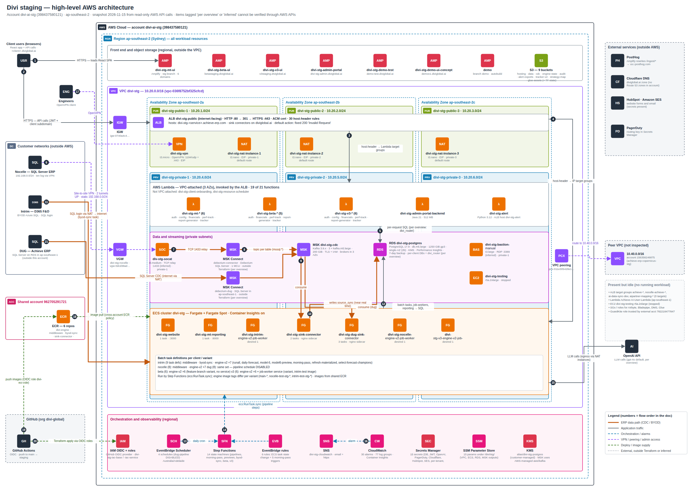
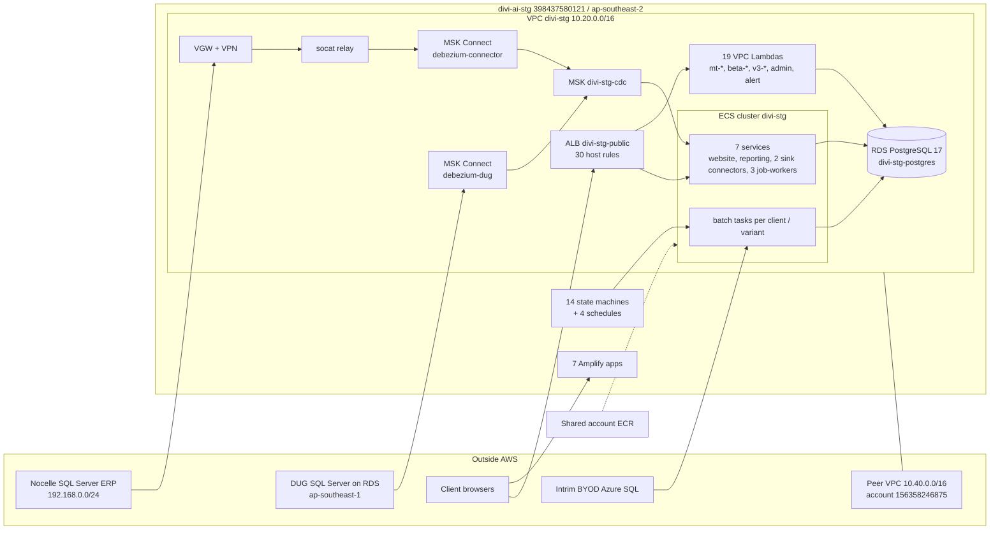

# Divi staging — AWS architecture (`divi-ai-stg`)

| | |
|---|---|
| **Account** | `divi-ai-stg` · 398437580121 · OU `projects` · management account 892166101996 |
| **Region** | ap-southeast-2 (Sydney), three AZs. ap-southeast-1 holds one Lambda; us-east-1 holds the Terraform lock table and the `GuardKiteRole` stack. |
| **Snapshot** | 2026-11-15 (UTC) from read-only AWS API calls. *Per overview* = taken from the platform overview document, not verifiable through AWS APIs. *Inferred* = deduced from names, ports, tags or configuration. |
| **Nature** | Descriptive only. The account is used as staging but holds real data and users. |
| **Terraform prefix** | `divi-stg` (account is named `divi-ai-stg`) |

Related pages: [Organization and network](01-organization-and-network.md) · [Production](02-divi-prod-architecture.md) · [Security-group appendix](04-appendix-security-groups.md)

Staging has the same layout as production (same base Terraform, *per overview*) plus **feature-branch variants** that share the one VPC, RDS instance, MSK cluster, ALB and ECS cluster, and some legacy leftovers. This page records the differences in detail; components identical to production are summarised.

---

## 1. Architecture diagram

*Editable source: `diagrams/03-divi-stg-architecture.drawio`. Colour key: orange = ERP data path, grey = application traffic, blue dashed = orchestration, purple dashed = VPN / peering / admin access, green dashed = deploy / image supply.*

### 1.1 Flow legend (numbers in the diagram)

Flows 1–20 are the same as in production (see [prod flow legend](02-divi-prod-architecture.md#11-flow-legend-numbers-in-the-diagram)), with these staging specifics:

| # | Staging specifics |
|---|---|
| 1 | Seven Amplify apps (table 2.2); the main UI `divi-stg-mt-ui` serves six client/demo domains. |
| 2–4 | ALB `divi-stg-public` has 30 host-header rules; API hostnames are under `achieve-erp.com`, sink-connector hostnames under `diviglobal.ai`. |
| 6–10 | Nocelle CDC: same path as prod (VPN → `div-stg-socat` → connector `debezium-connector` → MSK → `divi-stg-sink-connector` → RDS). |
| 11 | Intrim BYOD pull: task `divi-stg-intrim-byod-sync`, scheduled daily 00:00 `Australia/Adelaide`. |
| 13 | Four schedules; `divi-stg-dug-pipeline` is **disabled**. |
| 14 | 14 state machines (pipelines per client plus the `beta` and `v3` variants). |
| 16 | Alarms notify SNS `divi-stg-cloudwatch` (email **and** an https subscriber; the Lambda `divi-stg-alert` is reachable through the ALB). |
| 21 | **DUG CDC (staging only):** connector `debezium-dug` reads a SQL Server on RDS in ap-southeast-1 (outside this account) over the internet via NAT and publishes to the same MSK cluster; `divi-stg-dug-sink-connector` consumes it. |
| — | VPC peering `pcx-011e305428e123226` to `10.40.0.0/16` (account 156358246875) is an additional path with no workload shown on the diagram. |

*Mermaid is a plain-text fallback and has not been render-tested; the PNG and `.drawio` are the reference.*

---

## 2. Component inventory

### 2.1 Networking

| Resource | Name / ID | Detail |
|---|---|---|
| VPC | `divi-stg` `vpc-036f8752bf325cfcd` | `10.20.0.0/16`, 3 public + 3 private `/24` (full table in [page 01](01-organization-and-network.md#23-vpc-divi-stg--account-divi-ai-stg)) |
| Gateways | IGW `igw-0740a4c4d4837588d`; NAT instances `divi-stg-nat-instance-1..3` (`t3.nano`); VGW `vgw-0dcd38adec9339642` | No NAT Gateways, no VPC endpoints, no flow logs |
| VPN | `vpn-0be9465e2a7e430b7` (`divi-stg-nocelle`), customer gateway `cgw-05a17bc4e25d65d19` | Static `192.168.0.0/24`, 2 tunnels UP; log groups `/divi/stg/tunnel1`, `/divi/stg/tunnel2` |
| Peering | `pcx-011e305428e123226` | active; `divi-stg` ↔ `vpc-0a60e962e0d688e5c` (`10.40.0.0/16`, account 156358246875); routed from all three private route tables |
| Load balancer | `divi-stg-public` (ALB, internet-facing) | HTTP :80 → 301 → HTTPS :443; ACM certificate `achieve-erp.com` (issued); default action fixed 200 "Invalid Request"; 30 host-header rules (2.1.1) |
| EC2 hosts | `divi-stg-vpn` (t3.micro, EIP), `divi-stg-bastion-manual` (t3.large), `div-stg-socat` (t3.medium), `divi-stg-testing` (r5a.2xlarge, **stopped**) | OpenVPN, jump host and SQL relay are *inferred* from names and ports |

#### 2.1.1 ALB host-header rules (HTTPS :443)

| Group | Hosts (`<name>.achieve-erp.com` unless noted) | Target |
|---|---|---|
| Website | `divi-website-testing` | ECS `divi-stg-website` (:3000) |
| Reporting | `divi-stg-mt-reporting` | ECS `divi-stg-mt-reporting` (:8000) |
| Main (`mt`) APIs | `divi-stg-mt-auth`, `-mt-config`, `-mt-financials`, `-mt-perf-track`, `-mt-report-generator`, `-mt-tracker` | Lambda `divi-stg-mt-*` |
| `beta` APIs | `divi-stg-beta-auth`, `-beta-financials`, `-beta-perf-track`, `-beta-report-generator`, `-beta-tracker` | Lambda `divi-stg-beta-*` |
| `v3` APIs | `divi-stg-v3-auth`, `-v3-config`, `-v3-financials`, `-v3-perf-track`, `-v3-report-generator`, `-v3-tracker` | Lambda `divi-stg-v3-*` |
| Admin / alert / onboarding | `divi-stg-admin-portal-backend`, `divi-stg-alert`, `divi-stg-client-onboarding` | Lambda of the same name |
| Job-workers | `divi-stg-intrim-engine-v2-worker`, `divi-stg-nocelle-engine-v2-worker`, `divi-stg-v3-engine-v2-worker` | ECS job-worker health containers (:80) |
| Sink connectors | `divi-stg-sink-connector.diviglobal.ai`, `divi-stg-dug-sink-connector.diviglobal.ai` | ECS sink-connector nginx (:80) |
| Legacy (targets empty) | `dev-ai-achieve-ui`, `api-router-dev`, `ai-data-sync-dev` | instance target groups `achieve-react-app`, `achieve-ai-api-router`, `ai-data-sync-dev-9000` with no registered targets |

### 2.2 Front end — AWS Amplify (7 apps)

| App | ID | Branch | Custom domains |
|---|---|---|---|
| `divi-stg-mt-ui` | `d36672c0me4dp7` | `stg` | `demo`, `dug-test`, `fcf`, `intrim-test`, `nocellestaging`, `nocellestagingv1` — all `.diviglobal.ai` |
| `divi-stg-beta-ui` | `dy0zhhl24vqc0` | `stg` | `betastaging.diviglobal.ai` |
| `divi-stg-v3-ui` | `d1lq41bise7nhy` | `stg` | `v3staging.diviglobal.ai` |
| `divi-stg-admin-portal` | `d1kruij49qs47h` | `stg` | `divi-stg-admin.diviglobal.ai` |
| `divi-stg-demo-test` | `d2pqjssk4o3cuf` | `stg` | `demo-test.diviglobal.ai` |
| `divi-stg-demo-ui-concept` | `d2fr5fmy6v83t6` | `stg` | `demov1.diviglobal.ai` |
| `demo` | `d1tofv3w2smu4q` | `demo` (auto-build on) | none (default Amplify domain) |

The UI apps rewrite `/ingest/*` to PostHog; deploys are manual (no repository is connected to any of the apps; `demo` has auto-build on).

### 2.3 Variants

The variants share all base infrastructure and differ in service names, images and the state machines that run them. The branch names below are those trusted by the staging CI role (`divi-stg-iac-service`); the mapping of variant to branch is *inferred* from the image tags.

| Variant | Lambda set | UI app | Step Functions | Engine image tag |
|---|---|---|---|---|
| **main** (`mt`, plus clients `intrim`, `nocelle`, `dug`) | `divi-stg-mt-*` (6), `divi-stg-admin-portal-backend`, `divi-stg-alert`, `divi-stg-client-onboarding`, `divi-stg-resource-scheduler` | `divi-stg-mt-ui` | per client: `*-pipeline`, `*-morning-pass`, `*-model6-preview`, plus `divi-stg-intrim-byod-sync` | `divi-engine:main-0dc6905-142` |
| **beta** | `divi-stg-beta-*` (5: auth, financials, perf-track, report-generator, tracker) | `divi-stg-beta-ui` | `divi-stg-beta`, `divi-stg-beta-morning-pass` | `divi-engine:nocelle-test-stg-7cc317e-97` (branch `nocelle-test-stg`) |
| **v3** | `divi-stg-v3-*` (6: auth, config, financials, perf-track, report-generator, tracker) | `divi-stg-v3-ui` | `divi-stg-v3`, `divi-stg-v3-morning-pass` | `divi-engine:intrim-test-stg-6a66063-150` (branch `intrim-test-stg`) |

Also trusted for CI: branch `development_without_mt` of `divi-engine-v2`; no matching deployed resources were identified for it.

### 2.4 Compute — ECS on Fargate

Cluster `divi-stg`: capacity providers `FARGATE` and `FARGATE_SPOT`, Container Insights enabled, 10 tasks running at snapshot. Security group `divi-stg-ecs-cluster`.

**Services (7)**

| Service | Task def (vCPU / memory) | Desired / running | Image (shared ECR) |
|---|---|---|---|
| `divi-stg-website` | `:51` (0.5 / 1 GB) | 1 / 1 | `divi-website:main-fc02371-62` |
| `divi-stg-mt-reporting` | `:46` (1 / 2 GB) | 1 / 1 | `divi-reporting:main-0dfc60f-77` |
| `divi-stg-sink-connector` | `:64` (2 / 4 GB, + nginx) | 2 / 2 | `divi-sink-connector:main-cf94158-74` |
| `divi-stg-dug-sink-connector` | `:4` (2 / 4 GB, + nginx) | 3 / 3 | `divi-sink-connector:main-cf94158-74` |
| `divi-stg-intrim-engine-v2-job-worker` | `:22` (0.5 / 1 GB, + nginx health) | 1 / 1 | `divi-engine:main-0dc6905-142` |
| `divi-stg-nocelle-engine-v2-job-worker` | `:22` | 1 / 1 | `divi-engine:main-0dc6905-142` |
| `divi-stg-v3-engine-v2-job-worker` | `:53` | 1 / 1 | `divi-engine:intrim-test-stg-6a66063-150` |

Website, reporting and sink-connector services use Fargate weight 2 : Fargate Spot weight 98; the job-workers run on Fargate.

**Batch task definitions (44 families in total, 37 batch + 7 service)** — engine tasks are 2 vCPU / **16 GB** (production uses 8 GB), middleware and byod-sync 2 vCPU / 8 GB.

| Client / variant | Task definitions |
|---|---|
| `intrim` | `middleware`, `byod-sync`, `engine-v2-` `runall`, `daily-forecast`, `model-6`, `model6-preview`, `morning-pass`, `refresh-materialized`, `select-forecast-champions` (9) |
| `nocelle` | `middleware` + the same seven engine tasks (8) |
| `dug` | `middleware` + the same seven engine tasks (8) |
| `beta` | `engine-v2-` `runall`, `daily-forecast`, `model-6`, `morning-pass`, `refresh-materialized`, `select-forecast-champions` (6) |
| `v3` | the same six engine tasks as `beta` (6) |

### 2.5 Compute — Lambda (21 functions)

| Group | Functions | Runtime | VPC |
|---|---|---|---|
| `mt` | `divi-stg-mt-auth`, `-config`, `-tracker`, `-perf-track` (512 MB / 75 s); `-financials` (2048 MB / 300 s); `-report-generator` (1024 MB / 120 s) | Java 21; report-generator Python 3.13 | yes |
| `beta` | `divi-stg-beta-auth`, `-tracker`, `-perf-track`, `-financials`, `-report-generator` | same | yes |
| `v3` | `divi-stg-v3-auth`, `-config`, `-tracker`, `-perf-track`, `-financials`, `-report-generator` | same | yes |
| Admin | `divi-stg-admin-portal-backend` (512 MB / 75 s) | Java 21 | yes |
| Alerting | `divi-stg-alert` (256 MB / 75 s) | Python 3.12 | yes |
| Onboarding | `divi-stg-client-onboarding` (256 MB / 900 s) | Python 3.13 | **no** |
| Scheduler | `divi-stg-resource-scheduler` (128 MB / 870 s) | Python 3.13 | **no** — name suggests start/stop scheduling of staging resources (*inferred*) |
| Other region | `Achieve-AI-User-Lambda` in **ap-southeast-1** | — | — |

### 2.6 Orchestration

| Resource | Detail |
|---|---|
| Step Functions (14, STANDARD) | Per client `dug`, `intrim`, `nocelle`: `*-pipeline` (Middleware → RunAll → parallel DailyForecast / Model6 → RefreshMaterialized), `*-morning-pass`, `*-model6-preview`; `divi-stg-intrim-byod-sync`; variants `divi-stg-beta`, `divi-stg-beta-morning-pass`, `divi-stg-v3`, `divi-stg-v3-morning-pass`. The per-client state machines publish failures to SNS (`Notify-Failure` steps), as in production. |
| EventBridge Scheduler (4) | `divi-stg-intrim-byod-sync` `cron(0 0 * * ? *)`; `divi-stg-intrim-pipeline`, `divi-stg-nocelle-pipeline` `cron(0 1 * * ? *)` — enabled; `divi-stg-dug-pipeline` `cron(0 1 * * ? *)` — **disabled**. Timezone `Australia/Adelaide`. |
| EventBridge rules (6) | `StepFunctionsGetEventsForECSTaskRule` plus `divi-stg-{beta,dug,intrim,nocelle,v3}-morning-pass-trigger` |

### 2.7 Data and streaming

| Resource | Detail |
|---|---|
| **RDS** `divi-stg-postgres` | PostgreSQL 17.9, `db.m5.large`, 1250 GiB gp3 (max allocated storage also 1250 GiB), single-AZ (2b), encrypted, Performance Insights on, 7-day backups, deletion protection **off**, not public. Subnet group `divi-stg-postgres`. SG `divi-stg-postgres-db` (5432 from `10.20.0.0/16`). Each variant has its own database (*per overview*). |
| **MSK** `divi-stg-cdc` | Provisioned, Kafka 3.9.x, 3 × `kafka.m5.large`, 200 GiB per broker, 3 private subnets, TLS + IAM auth, AWS-managed key `alias/aws/kafka`, broker logs `/msk/divi/stg/cdc`. SG `divi-stg-cdc-msk` (9098, 9094, 1433 from `10.20.0.0/16`). |
| **MSK Connect** `debezium-connector` | Plugin `debezium-sqlserver-3-5-2-updated`; Debezium SQL Server; 1 MCU × 1 worker; `tasks.max 1`; prefix `mssql`; snapshot `initial`. Target: private IP in `divi-stg-private-1` :1433 (the `div-stg-socat` relay) → Nocelle over the VPN. Logs `/msk/divi/stg/cdc`. State `RUNNING`. |
| **MSK Connect** `debezium-dug` | Same plugin and settings; table include list `dug_uat.srp_erp_*`. Target: RDS SQL Server host in **ap-southeast-1** :1433 (outside this account). Logs group `msk-connect`. State `RUNNING`. Both connectors share the service role `divi-stg-cdc`. |
| **S3** (9 + state) | `divi-stg-hosting`, `divi-stg-data`, `divi-stg-cdc`, `divi-stg-engine-state`, `divi-stg-audit`, `divi-stg-alert-excel-exports`, `divi-stg-tracker-v2`, `divi-strategy-map-s3`, `aws-glue-assets-398437580121-ap-southeast-2`; state `terraform-state-398437580121`. |
| Not present | DynamoDB (other than the lock table), ElastiCache, OpenSearch, running DMS or Glue jobs, AWS Backup plans. IAM roles for DMS, Glue and a VPC-flow-logs role still exist. |

### 2.8 Operations, security and identity

| Area | Detail |
|---|---|
| CloudWatch | 30 alarms (CPU and memory *high*/*critical* for the 7 ECS services; CPU for RDS), 77 log groups, Container Insights. |
| Notifications | SNS `divi-stg-cloudwatch`: one email and one https subscriber (endpoints not recorded). Secret `divi-stg-pagerduty-routing-key`. |
| Secrets Manager (15) | Same classes as production plus `divi-stg-client-onboarding-github-app`. Values not recorded. |
| SSM Parameter Store (15) | `/divi/stg/central/*` and `/divi/stg/cdc/central/msk/bootstrap-brokers`. |
| KMS | One customer-managed key `alias/divi-stg-postgres`. |
| IAM | Same pattern as prod; additional legacy roles (`Achieve-AI-*`, `divi-role-*`, `aa-role-*`, DMS and Glue service roles, `manual-glue-role`, VPC flow logs role) and OIDC role `divi-stg-iac-service` with a wider set of trusted repositories and branches (see [page 01, row 5](01-organization-and-network.md#3-cross-account-and-external-connections)). `GuardKite` (external account 782218477847). |
| Account-level services | No GuardDuty detector, AWS Config recorder or AWS Backup plan in ap-southeast-2. Organization trail only. |

### 2.9 Present but idle

Resources that exist but have no running workload, listed so the diagram is complete:

- ALB target groups `achieve-ai-api-router`, `achieve-ai-engine`, `achieve-react-app`, `ai-data-sync-dev-9000`, `aipartner-mapping-middleware-dev`, `nocelle-achieve-ai-api-router`, `nocelle-achieve-ai-engine`, `nocelle-achieve-erp-ai`, `nocelle-achieve-react-app` — all with zero registered targets (three have listener rules).
- EC2 `divi-stg-testing` (r5a.2xlarge) — stopped.
- Security groups named for Airbyte, Bladepipe, AWS DMS and Glue; IAM roles for DMS, Glue and VPC flow logs; Lambda `Achieve-AI-User-Lambda` (ap-southeast-1).

---

## 3. Differences from production at a glance

| Aspect | Production | Staging |
|---|---|---|
| VPC CIDR | `10.30.0.0/16` | `10.20.0.0/16` |
| Customer sources | Nocelle (CDC), Intrim (BYOD) | Nocelle (CDC), Intrim (BYOD), **DUG** (CDC from SQL Server in ap-southeast-1) |
| MSK Connect connectors | 1 | 2 |
| ECS services | 4 | 7 |
| Lambdas | 7 | 21 (19 in VPC) |
| Step Functions / schedules / rules | 7 / 3 / 3 | 14 / 4 (1 disabled) / 6 |
| Amplify apps | 2 | 7 |
| RDS storage | 1000 GiB, deletion protection on | 1250 GiB (max allocated 1250), deletion protection off |
| MSK storage | 350 GiB / broker | 200 GiB / broker |
| Engine task memory | 8 GB | 16 GB |
| API hostnames | `*.diviglobal.ai` | `*.achieve-erp.com` (sink connectors on `diviglobal.ai`) |
| VPC peering | none | to `10.40.0.0/16` (account 156358246875) |
| Deploy trigger | release tags `vX.Y.Z` | pushes to `main` and variant branches |
| Alerting Lambda (`*-alert`) | no | yes (`divi-stg-alert`) |

## 4. Verified versus *per overview* or *inferred*

| Statement | Basis |
|---|---|
| Names, sizes, versions, subnets, routes, peering, schedules, state machines, ALB rules, IAM trust | Verified live |
| Connector targets (socat private IP; `debezium-dug` host in ap-southeast-1) | Verified from connector configuration (hosts not recorded here) |
| Variant ↔ branch mapping; `socat`/`bastion`/`vpn` roles; `resource-scheduler` purpose | *Inferred* |
| Per-client databases, mapping layers, three staging variants, OpenAI usage | *Per overview* |
