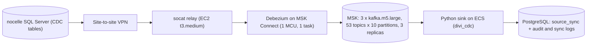
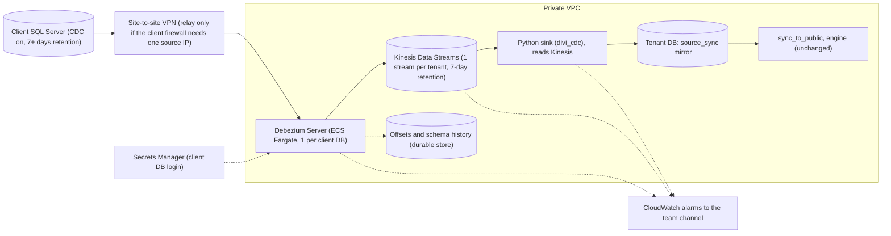

# Tenant ERP change capture: Debezium + Kinesis (proposed)

| | |
|---|---|
| **Scope** | Getting client ERP data (SQL Server) into each tenant's `source_sync` schema: the full load, then ongoing change capture (CDC) |
| **First client** | nocelle (`GcorpNocelle` on SQL Server), production account 832569409513 (divi-ai-prod), ap-southeast-2 |
| **Prepared (UTC)** | 2026-11-15T15:29Z |
| **Basis** | Read-only review of the production account (2026-11-12) and follow-up checks to 2026-11-15. Sources: AWS metrics, the connector, sink, middleware and PostgreSQL logs, connector settings, CloudTrail, and Jira history |
| **Status** | Proposal for discussion. Nothing in AWS was changed |
| **Decision** | 2026-11-15: the owner chose **Debezium Server + Kinesis** as the primary design. The Debezium Server JDBC sink (straight to PostgreSQL) stays as an alternative (Section 9) |
| **Related** | Findings AWS-WA-101, -103, -108, -110, -128, -129 in [findings.md](../reports/aws-well-architected/divi-ai-prod/findings.md) · [103 deep dive](../reports/aws-well-architected/divi-ai-prod/deep-dives/2026-11-12T1527Z-AWS-WA-103-cdc-pipeline.md) · [overall proposed architecture](../reports/aws-well-architected/divi-ai-prod/architecture/2026-11-15T1431Z-divi-proposed-architecture.md) |
| **Evidence tags** | [Measured] from metrics or logs · [Confirmed] seen in configuration · [Inferred] reasoned from evidence · [Estimated] a size, time or cost estimate |

> **Confidential.** Contains account, network and tenant identifiers. No credentials or data values are included.

---

## 1. Summary

**What we have today.** Debezium runs on MSK Connect and reads nocelle's SQL Server change tables. It publishes every change to Kafka (MSK, three brokers), and a Python sink reads Kafka and writes the rows into `source_sync` in PostgreSQL.
- **It has delivered nothing since 20 Aug 2026.**
- **It costs about $1,010 a month,** 58% of the October bill.
- **Its one full load took about 42 hours,** and turned about 8.7 GB of client data into 463 GB in Kafka and about 703 GB of PostgreSQL storage.

**What we propose.** Keep the two parts that worked: Debezium's SQL Server connector and the sink's mirror logic. Replace MSK and MSK Connect with:
- **Debezium Server** running as one small ECS service per client database;
- **Kinesis Data Streams** as the buffer.

At the same time, fix the four things that inflated the data and stretched the load to two days.

| | Today (Debezium + MSK) | Proposed (Debezium Server + Kinesis) |
|---|---|---|
| Full load of nocelle | about 42 h wall clock, 3 attempts [Measured] | about 1–2 h when tuned [Estimated] |
| Bytes in transit for one full load | about 160 GB per attempt (about 18× the source) [Measured] | about 2–3× the source as plain JSON [Estimated] |
| PostgreSQL space used by the load | about 703 GB, of which about 567 GB is two sink log tables [Measured] | about 15–20 GB for the mirror including indexes [Estimated] |
| Monthly run cost | about $1,010 [Measured / Estimated] | about $140–185 including the VPN and relay host [Estimated] |
| Near-real-time after the load | Yes, in design; dead since 20 Aug | Yes: the same process streams changes within seconds |
| When something breaks | Console shows `RUNNING` while the task is dead; no alarm | ECS task health, Kinesis and freshness alarms to the team |

---

## 2. What happened with the current setup

### 2.1 How it works today



Settings that matter [Confirmed · connector configuration]:
- **Message format:** JSON converter with `schemas.enable=true` on key and value, the Kafka Connect default. `ExtractNewRecordState` flattens each event to the row.
- **Topics:** `topic.creation.default.partitions=10`, replication factor 3, 53 tables.
- **Snapshot:** `snapshot.mode=initial`, `snapshot.isolation.mode=snapshot`, `errors.tolerance=none`.
- **Other:** schema history in S3. The tenant database password appears to be stored as plain text in the connector configuration (AWS-WA-128).
- **Sink:** `mirror pool: 4 workers, batch=300, interval=1.0s`, mode `SOURCE_SYNC_MIRROR_ONLY`. It applied `additional_audit_tables.sql` at setup [Measured · sink log].

### 2.2 The August full load: three attempts and 42 hours

| Attempt | Started (UTC) | Read over VPN | Into Kafka | Outcome |
|---|---|---|---|---|
| 1 | 14 Aug 10:51 | about 8.6 GB | about 160 GB | Died about 13:46 with Kafka metadata errors and timeouts as broker disks filled |
| 2 | 15 Aug 18:23 | about 7.8 GB | about 104 GB | Died about 20:23, same cause |
| 3 | 16 Aug 00:57 | about 8.7 GB | about 161 GB | **Completed at 04:33:33** |

[Measured · connector log; AWS/VPN and AWS/Kafka hourly. MSK broker storage was expanded at 14 Aug 10:03, 15 Aug 18:10 and 16 Aug 00:36, and each attempt started soon after an expansion.]

What the completed attempt tells us:
- **The client data is about 33.5 million rows and about 8.7 GB as sent,** copied in **3 h 36 min.**
- **Largest tables:**

  | Table | Rows | Time |
  |---|---|---|
  | DWGLMovement | 15.3 M | 71 min |
  | ITEMMOVTS | 3.7 M | |
  | GLMOVEMENTS | 3.3 M | |
  | SAL_ORDER_DTL | 3.2 M | |
  | INVOICE_DTL | 3.0 M | |
  | SALESYTD | 2.1 M | |

- **The read was already split into four parallel chunks per table.**
- **The connector's single worker was the limit.** Its hourly CPU averaged 40–76% with maxima of 83–100%, while it turned every row into JSON that carried the full schema [Measured; cause Inferred].
- **The network was not the limit.** The busiest hour moved 3.9 GB, about 1.1 MB/s.
- **The NAT instances were not on the path.** They carried under 0.5 MB an hour throughout. The data came over the VPN to the relay and stayed inside the VPC [Measured].

The 42 hours came from the two failed attempts, not from copying speed. Each failure restarted the copy from the beginning, because a Debezium initial snapshot cannot resume part-way.

### 2.3 Where the space went

| Where | Size | Why |
|---|---|---|
| Kafka (producer bytes, 14–16 Aug) | about 463 GB | Three attempts × about 18× growth from schemas in every message [Measured] |
| `source_sync.cdc_audit_log` | about 326 GB | The sink writes every event to an audit table, with no retention [Measured · PostgreSQL autovacuum log, heap pages] |
| `source_sync.sync_log` | about 241 GB | Same: every event logged again [Measured · same source] |
| Mirrored ERP tables (five largest) | about 11 GB for about 28.5 M rows | The real data: about 390 bytes a row, against about 260 bytes on the wire. Healthy [Measured; per-row figures Estimated] |

What made the log tables so large [Measured · sink and PostgreSQL logs; link Inferred]:
- **The database was restarted** on 16 Aug at 10:05, and free space briefly recovered.
- **The sink then replayed DWGLMovement from the start 315 times** over 16–17 Aug (`SOURCE_SYNC_MANUAL_RETRY: rewinding topics ['mssql.dbo.DWGLMovement'] (mode=all)`).
- **Its tasks kept restarting** while this ran, and every replayed event was logged again.
- **Free space fell by about 600 GB** in that period, while the client sent almost nothing.

Overall, free space went from about 988 GB on 13 Aug to about 285 GB on 21 Aug, and the database is still about 82% full (AWS-WA-101).

### 2.4 The 20 August failure

| When (UTC) | What happened | Evidence |
|---|---|---|
| 17–20 Aug | Streaming worked: about 1.5–2 changes a second | Connector metrics |
| 20 Aug 09:17:37 | SQL Server answered `Invalid object name 'GcorpNocelle.cdc.lsn_time_mapping'`, then `cdc.change_tables`. The client's CDC tables were gone: CDC switched off, or the database restored or rebuilt. The task was killed at 09:17, 09:21, 09:37, 09:52 and 10:08 | Connector log |
| By 20 Aug 10:54 | CDC was back on the database. But the connector's saved position (`00240b86:00021c58:00dd`) was older than anything SQL Server still kept (`00240B8F…`), so each start failed: "The connector is trying to read change stream starting at … but this is no longer available on the server. Reconfigure the connector to use a snapshot mode when needed." | Connector log |
| 20 Aug → 13 Nov | MSK Connect restarted the task **992 times**, about every 2 hours, and each start died within seconds. No one restarted it through the API (CloudTrail). The console still showed `RUNNING`. `TaskStartupAttemptsTotal` read 0, but `ErroredTaskCount` = 1 and `RunningTaskCount` = 0 every hour. No alarm existed | Connector log, CloudTrail, metrics |
| Same hour | Staging's connector on the same client database failed too | Staging metrics |

**What it means for the data:**
- **Every table stopped at once,** because one task reads all 53. In the middleware's nightly run, every CDC-fed table last brought in new rows on 20 Aug.
- **By 12 Nov, 30 source tables were behind the ERP by row count.** Examples:

  | Table | Rows behind |
  |---|---|
  | ITEMMOVTS | 55,997 |
  | SAL_ORDER_DTL | 42,565 |
  | INVOICE_DTL | 39,043 |
  | WKSORDERS_MATERIALS | 8,902 |
  | BOM_LABOUR_COST | 7,039 |

- **The gap follows the client's working week.** Median nightly growth runs from about +4,100 rows on Mondays to 0 on Sundays.
- **Even before the outage, seven tables were short by a fixed 1–39 rows,** consistent with rows missed at the initial load.
- **No alarm went off.** The middleware's health check counts rows only, and it logged `cdc_gap` as a WARNING, so the nightly pipelines still ended SUCCEEDED (AWS-WA-103, -108).

### 2.5 Other weaknesses found

| Weakness | Evidence | Finding |
|---|---|---|
| Tenant database password appears as plain text in the connector configuration, visible to read-only console users | Configuration keys; no worker configuration provider | AWS-WA-128 |
| `trustServerCertificate=true` (no certificate check on the SQL Server connection); `errors.log.include.messages=true` (record contents can land in logs kept 180 days) | Connector configuration | AWS-WA-128 |
| Sink tasks restart constantly: "Divi CDC consumer started" logged about 1,800 times between 14 Aug and 8 Nov | Sink log | — |
| Sink health check tests an `nginx:latest` sidecar, which always answers, not the consumer | Task definition | AWS-WA-123 |
| Hand-built relay host outside Terraform; Debezium "runs outside Terraform" per the platform overview | EC2, overview document | AWS-WA-115 |

---

## 3. Proposed architecture

### 3.1 Overview



### 3.2 Components

| Component | Role | Sizing | Notes |
|---|---|---|---|
| **Debezium Server** | Runs Debezium's SQL Server connector without Kafka Connect. Does the full load, then streams changes | 2 vCPU / 4 GB during a full load, then 0.5–1 vCPU / 1–2 GB [Estimated] | One ECS service per client database, in Terraform. Container health check on Debezium Server's health endpoint |
| **Offset store** | Remembers how far Debezium has read (the LSN) | Tiny | Must survive restarts. Debezium Server supports a JDBC offset store (PostgreSQL) or a file on EFS. Confirm in a staging spike |
| **Schema history store** | Remembers table structures over time | Tiny | Today it is in S3. Debezium Server's documentation lists file, Redis, RocketMQ, Azure Blob and Kafka stores, not S3 or JDBC. Use a file on EFS, or Redis |
| **Kinesis Data Streams** | Buffer between Debezium and the sink. Absorbs bursts; lets the sink be down for a while without losing data | Steady state: 1 shard or on-demand. Full load: about 10–20 provisioned shards for the hours of the load, then scale back | 1,000 records/s and 1 MB/s of writes per shard. Retention extended from the 24 h default to 7 days. Server-side encryption with KMS |
| **Python sink** | Reads Kinesis and upserts rows into `source_sync` by primary key | Steady state: 0.5 vCPU / 1 GB [Estimated]; more workers during a full load | Same mirror logic as today; new reader, bulk path, and no per-event audit rows (Section 3.5) |
| **VPN and relay** | Network path to the client | Unchanged | Private subnets already route the client network (192.168.0.0/24) through the VPN. Keep the socat relay only if the client's firewall must see a single source IP; otherwise retire it. In Terraform either way |
| **Secrets Manager** | Holds the client database login | — | Debezium Server reads it at start-up. No passwords in configuration (fixes AWS-WA-128) |

### 3.3 Full load, then CDC, in one process

```mermaid
sequenceDiagram
  autonumber
  participant SQL as Client SQL Server
  participant DBZ as Debezium Server
  participant OFF as Offset store
  participant KIN as Kinesis
  participant SINK as Sink
  participant PG as source_sync
  DBZ->>SQL: Record current change position (LSN)
  DBZ->>SQL: Read every table (parallel chunks)
  DBZ->>KIN: Snapshot rows (op = read)
  KIN->>SINK: Batches
  SINK->>PG: Bulk insert into empty tables
  Note over DBZ: Snapshot complete. Switch to streaming automatically
  DBZ->>SQL: Read CDC change tables from the recorded LSN
  DBZ->>KIN: Inserts, updates, deletes (seconds)
  DBZ->>OFF: Save position regularly
  KIN->>SINK: Changes
  SINK->>PG: Upsert or delete by primary key
```

There is no manual switch from "full load" to "CDC". The same Debezium Server keeps running after the snapshot. Because it records the LSN before it starts copying, nothing that changes during the copy is missed.

### 3.4 Debezium Server settings (intent)

Exact property names to be confirmed against the Debezium Server documentation during the staging spike.

| Setting | Value | Why |
|---|---|---|
| Sink type | Kinesis, Region ap-southeast-2 | Replaces Kafka |
| Connector | SQL Server, database `GcorpNocelle`, the 53 tables in today's include list | Same as today |
| Credentials | From Secrets Manager at start-up | No plain-text password |
| SQL Server TLS | Encrypt on, verify the server certificate where the client can supply it | Today certificate checks are off |
| Value and key format | JSON **without** embedded schemas | Removes the ~18× growth |
| Event shape | Keep `ExtractNewRecordState` (flattened row plus operation and delete markers) | The sink already understands it |
| Routing | All tables of a tenant to one stream, keeping the table name in the record | One stream per tenant; partition key = record key (table + primary key), so changes to a row stay in order. The Debezium Server documentation does not say how the Kinesis sink picks the partition key, so confirm it, and the routing transform, in the spike |
| Snapshot | `initial` for a new client; parallel chunked reads; consider Debezium's incremental snapshot so a failed load resumes instead of restarting | Avoids the August restarts |
| Signals | A signal table on the client database, or another signal channel | Lets the team re-copy chosen tables later without stopping streaming |
| Heartbeat | Keep 10 s; give heartbeats a destination or have the sink ignore them | Keeps the saved position moving on quiet days |
| Errors | Stop on error (as today) and alert | Never silently skip data |
| Record contents in logs | Off | Keeps client data out of logs |

### 3.5 Sink changes

| Change | Why |
|---|---|
| Read from Kinesis instead of Kafka, using the Kinesis Client Library (KCL) or a reader that checkpoints per shard | KCL handles many shards during a full load, resharding afterwards and parent-before-child ordering |
| **Bulk path for snapshot rows** (`op = r`): large batches or `COPY` into empty tables, 4–8 parallel writers, indexes ready before streaming starts | Today's `4 workers, batch=300, interval=1.0s` caps a task at roughly 1,200 rows/s if the interval limits it, too slow for a full load |
| Upsert or delete by primary key for streaming changes (`c`, `u`, `d`) | Idempotent: duplicates after a restart are harmless |
| **Stop writing every event to `cdc_audit_log` and `sync_log`.** Log counts, errors and the latest position. Keep any audit trail for a few days or in S3 | These two tables are about 567 GB today |
| Remove "rewind everything on start-up" behaviour: a manual retry must run once and finish, never again on every restart. Within Kinesis retention, re-read from a recorded position; beyond it, use an incremental snapshot | The 315 replays of DWGLMovement |
| A real health check (consumer loop alive, last batch age) instead of the nginx sidecar | ECS restarts the task when the consumer is actually stuck |
| Publish metrics: rows applied per table, last change time per tenant, errors | Freshness alarms (Section 3.8) |

### 3.6 What the client must provide

| Requirement | Why |
|---|---|
| CDC enabled on the database and on every captured table; SQL Server Agent running | Debezium reads SQL Server's CDC change tables |
| CDC retention of at least 7 days (default is 3) | If Debezium is down longer than retention, its position is lost and tables must be re-copied, as on 20 Aug |
| A least-privilege login with the access Debezium's SQL Server documentation lists | Security |
| Notice before restores, upgrades or schema changes. A restore drops CDC unless `KEEP_CDC` is used. After a column is added, the client's DBA must create a new capture instance for that table | Avoids silent breakage |
| A load window for the first copy, and their upload bandwidth | The full load reads every table under snapshot isolation |

### 3.7 Security

- Client password in Secrets Manager; tasks fetch it with a narrowly scoped role (AWS-WA-128).
- Debezium's role may write only to its tenant's stream; the sink's role may read only from it.
- Kinesis encrypted with KMS; PostgreSQL reachable only from the sink's security group, not the whole VPC range (AWS-WA-106).
- Record contents kept out of logs.

### 3.8 Monitoring and alarms

All alarms go to a team channel with an owner (AWS-WA-108).

| Alarm | Signal | Catches |
|---|---|---|
| Debezium not running | ECS running task count < 1, or health check failing | Crashes; a failed start like the 992 restarts |
| Nothing arriving | Kinesis incoming records = 0 for 15 minutes (heartbeats arrive even when the ERP is quiet) | Lost connection, CDC off at the client, stuck connector |
| Sink falling behind | Kinesis iterator age above, say, 15 minutes | Slow or stuck sink |
| Data going stale | Time since the latest change landed per tenant (published by the sink) | Anything upstream |
| Errors | Sink error count; Debezium error log lines | Bad records, permission problems |
| Database space | RDS free storage below a threshold | Space problems like August |

---

## 4. Why this is better than Debezium + Kafka

| Aspect | Debezium on MSK Connect + MSK | Debezium Server + Kinesis |
|---|---|---|
| Moving parts | 3 brokers, MSK Connect worker, 53 topics × 10 partitions × 3 replicas | One ECS service and one stream per tenant |
| Fixed cost | About $816/month for MSK and MSK Connect alone (October) | About $30–45 for Debezium Server plus about $11–40 for Kinesis [Estimated, prices not re-checked] |
| Buffer filling up | Broker disks filled twice during the load and killed the copy; storage can be grown but never shrunk | Retention-based, no disks to fill; shards can be added for the load and removed after |
| Visibility | Console shows `RUNNING` while the task is dead; `TaskStartupAttemptsTotal` read 0 through 992 restarts | ECS task health, Kinesis metrics and freshness alarms |
| Restarts | MSK Connect restarted the task silently every ~2 h | Restart behaviour in your hands (ECS service), visible in metrics |
| Secrets | Password as plain text in connector configuration | Secrets Manager |
| Sizing for the full load | Brokers sized for a one-off peak and stuck at that size | Scale shards up for hours, then down |
| Infrastructure as code | Debezium outside Terraform today | ECS service and stream in Terraform |
| Real time | Seconds | Seconds (same Debezium) |

**What you give up**, and why it doesn't matter yet:
- **Kafka's strengths:** many consumers reading the same change stream, very high throughput, the Kafka Connect ecosystem. Divi has one consumer and about 2 changes a second.
- **Kinesis limits:** 1,000 records/s per shard means planning shards for full loads. The sink needs a per-shard reader (KCL) rather than a Kafka consumer group.
- **Familiarity:** Debezium Server is used less than Debezium on Kafka Connect. Rehearse in staging first.

**The core lesson:** the August problems came from settings and sink design, not from Kafka itself. Moving to Kinesis without the changes in Section 6 would bring them along.

---

## 5. How long a full load of nocelle would take

### 5.1 What is being loaded

About **33.5 million rows, about 8.7 GB as read from SQL Server**, from the completed August snapshot [Measured].

### 5.2 Stage by stage

All stages run at the same time, so the slowest stage sets the total.

| Stage | August (measured) | Proposed, tuned [Estimated] | Time for nocelle |
|---|---|---|---|
| Debezium reading and converting | 3 h 36 min per attempt; one CPU near 100% building schema-heavy JSON | Schemas off, 2 vCPU, parallel chunks: 3–5× faster | about **45–75 min** |
| Client upload bandwidth | Not the limit (peak hour about 1.1 MB/s while the connector was CPU-bound); actual line speed unknown | Agreed load window | 10 Mbit/s: about 1.9 h · 20 Mbit/s: about 58 min · 50 Mbit/s: about 23 min |
| Kinesis | — (Kafka disks filled twice) | One record per row; 10 shards = 10,000 rows/s; about 0.5–0.8 KB per record, so 5–8 MB/s fits within 10 MB/s | 10 shards: about **56 min** · 20 shards: about 28 min |
| Sink to PostgreSQL | 4 workers, batch 300, 1 s interval per task; restarts; audit logging | Bulk path at 10–20k rows/s on the current instance | about **28–56 min** |

### 5.3 End to end

| Scenario | Estimate |
|---|---|
| August, as it happened | **about 42 h** to a completed snapshot (14 Aug 10:51 → 16 Aug 04:33), plus another day of sink replays [Measured] |
| Kinesis swapped in, schemas off, sink unchanged | about **4 h**: the sink's small batches (about 2,400 rows/s with two tasks) become the limit [Estimated] |
| Fully tuned, client line ≥ 20 Mbit/s | about **1–1.5 h** [Estimated] |
| Fully tuned, client line about 10 Mbit/s | about **2 h** [Estimated] |
| A larger client (about 16 GB, about 60–65 M rows), tuned | about **2–4 h** [Estimated] |

These are estimates from the August measurements and published limits. Prove them with a staging rehearsal (Section 10).

### 5.4 Database space after a load

The mirror should need about **15–20 GB including indexes** for nocelle [Estimated, from about 11 GB of heap for the five largest tables]. That compares with about 703 GB in August. Kinesis keeps nothing permanently; data ages out after the retention period.

---

## 6. What to change so August cannot happen again

| # | August problem | Evidence | Change | Where |
|---|---|---|---|---|
| 1 | Schema repeated in every message (about 18× growth in transit) | `schemas.enable=true` on key and value; 463 GB in Kafka | JSON without embedded schemas (or a compact binary format); keep the flattened row | Debezium Server |
| 2 | Buffer ran out of space mid-load; copy restarted from scratch twice | Broker storage expanded 3 times; attempts 1 and 2 died | Kinesis (no disks) with shards sized for the load | Kinesis |
| 3 | A failed load restarted from zero | `snapshot.mode=initial`; three full reads | Incremental snapshots (resumable, per table) for large or risky loads; rehearse first | Debezium Server |
| 4 | Connector CPU-bound | 1 MCU averaging 40–76% with maxima near 100% | 2 vCPU during loads; slimmer format | ECS task size |
| 5 | Sink logged every event in PostgreSQL | `cdc_audit_log` about 326 GB, `sync_log` about 241 GB | Counts and errors only; short retention or S3 for any audit trail; agree with owners, then truncate the existing tables (frees about 570 GB) | Sink, database |
| 6 | Sink replayed the largest table again and again | 315 "rewinding topics … DWGLMovement (mode=all)" lines while tasks restarted | One-shot retries; never rewind on start-up; incremental snapshot for re-copies | Sink |
| 7 | Sink too slow for bulk loads | `batch=300, interval=1.0s`, 4 workers | Bulk path for snapshot rows | Sink |
| 8 | Sink restarting constantly | About 1,800 starts in under 3 months | Real health check; investigate crashes and Spot interruptions; no Spot during loads | Sink, ECS |
| 9 | 10 partitions × 3 replicas per table | 655 partitions per broker | Not applicable: one stream per tenant, shard count by load | Kinesis |
| 10 | Failure invisible for 12 weeks | `RUNNING` status; WARNING-only health check; one external mailbox | Alarms in Section 3.8 to a team channel; freshness as a metric | CloudWatch |
| 11 | Saved position outlived the client's CDC retention | 72-hour default; dead for 85 days | 7+ days retention agreed; alert within hours; incremental snapshot for recovery | Client and runbook |
| 12 | Client password in plain text | Connector configuration | Secrets Manager | Debezium Server |
| 13 | No space check before the load | 82% full afterwards | Free-space check and storage autoscaling before any load | RDS (AWS-WA-101) |
| 14 | Load competed with nightly pipelines | Nightly CPU bursts to 100% | Run loads outside the 01:00 Adelaide pipeline window | Scheduling (AWS-WA-111) |

---

## 7. Day-to-day running after the load

| Situation | What happens or what to do |
|---|---|
| Debezium Server restarts | Resumes from the saved position. Fine as long as it is back within the client's CDC retention (7+ days agreed) |
| Down longer than retention | Position lost. Re-copy affected tables with an **incremental snapshot** while streaming continues |
| Client turns CDC off, restores the database or upgrades the ERP | Debezium stops with an error and the "nothing arriving" alarm fires within minutes. Once CDC is back, run an incremental snapshot (do not just restart, as August showed) |
| Column added on the client side | Client DBA creates a new CDC capture instance for that table (Debezium documents the procedure); the sink adds the column |
| Sink down | Data waits in Kinesis for up to the retention period (7 days), then the sink catches up from its checkpoint |
| Duplicate events after a restart | Delivery is at-least-once; upserts by primary key make duplicates harmless |
| Order of changes | Partition key = table + primary key keeps each row's changes in order |
| Quiet ERP (weekends) | Heartbeats every 10 s keep the position current and prove the pipeline is alive |
| More tenants | One Debezium Server and one stream per client database; one tenant's problem never blocks another |

---

## 8. Cost

Monthly. October billing is [Measured]; the rest is [Estimated] with prices not re-checked for this document.

| Item | Today | Proposed |
|---|---|---|
| MSK brokers | $587 | — |
| MSK broker storage (3 × 350 GiB, cannot shrink) | $126 | — |
| MSK Connect (1 MCU) | $103 | — |
| Debezium Server on Fargate | — | about $30–45 (0.5–1 vCPU steady state) |
| Kinesis | — | about $11–15 for one provisioned shard, or about $30–40 on-demand; a full load adds a few dollars |
| Sink on Fargate | about $114 (2 × 2 vCPU / 4 GB) | about $20 (0.5 vCPU / 1 GB) |
| socat relay host | about $42 | about $42, or $0 if retired |
| Site-to-site VPN | $37 | $37 |
| **Total** | **about $1,010** | **about $140–185** |

Database storage: truncating the two log tables frees about 570 GB of headroom. The allocated storage, and its cost, stays the same, because RDS storage cannot be reduced.

---

## 9. Alternatives considered

| Option | Monthly cost [Estimated] | Effort | Verdict |
|---|---|---|---|
| **Debezium Server + Kinesis + existing sink** | about $140–185 incl. VPN and relay | Medium | **Recommended**: keeps what worked; removes the fixed Kafka cost and the disk-full failure |
| Repair and right-size MSK (t3.small brokers, new cluster) | about $366 | Low code change | Fallback if the team wants the least change; still a Kafka platform for one reader |
| **Debezium Server JDBC sink straight to PostgreSQL** (`debezium.sink.type=jdbc`: upsert by record key, deletes, basic schema evolution) | about $110–125 incl. VPN and relay | Low–medium | **Alternative to the chosen Kinesis design;** worth a quick test in the spike if time allows. Simplest design: one container per client, no buffer and no custom sink. While PostgreSQL is down, changes wait in the client's CDC tables. Trade-offs: the sink's extra logic must move elsewhere; bulk-load speed is unmeasured; the docs note delivery guarantees may differ from Kafka Connect |
| Amazon SQS | about the same as Kinesis | Medium–high | **Not recommended.** Debezium Server has no SQS sink, so it needs a custom sink or HTTP → API Gateway → SQS. Standard queues don't keep order; FIFO queues keep order per group but cap throughput for full loads; consumed messages can't be replayed |
| Scheduled pull from SQL Server CDC tables (hourly ECS task) | a few dollars plus VPN and relay | Medium (custom capture code) | Cheapest, but rebuilds what Debezium already does; not near-real-time |
| Airbyte (self-hosted) | about $154–175 for a server | Medium–high | Heavy to run for one or two sources; it runs Debezium inside anyway |
| AWS DMS | not priced | Low–medium | The team reports past problems; reasons to confirm (open question 2) |

**When Kafka would be the right choice again.** Bring it back, right-sized, if any of these becomes true:
- **Several consumers** need the same change stream: search, analytics, ML features, alerts, write-back to the ERP.
- **Product features react to events** in real time.
- **Volume grows** to thousands of changes a second across many large tenants.

---

## 10. Before switching: staging rehearsal

1. **Build it in staging:** Debezium Server and Kinesis, with schemas off, secrets from Secrets Manager, and offsets and schema history in the chosen stores.
2. **Change the sink:** a Kinesis reader, the bulk path, no per-event audit rows, one-shot retries, a real health check.
3. **Load a nocelle-sized dataset.** Use the staging tenant database that points at the same client, if the client agrees, or a copy. Record per stage: rows/s read, Kinesis incoming records, sink rows/s, PostgreSQL growth, total time.
4. **Exercise the failure cases:**
   - kill Debezium mid-load (does it resume?);
   - stop the sink for an hour (does it catch up?);
   - add a column on the source (does the capture-instance procedure work?);
   - trigger an incremental snapshot of one table.
5. **Success criteria:**
   - a full load in a few hours;
   - PostgreSQL growth within about 2× the mirror size;
   - no restarts from scratch;
   - alarms fire for each failure case.

---

## 11. Open questions

| # | Question | Who can answer |
|---|---|---|
| 1 | What was done to `GcorpNocelle` on 20 Aug between 09:17 and 10:54 UTC? Can nocelle commit to keeping CDC on with 7+ days retention? | nocelle |
| 2 | What exactly went wrong with DMS, Airbyte and BladePipe before the team chose Debezium on MSK? | Data engineers |
| 3 | What are `cdc_audit_log` and `sync_log` used for, and how long must their contents be kept? | Sink developer |
| 4 | What does `SOURCE_SYNC_MANUAL_RETRY` do on start-up, and why did it run 315 times? | Sink developer |
| 5 | Why does the sink restart about 20 times a day? | Sink developer, DevOps |
| 6 | Does the client's firewall require a single source IP (the socat relay), or can Debezium reach the client through the VPN directly? | DevOps, client IT |
| 7 | The client's upload bandwidth and any limits on load against their SQL Server during business hours | Client IT |
| 8 | Is any second consumer of the change stream planned (which would favour Kafka)? | Product |
| 9 | Which future clients (ESS, GDC, ADCT, DT) run SQL Server with CDC available, and how large are they? | Onboarding |

---

## 12. Side note: why Kafka was added, and what its job was

*For later reference. Pieced together from Jira, the AWS setup and the services' own logs. No design document was found.*

**Why it was added**
- **It replaced the old middleware.** The CDC pipeline was ticketed as "CDC / Kafka data pipeline (replaces T1/T2 middleware)" (AP-867, July 2026). It replaced a Glue-job middleware that fed AWS Glue from backups and S3, and it was built for the admin portal's mapping agent (AP-808). The old Glue path was removed on 30 Jul (AP-873), three weeks before the new path broke, so there was no fallback.
- **Kafka came bundled with the tool that worked.** On AWS, the managed way to run Debezium is MSK Connect, and MSK Connect runs only against a Kafka cluster (MSK). The team reportedly tried DMS, Airbyte and BladePipe first; Debezium is what worked.
- **It bridged two languages.** Debezium is Java and the team's sink is Python. Kafka, or another log or queue, is the natural hand-off between them. Debezium Server could have done the same without Kafka.
- **No requirement recorded anywhere needs Kafka itself.** There is no second consumer and no real-time product feature. The onboarding catalogue (DUGC-98) describes the step as "Set Up Incremental Delta Sync (CDC)" with "schedule documented", which is scheduled-batch wording.
- **Ownership:** per Jira, the external DevOps contractor set up Kafka and Debezium, and an internal developer built the sink. The platform overview notes Debezium runs outside Terraform.

**What Kafka actually did in this design**

| Job | How it was used | Needed in the new design? |
|---|---|---|
| Transport from Debezium to the sink | One topic per table (`mssql.dbo.TABLE`), JSON with schemas | Yes: Kinesis does it |
| Buffer | Held changes while PostgreSQL and the sink restarted during the August load; 7-day retention | Yes: Kinesis with 7-day retention |
| Replay | The sink's manual retry mode rewinds topics to re-mirror tables (`SOURCE_SYNC_MANUAL_RETRY … mode=all`) | Within retention, yes; beyond it, use incremental snapshots (also safer than unlimited replays) |
| Fan-out to several consumers | Not used: one consumer group (`divi-cdc-sink-connector`) | No |
| High throughput | Not needed: about 2 changes a second in steady state | No |

**In one line:** Kafka was a buffer and a hand-off between Java Debezium and a Python sink, which MSK Connect made mandatory. Those jobs are real, but they don't need a three-broker cluster costing about $816 a month.

---

## 13. Evidence and references

**Measurements and logs (read-only, 2026-11-12 to 2026-11-15)**
- Connector log `/msk/divi/prod/cdc`, stream `debezium-connector-d4aa088c-5bb0-4d63-a681-397d042aa9fe-2`:
  - snapshot steps, chunk progress and "Snapshot completed";
  - the 20 Aug errors;
  - 992 task starts.
- Sink log `/ecs/divi/prod/sink-connector`:
  - mirror pool settings and `additional_audit_tables.sql`;
  - 315 rewinds;
  - about 1,800 starts.
- PostgreSQL log `/aws/rds/instance/divi-prod-postgres/postgresql`:
  - autovacuum page counts per table;
  - restarts on 14 and 16 Aug.
- Middleware log `/ecs/divi/prod/nocelle-middleware`: nightly health checks and per-table gaps.
- Metrics:
  - AWS/VPN TunnelDataIn;
  - AWS/Kafka BytesInPerSec;
  - AWS/KafkaConnect CpuUtilization, SourceRecordPollRate, ErroredTaskCount and RunningTaskCount;
  - AWS/EC2 NetworkOut for the relay and NAT instances;
  - AWS/RDS FreeStorageSpace and WriteThroughput.
- CloudTrail `lookup-events` for `kafkaconnect.amazonaws.com`: no write calls since 15 Aug.
- MSK cluster operations: broker storage expansions on 14, 15 and 16 Aug.

**Findings:**
- AWS-WA-101: database storage.
- AWS-WA-103: CDC connector failure.
- AWS-WA-108: alerting.
- AWS-WA-110: Kafka cost.
- AWS-WA-128: connector password.
- AWS-WA-129: data amplification.

**Documentation**
- Debezium Server (sinks including Kinesis; offset and schema history stores): https://debezium.io/documentation/reference/stable/operations/debezium-server.html
- Debezium SQL Server connector (snapshots, incremental snapshots, signals, schema changes and capture instances): https://debezium.io/documentation/reference/stable/connectors/sqlserver.html
- Kinesis Data Streams capacity modes and shard limits: https://docs.aws.amazon.com/streams/latest/dev/how-do-i-size-a-stream.html
- MSK best practices (partitions per broker; storage cannot be decreased): https://docs.aws.amazon.com/msk/latest/developerguide/bestpractices.html
