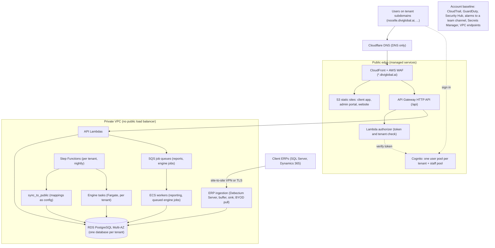
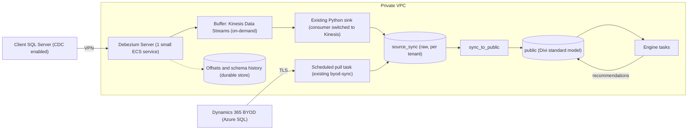
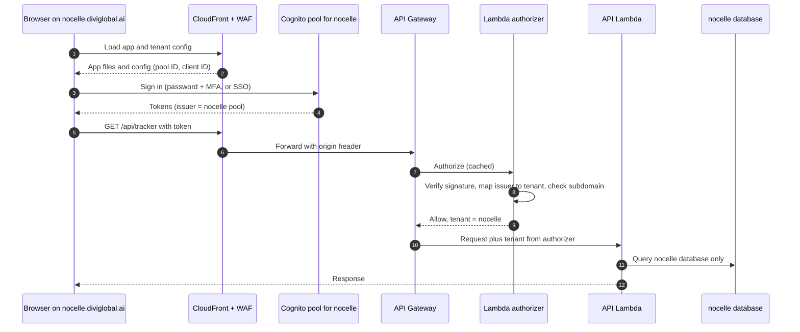

# Divi production: proposed target architecture

| | |
|---|---|
| **Account** | 832569409513 (divi-ai-prod) · ap-southeast-2 (Sydney) |
| **Prepared (UTC)** | 2026-11-15T14:31Z |
| **Basis** | Read-only Well-Architected review of 2026-11-12 ([2026-11-12T0853Z-divi-ai-prod-review.md](../reviews/2026-11-12T0853Z-divi-ai-prod-review.md)), the AWS-WA-103 deep dive ([2026-11-12T1527Z-AWS-WA-103-cdc-pipeline.md](../deep-dives/2026-11-12T1527Z-AWS-WA-103-cdc-pipeline.md)), the team's "Divi platform overview" document, and live read-only checks on 2026-11-13 to 2026-11-15 (load balancer, Amplify, ECS, Lambda, CloudWatch metrics and logs, public DNS) |
| **Status** | Proposal for discussion. Nothing in AWS was changed. |
| **Evidence tags** | [Confirmed] seen in configuration · [Measured] from metrics, logs or billing · [Inferred] reasoned from evidence · [Estimated] a size or cost estimate |

> **Confidential.** Contains account, network and tenant identifiers. No credentials or data values are included.

---

## 1. Summary

**What Divi is.** A multi-tenant B2B planning and forecasting product built on each client's ERP data. Two tenants run in production
(nocelle and intrim). More are coming: ESS, GDC, ADCT and DT. Each tenant has its own PostgreSQL database on a shared RDS instance. ERP data
lands raw in the tenant's `source_sync` schema, `sync_to_public` maps it into Divi's standard `public` model, and per-tenant engine tasks write
recommendations back. Users load a React app and call Java Lambda APIs.

**The seven biggest changes**

| # | Change | In one line |
|---|---|---|
| 1 | **One front door** | CloudFront with AWS WAF in front of everything users touch; the public load balancer goes away |
| 2 | **One API, behind sign-in checks** | API Gateway HTTP API at `/api` on each tenant's own subdomain, with a token check and throttling before any code runs |
| 3 | **Managed identity, one Cognito user pool per tenant** | Replaces the hand-built auth Lambda; adds MFA, lockout and per-client SSO |
| 4 | **Tenant comes from the token, never the URL** | The subdomain picks branding and the sign-in pool; the signed token decides which database is used |
| 5 | **Static things served statically** | Marketing website, client app and admin portal from S3 behind CloudFront; no web containers on the internet |
| 6 | **Keep Debezium, drop MSK** | Debezium Server on one small ECS service feeds the existing sink through a cheap buffer; about $800 a month less [Estimated] |
| 7 | **Run it like production** | Multi-AZ database with automatic storage growth, alarms that reach the team, an account security baseline, everything in Terraform |

**Design principles**

| Principle | What it means here |
|---|---|
| One front door | Every public request passes CloudFront + WAF. Nothing else accepts traffic from the internet |
| Nothing internal on the internet | Workers, the sink, health checks and the database get no public hostnames |
| Tenant identity from the token | APIs use the tenant in a signed token. A subdomain that disagrees with the token is refused |
| Pay per request for a light API | About 4,000 API calls in 90 days does not justify always-on infrastructure |
| Static things static | HTML, JavaScript and images come from S3 and the CDN |
| A standard ERP connector pattern | Every client's data lands the same way in `source_sync`, whatever the ERP |
| Mappings are configuration | Onboarding or fixing a tenant does not need a new image release |
| Everything in Terraform | No hand-built hosts, connectors or triggers |
| Alerts reach the team | Failures go to a team channel with an owner, not one external mailbox |

---

## 2. Today: the facts that drive the design

| # | Fact | Evidence | Tag | Findings |
|---|---|---|---|---|
| 1 | **Cloudflare is DNS only, not a proxy.** The `diviglobal.ai` nameservers are Cloudflare's (`ishaan.ns.cloudflare.com`, `pearl.ns.cloudflare.com`). API hostnames, `diviglobal.ai` and `www` resolve straight to the load balancer `divi-prod-public`. The tenant and admin domains resolve straight to Amplify's CloudFront. No Cloudflare IP addresses appear anywhere | Public DNS lookups, 2026-11-15 | [Measured] | AWS-WA-114 |
| 2 | **The load balancer is the internet edge, with no filtering.** Internet-facing; security group allows 80 and 443 from 0.0.0.0/0; no AWS WAF; TLS policy `ELBSecurityPolicy-2016-08` (allows TLS 1.0 and 1.1); no access logs; no deletion protection; idle timeout 3,600 s | elbv2, ec2, wafv2 | [Confirmed] | AWS-WA-114 |
| 3 | **11 hostnames are routed, including internal ones.** Seven Lambdas, the website, the reporting service, the sink connector's nginx sidecar and the job worker's nginx sidecar. Unknown hostnames get a fixed `200` response. `divi-prod-sink-connector.diviglobal.ai` has no DNS record, but the rule still answers anyone who sends that hostname | elbv2 describe-rules | [Confirmed] | AWS-WA-114, -112 |
| 4 | **Almost all traffic is the marketing website.** Last 30 days: website 176,104 requests; all APIs 92. Over 90 days the APIs had about 4,000 invocations, with a peak of 868 in one day (tracker) | ALB and Lambda metrics | [Measured] | — |
| 5 | **The website is a Next.js server, not static files.** `divi-prod-website` runs Next.js 16.1.6 on port 3000, one task of 0.5 vCPU / 1 GB on Fargate and Fargate Spot. Its log has more than 9,600 "Failed to find Server Action" errors since 24 Jul, including probes labelled `r2s`. These are scanners looking for the December 2025 React Server Components remote-code-execution bug. 16.1.6 is newer than that fix | ECS, website log | [Confirmed]; scanner purpose [Inferred] | AWS-WA-122 |
| 6 | **The browser calls the reporting service directly.** The service logged a CORS preflight followed by `POST /reports/generate`, once in 90 days (around 21 Sep) | Reporting service log | [Measured] | — |
| 7 | **Two Amplify apps host static front ends.** `divi-prod-mt-ui` serves `nocelle.diviglobal.ai` and `intrim.diviglobal.ai`, each added by hand as its own custom domain. `divi-prod-admin-portal` serves `divi-admin.diviglobal.ai`. Neither is connected to Git; deploys are manual zip uploads. Last client-app deploy 29 Sep | amplify list-apps, list-domain-associations, list-jobs | [Confirmed] | — |
| 8 | **Sign-in is hand-built.** No Cognito user pools or identity pools. Sign-in is the `divi-prod-mt-auth` Lambda. Each request carries a JWT and the tenant's subdomain, and the APIs resolve the database through `divi_router` | cognito-idp, platform overview | [Confirmed]; how the token and subdomain are matched is unknown | — |
| 9 | **Seven Lambdas, all inside the VPC.** Six Java 21 (no SnapStart) and one Python 3.13; login p95 about 3.4 s | lambda list-functions; earlier review | [Confirmed]; [Measured] | AWS-WA-127, -109 |
| 10 | **The database accepts 5432 from the whole VPC range,** so any task in the VPC, including the public website container, can reach it on the network | RDS security group | [Confirmed] | AWS-WA-106 |
| 11 | **The database is single-AZ and 82% full,** with no storage autoscaling or storage alarm; backups never leave the account and Region; no tested restore | rds | [Confirmed] | AWS-WA-101, -107 |
| 12 | **All outbound traffic goes through three t3.nano NAT instances,** with no VPC endpoints | ec2, route tables | [Confirmed] | AWS-WA-116 |
| 13 | **The CDC path costs about $1,010 a month (58% of October's $1,741.58 bill) and has delivered nothing since 20 Aug.** The Debezium task has been restarted automatically 992 times and fails each time because its saved source position no longer exists | Cost Explorer, connector log | [Measured] | AWS-WA-103, -110, -128, -129 |
| 14 | **The August initial load multiplied the data.** The snapshot ran three times: two attempts died when the Kafka brokers ran out of disk. The completed one copied about 33.5 million rows (about 8.7 GB over the VPN) in 3 h 36 min. Across the attempts, about 26 GB read became 463 GB in Kafka, because of schemas in every message. About 703 GB was written to PostgreSQL, of which about 567 GB is two sink log tables (`cdc_audit_log`, `sync_log`). The five largest mirrored tables are about 11 GB together | VPN, MSK and RDS metrics; connector log; PostgreSQL autovacuum log | [Measured] | AWS-WA-129, -101 |
| 15 | **Mappings ship inside the middleware image,** so the prod intrim pipeline has failed on every run since 30 Oct. The prod image predates intrim's mapping files | ECS, middleware log | [Confirmed] | AWS-WA-102 |
| 16 | **Failure alerts go to one external mailbox.** 28 SNS e-mails in 14 days, not actioned | sns | [Measured] | AWS-WA-108 |
| 17 | **No account security baseline:** no CloudTrail, GuardDuty, Security Hub or Config; root user without MFA; the deploy role trusts every repository in the GitHub organisation | various | [Confirmed] | AWS-WA-104, -105, -113 |

---

## 3. Target architecture

### 3.1 Whole platform

What to notice:
- **One path in.** Users reach only CloudFront. The API is a path (`/api`) on the same tenant subdomain, so the browser talks to one origin.
- **No public load balancer.** Lambdas sit behind API Gateway. The one container service that users trigger, reporting, sits behind a queue.
- **The data side is unchanged in shape:** raw tables in `source_sync`, mapping into `public`, engine runs per tenant. Only the transport changes, and mappings move out of the image.

### 3.2 ERP data path

---

## 4. Area-by-area changes

### 4.1 Front door and web

| Area | Today | Proposed | Why it's better or needed | Findings |
|---|---|---|---|---|
| DNS and front door | Cloudflare DNS only; API and website names point straight at an internet-facing ALB open to 0.0.0.0/0, with no WAF | Keep Cloudflare for DNS. All public names point to CloudFront distributions with AWS WAF (managed rule groups plus rate limits). Use Cloudflare's CNAME flattening for the apex `diviglobal.ai` | One place to filter, rate-limit and log every request. Nothing can go around it | AWS-WA-114 |
| TLS and certificates | ALB policy `ELBSecurityPolicy-2016-08` (TLS 1.0+); one ACM certificate in Sydney | ACM certificates in us-east-1 for CloudFront: `*.diviglobal.ai` plus `diviglobal.ai`. Modern TLS policy on CloudFront | Removes TLS 1.0/1.1 from the internet edge; one wildcard certificate covers every tenant | AWS-WA-114 |
| Marketing website | Next.js 16.1.6 server on one ECS task behind the ALB; constant scanner probes | Static export to S3 behind its own CloudFront distribution (`diviglobal.ai`, `www`). If it truly needs server features (forms, CMS, server actions), use Amplify Hosting's Next.js support instead of a container | No public server to patch or keep up; survives Spot interruptions; scanner traffic stays out of the VPC | AWS-WA-122, -117 |
| Client app hosting | Amplify (static), manual zip deploys, no Git connection | S3 behind the tenant CloudFront distribution, deployed by CI. CloudFront serves the app and routes `/api/*` to API Gateway on the same hostname | One origin per tenant (no CORS), one WAF, repeatable deploys | — |
| Admin portal hosting | Amplify (static), `divi-admin.diviglobal.ai`, manual deploys | S3 behind its own CloudFront distribution with a stricter WAF (IP allow-list or AWS Verified Access) and the staff user pool | The admin portal can create tenants; it should not be as open as the client app | AWS-WA-113 |
| Tenant subdomains | One Amplify custom domain added by hand per tenant | One CloudFront distribution with the wildcard `*.diviglobal.ai` and a wildcard CNAME in Cloudflare. Specific names (`www`, `divi-admin`, `login`, `api`) live on other distributions or are reserved; CloudFront routes to the most specific match. Tenant slugs may not use reserved names | A new tenant needs no DNS or CDN change; only a registry entry | — |

### 4.2 API, identity and tenant isolation

| Area | Today | Proposed | Why it's better or needed | Findings |
|---|---|---|---|---|
| API layer | Public ALB → 7 Lambdas on 7 separate hostnames (`divi-prod-mt-*.diviglobal.ai`) | One API Gateway HTTP API reached at `/api/...` on each tenant subdomain through CloudFront. Routes per service (`/api/tracker`, `/api/financials`, ...). Throttling, access logs. Remove the public ALB | Bad or missing tokens are rejected before any Lambda runs; per-route throttling; request logs; pay per request (about 4,000 calls in 90 days) | AWS-WA-114 |
| Reporting service | Browser calls `divi-prod-mt-reporting` directly through the ALB | `POST /api/reports` puts a job on SQS; an ECS worker builds the report and stores it in S3; the app polls status and downloads through a short-lived link | Signed-in only; retries; no long-running HTTP calls; the container never faces the internet | AWS-WA-122 |
| Identity | Hand-built `divi-prod-mt-auth` Lambda issues JWTs | Amazon Cognito, **one user pool per tenant** plus one staff pool (Section 5) | MFA, lockout, password policy and per-client SSO without custom code; AWS manages signing keys | — |
| Tenant isolation | APIs receive a JWT and a subdomain; whether they check one against the other is not known | A Lambda authorizer validates the token, maps its issuer (the tenant's pool) to the tenant through `divi_router`, and refuses any request whose subdomain does not match. Lambdas receive the tenant only from the authorizer's context | A valid login for one tenant can never read another tenant's database | Open question 1 |
| Direct origin access | ALB reachable by anyone | API Gateway answers only through CloudFront: CloudFront adds a secret origin header, which the authorizer checks | Nothing bypasses WAF | AWS-WA-114 |
| Internal services | Sink connector and job worker nginx sidecars and the reporting service have public host rules | No public hostnames. ECS container health checks replace ALB health checks | Smaller attack surface; health checks that test the real process | AWS-WA-114, -112 |

### 4.3 Compute and network

| Area | Today | Proposed | Why it's better or needed | Findings |
|---|---|---|---|---|
| Java Lambdas | Java 21, no SnapStart; login p95 about 3.4 s; mostly cold starts | SnapStart on published versions behind aliases; review memory per function | Faster first requests at no extra cost for Java | AWS-WA-127 |
| Secrets in Lambdas | Database passwords and API keys appear as plain environment variables | Read from Secrets Manager at start-up (cached); rotate | Secrets not visible to anyone who can read function settings | AWS-WA-109, -124 |
| ECS services | Tasks reserve 10–25× the CPU and memory they use; single tasks for website and reporting | Right-size; reporting becomes a queue-driven worker that scales to zero; the website leaves ECS | Lower cost; no single-task outages | AWS-WA-117, -122 |
| Job worker | Crash-looping since 20 Oct, behind a public nginx sidecar | Driven by SQS (the app enqueues; the worker polls the queue); no public route | A queue retries and shows backlog; no public sidecar | AWS-WA-112 |
| Container images | Unpinned sidecars from public registries (`nginx:latest`) | Pinned versions from ECR (or no sidecar at all) | Repeatable builds; no surprise upgrades | AWS-WA-123 |
| Security groups | Database allows 5432 from the whole VPC range; admin ports open to 0.0.0.0/0 on hand-built hosts | Database allows only the security groups of the API Lambdas, sync tasks, engine tasks and workers. Admin access through Systems Manager Session Manager | Only services that need the database can reach it | AWS-WA-106, -115 |
| Egress | Three t3.nano NAT instances; no VPC endpoints | VPC endpoints for Secrets Manager, ECR, CloudWatch Logs, STS and S3; a managed NAT gateway for the remaining internet traffic (OpenAI). Consider one NAT gateway for cost | AWS service traffic stays private and does not fail with a NAT instance | AWS-WA-116 |
| Hand-built EC2 | VPN server, Windows bastion and socat relay outside Terraform | In Terraform and Systems Manager; replace the bastion with Session Manager; keep the relay only while the ERP path needs it | Rebuildable; patched; auditable | AWS-WA-115 |

### 4.4 Database

| Area | Today | Proposed | Why it's better or needed | Findings |
|---|---|---|---|---|
| Availability | db.m5.large, single-AZ | Multi-AZ | Survives an AZ outage without a manual restore | AWS-WA-107 |
| Storage | 82% full; no automatic growth; no storage alarm | Storage autoscaling with a maximum threshold; free-space alarm; remove the CDC amplification before any re-load | Prevents a storage-full stop for every tenant | AWS-WA-101, -129 |
| Backups | Snapshots stay in one account and Region; no tested restore | Copy snapshots to a second Region or a backup account (AWS Backup); quarterly restore test | Recoverable after a Region or account problem | AWS-WA-107, -118 |
| Tenant model | One database per tenant on one instance | Keep. Add a path to move a large tenant to its own instance when needed | Good isolation at low cost; a noisy tenant can be moved | — |
| Night load | Nightly pipelines push CPU to 100% in bursts | Stagger tenant start times in the scheduler; watch I/O balance; resize only if needed | Room to add tenants | AWS-WA-111 |

### 4.5 ERP ingestion, mappings and batch

| Area | Today | Proposed | Why it's better or needed | Findings |
|---|---|---|---|---|
| CDC transport | Debezium on MSK Connect → MSK (3 × kafka.m5.large) → Python sink; about $1,010 a month; idle since 20 Aug | Debezium Server on one small ECS service → Kinesis Data Streams (on-demand) → the existing Python sink (consumer switched to Kinesis). Details in Section 6 | Keeps the parts that worked; removes the fixed broker and connector cost | AWS-WA-103, -110 |
| Message format | JSON with the full schema in every message; 10 partitions per table | JSON without embedded schemas; route all tables of a tenant to one stream; partition key = table + primary key | Removes the ~18× growth in transit. The PostgreSQL growth is fixed separately in the sink (next row) | AWS-WA-129 |
| Sink event logging | The sink writes every event into `source_sync.cdc_audit_log` (~326 GB) and `source_sync.sync_log` (~241 GB) | Log counts and errors only; keep any audit trail for a short retention period or in S3, not as full events in PostgreSQL | Frees about 570 GB now and stops the next load filling the database | AWS-WA-129, -101 |
| Connector secrets | Tenant database password in plain text in the connector configuration | Debezium Server reads it from Secrets Manager at start-up | Not visible to console readers | AWS-WA-128 |
| Sources without CDC | intrim (Dynamics 365 BYOD export in Azure SQL), pulled every 2 hours by `divi-byod-sync` | Keep the scheduled pull; land the same way in `source_sync`; one task definition for all BYOD tenants | Same landing for every ERP type | — |
| Mappings | T1/T2 JSON mapping files built into the middleware image | Mappings in versioned configuration (S3 or a database table), loaded at run time, validated in CI | Onboard or fix a tenant without a release | AWS-WA-102 |
| Orchestration | Step Functions per tenant; one task definition per client; triggers outside Terraform | One task definition per step (sync, RunAll, forecast, Model 6, refresh) with the tenant passed as input by Step Functions; schedules in Terraform | Adding a tenant is configuration, not new infrastructure | — |
| Data freshness | Middleware health check logs `cdc_gap` only as a WARNING; pipelines still end SUCCEEDED | Publish per-tenant freshness (newest change time, gap counts) as metrics; alarm when data is older than agreed | A stale tenant is noticed in hours, not months | AWS-WA-103, -108 |

### 4.6 Operations, security and delivery

| Area | Today | Proposed | Why it's better or needed | Findings |
|---|---|---|---|---|
| Alerting | Failures e-mailed to one external address; no MSK or MSK Connect alarms | Alarms for pipeline failures, connector errors, data freshness, database storage and CPU, and API errors, sent to a team chat channel (for example through Amazon Q Developer in chat applications, formerly AWS Chatbot) with a named owner | Problems reach people who can fix them | AWS-WA-108 |
| Audit and threat detection | No CloudTrail, GuardDuty, Security Hub or Config | Organisation CloudTrail to a log-archive account; GuardDuty; Security Hub with the AWS Foundational Security Best Practices standard; IAM Access Analyzer | Forensics and early warning | AWS-WA-105 |
| Root and IAM | Root without MFA; deploy role with `iam:*` trusts every repository in the GitHub organisation; unused users and roles | Root MFA; deploy roles scoped to named repositories, branches and environments; remove unused principals | Limits damage from a compromised repository | AWS-WA-104, -113, -121 |
| Storage protection | EBS encryption by default off; S3 public-access block per bucket only | Account-level EBS default encryption and S3 Block Public Access | Safe defaults for anything created later | AWS-WA-119, -120 |
| Delivery | Two routes: Route A (image tag committed to `divi-iac-app`) and Route B (each repo applies its own Terraform). Terraform written by Opstimus, an outside contractor | One route for every service. Production deploys need approval through protected GitHub environments. Terraform owned in-house, with the contractor as contributor | One way to ship, reviewed changes, knowledge kept in the team | AWS-WA-113 |
| Cost governance | No budgets or alerts | AWS Budgets with alerts per account; tag by tenant and service | Spend surprises are caught within days | AWS-WA-125 |
| Leftovers | Unused and never-run components; legacy roles; about $96 a month of old backup storage | Remove after owner sign-off | Less to secure and pay for | AWS-WA-126, -118, -121 |

---

## 5. Identity: one Cognito user pool per tenant

The owner chose **one user pool per tenant**. It gives each client its own user directory, password and MFA policy, and SSO set-up.

### 5.1 How it fits together

| Piece | Design |
|---|---|
| Pools | One user pool per tenant (`divi-prod-<tenant>`), plus one **staff pool** for the admin portal and Divi support staff |
| Which pool to use | The app reads its subdomain (`nocelle.diviglobal.ai`) and loads a public, non-secret tenant config: pool ID, app client ID, Region and SSO options. This file is served from the tenant registry or S3 and contains nothing secret |
| Sign-in | Username and password with MFA through the Cognito user pools API (Amplify Auth library, SRP). Or, for clients who want SSO, Cognito managed login federated to the client's Entra ID (SAML or OIDC), configured on that tenant's pool only |
| Callback URLs | Each tenant pool's app client allows only that tenant's subdomain. Cognito allows 100 callback URLs per app client and does not accept wildcards, which is not a constraint with one pool per tenant |
| Tokens at the API | API Gateway's built-in JWT authorizer accepts a single issuer, and every pool is a different issuer. So use a **Lambda authorizer with caching**. It: 1. Reads `iss` from the token and looks the issuer up in the tenant registry (`divi_router`). Unknown issuers are refused. 2. Verifies the signature against that pool's public keys (JWKS), plus expiry and audience. 3. Checks that the request's subdomain is the tenant that owns that pool. A mismatch is refused. 4. Returns the tenant ID and user ID to the Lambdas. The Lambdas never take the tenant from the URL or a header |
| Onboarding | Creating a tenant creates its pool, app client, optional SSO provider and registry entry automatically, through a Terraform module or the admin backend. No hand steps |
| Moving existing users | Cognito's user-migration trigger checks each user's password against the current auth store at their next sign-in and creates them in the right pool. No forced password reset. After migration, switch the app client back to SRP sign-in |
| Staff and support | Staff use the staff pool and the admin portal. If staff must act inside a tenant, use an audited "support session" issued by the admin backend rather than accounts in every tenant pool |

### 5.2 Sign-in and API call

### 5.3 Trade-offs of one pool per tenant

| Benefit | Cost or limit | How to handle it |
|---|---|---|
| Strongest separation between clients; a mistake in one pool cannot expose another | More resources per tenant (pool, app client, domain, SSO provider) | Create them only through a Terraform module or the admin backend |
| Per-client password, MFA and SSO policies | Configuration can drift between pools | One module with tenant-level variables; nightly drift check |
| SSO set-up for one client never touches another | API Gateway's built-in JWT authorizer cannot list many issuers | Use the cached Lambda authorizer above |
| Simple callback URLs: one subdomain per pool | Default quota of 1,000 user pools per Region per account (adjustable, up to 10,000) | Far above the planned tenant count; request an increase if it ever matters |
| | A person who needs two tenants needs two accounts, one per pool | Acceptable for client users; Divi staff use the staff pool |
| | Request-rate quotas are shared by all pools in the account and Region | Monitor Cognito throttling metrics; raise quotas when the user count grows |

---

## 6. ERP ingestion: keep Debezium, drop MSK

This updates the earlier inline diagram's "hourly ECS connector task" box. The recommendation is now to **keep Debezium and drop Kafka.**

### 6.1 What worked and what did not

| Part | Keep or change | Reason |
|---|---|---|
| Debezium SQL Server connector | **Keep** | It captured changes correctly from 17 to 20 Aug. It failed because the tenant's CDC tables were removed and its saved position was lost, not because of Debezium |
| MSK + MSK Connect | **Replace** | One reader, nightly engine, $819 a month for MSK and MSK Connect on the October bill. Kafka's main benefit here was buffering while PostgreSQL struggled during the August load |
| Schemas in every message; 10 partitions per table | **Change** | Schemas cause the ~18× growth in transit. Partitions add no bytes, but they size the brokers |
| Sink logging every event to `cdc_audit_log` and `sync_log` | **Change** | About 567 GB of the ~703 GB PostgreSQL growth. Kinesis alone does not fix this; the sink must stop logging full events |
| Python sink (`divi_cdc`, upsert by primary key into `source_sync`, 47 views, error log) | **Keep the logic, change the input** | It holds the team's mirror and schema-drift handling. Only its reader changes from Kafka to Kinesis |
| socat relay and site-to-site VPN | **Keep for now** (in Terraform) | Needed to reach the tenant's SQL Server |

### 6.2 Proposed flow

| Step | Component | Notes |
|---|---|---|
| 1 | **Debezium Server** on one small ECS Fargate service per CDC tenant (or one service with several connectors if the team prefers) | Same SQL Server connector and settings. Password from Secrets Manager. Container health check on Debezium Server's health endpoint |
| 2 | **Offsets and schema history** in durable storage | Debezium Server supports a JDBC offset store (PostgreSQL). For schema history its documentation lists file, Redis, RocketMQ, Azure Blob and Kafka stores, not S3, so use a file on EFS (or Redis). Confirm in a staging spike |
| 3 | **Kinesis Data Streams, on-demand**, one stream per tenant | A routing transform sends every table of a tenant to one stream. Partition key = table + primary key, so changes to a row stay in order. On-demand absorbs snapshot bursts |
| 4 | **Existing Python sink**, reading Kinesis instead of Kafka | Same upsert and mirror logic. Right-size from 2 × (2 vCPU, 4 GB) |
| 5 | **source_sync** in the tenant's database | Unchanged landing, so `sync_to_public` and the engine are unaffected |
| 6 | **Alarms** | Debezium task not running; time since the last change per tenant; Kinesis iterator age; sink errors |

**Alternative (the owner chose Kinesis as the primary design on 2026-11-15): Debezium Server's JDBC sink** (`debezium.sink.type=jdbc`).
- **What it does:** writes straight into PostgreSQL with upserts by record key, deletes and basic schema evolution, according to the Debezium Server documentation checked on 2026-11-15.
- **What it removes:** both Kinesis and the separate sink.
- **Where changes wait during a database outage:** in the client's CDC tables, within their retention period.
- **Trade-offs:**
  - the sink's extra logic (views, error log, drift handling) must move into the database or `sync_to_public`;
  - bulk-load speed must be measured;
  - the documentation notes that delivery guarantees may differ from Kafka Connect.

(Correction: an earlier version of this document said Debezium Server could not write to PostgreSQL.)

### 6.3 Initial loads and re-snapshots

| Topic | Approach |
|---|---|
| First load of a new client (several GB) | Debezium's own initial snapshot, with more snapshot threads for large tables. The buffer absorbs the burst; the sink writes at the rate PostgreSQL can take |
| How long it took last time | The completed snapshot copied about 33.5 million rows (about 8.7 GB over the VPN) in **3 h 36 min** (16 Aug 00:57–04:33) [Measured]. It took two days of wall-clock time because two earlier attempts died when the Kafka brokers filled up, and each restart re-read everything. The connector's single worker was near full CPU turning rows into schema-heavy JSON [Measured; cause Inferred]. A buffer that cannot fill up, a slim format and more worker CPU should keep a full load to a few hours [Estimated; prove it in staging] |
| Network path | The load came over the VPN to the socat relay and stayed inside the VPC. The NAT instances carried under 0.5 MB an hour throughout, so they were not a bottleneck [Measured] |
| Re-copying one table later | Debezium incremental snapshots re-copy chosen tables while streaming continues. They need a signal channel to be set up |
| Space check | Size the target database and storage-autoscaling ceiling against the raw data size, not the August numbers |
| Source-side requirements | CDC enabled on the database and every captured table, SQL Server Agent running, retention of at least 7 days, a least-privilege login, and notice before any restore or upgrade (a restore drops CDC unless `KEEP_CDC` is used) |

### 6.4 Alternatives considered

| Option | Monthly run cost | Effort | Main risks |
|---|---|---|---|
| **A. Debezium Server + Kinesis + existing sink (recommended)** | Debezium task about $20–40 plus Kinesis on-demand (price not re-checked; small at about 2 changes per second) [Estimated] | Medium: new Debezium Server deployment; sink reader change | A new component to learn; offsets store must be durable |
| B. Repair and right-size MSK | About $366 [Estimated, from the 103 deep dive] | Low code change; new cluster needed because MSK storage cannot shrink | Still a Kafka platform for one reader; t3 brokers have throughput limits |
| C. Scheduled pull from SQL Server CDC tables (ECS task reads `cdc.fn_cdc_get_all_changes_*` hourly) | A few dollars [Estimated] | Some custom code (offsets, deletes, schema changes) | The team maintains change-capture logic Debezium already provides |
| D. Airbyte (self-hosted) | About $154–175 for a server [Estimated] | Medium–high: a platform on Kubernetes | Heavy to operate for a few sources |
| E. AWS DMS | DMS instance price not re-checked for this workload | Low–medium | The team reports past problems with it (open question 3) |

### 6.5 When Kafka would be the right choice

Bring Kafka (MSK or MSK Serverless) back if **any** of these becomes true:
- **Several consumers** need the same change stream, for example a search index, a cache and analytics alongside the mirror.
- **Product features react to events** in near real time, such as alerts on stock movements.
- **Volume is high:** thousands of changes per second, or many large tenants streaming at once.

None of these is true today: there is one reader, about 2 changes per second for nocelle, and a nightly engine.

---

## 7. Cost

Monthly figures. October billing is [Measured]; everything else is [Estimated]. Prices marked "not re-checked" were not looked up for this document.

| Area | Today | Proposed | Change |
|---|---|---|---|
| CDC transport | MSK brokers $587, MSK storage $126, MSK Connect $103 [Measured]; sink ≈ $114 [Estimated] | Debezium Server task ≈ $20–40; Kinesis on-demand (price not re-checked); right-sized sink | ≈ −$800 to −$880 |
| Relay and VPN | socat ≈ $42, VPN $37 | Same while the SQL Server tenant needs them | 0 |
| Load balancer | ELB $19 in October [Measured] | Removed | ≈ −$19 |
| Website | One Fargate task (part of ECS $195 in October) | S3 + CloudFront (cents at 176k requests a month; price not re-checked) | Small saving |
| Front door | None | CloudFront (price not re-checked; low volume); WAF ≈ $5 per web ACL + $1 per rule + $0.60 per million requests (list price, not re-checked) | ≈ +$15–30 |
| API | ALB-routed Lambdas | API Gateway HTTP API (price not re-checked; negligible at about 4,000 calls in 90 days) + authorizer Lambda | ≈ +$1 |
| Identity | Hand-built | Cognito (price not re-checked; expected low at current user numbers) | Small |
| Database | RDS $418 in October [Measured] | Multi-AZ roughly doubles the instance and storage charge (not re-checked) | ≈ +$300–400 |
| Egress | NAT instances (part of EC2 $163 in October) | Managed NAT gateway and interface endpoints (prices not re-checked) | ≈ +$30–80 |
| Security baseline | None | CloudTrail, GuardDuty, Security Hub, Config (prices not re-checked; usage-based) | ≈ +$20–60 |
| **Net** | **$1,741.58 (October)** | | **Roughly $250–550 a month lower, with Multi-AZ and the security baseline included** [Estimated] |

---

## 8. Open questions and assumptions

| # | Question or assumption | Why it matters | Who can answer |
|---|---|---|---|
| 1 | Do the APIs check that the tenant in the JWT matches the subdomain? Test: sign in as a tenant A user in staging, call an API with tenant B's subdomain; it must be refused | If not, any valid login can read another tenant's data. This is the most urgent check | API developers |
| 2 | Does the marketing website need server features on purpose (forms, CMS, server actions)? | Decides static S3 hosting or Amplify's Next.js hosting | Website owner |
| 3 | What exactly went wrong with DMS, Airbyte and BladePipe before Kafka was chosen? | Confirms the ingestion recommendation avoids the same problems | Data engineers |
| 4 | Which ERPs, versions and data sizes do ESS, GDC, ADCT and DT have? Can each enable SQL Server CDC? | Decides CDC versus scheduled pull per client, and initial-load sizing | Onboarding / product |
| 5 | Is near-real-time data a committed requirement, and by when? | The proposed design supports it; the date drives priorities | Product |
| 6 | Who owns the Cloudflare account and which plan is it on? | Needed for wildcard DNS records and CNAME flattening; Cloudflare proxying stays off | Whoever manages the domain |
| 7 | Does anything else call the APIs directly (scripts, partners, mobile)? | Hostname changes and new sign-in affect them | API developers |
| 8 | Assumption: one Cognito pool per tenant (owner's choice), with a separate staff pool for the admin portal | Shapes onboarding and the authorizer | Confirmed by owner; staff pool to confirm |
| 9 | Assumption: nocelle still needs its ERP data feed | If not, retire the CDC path instead of rebuilding it | Product / nocelle |

---

## 9. Evidence and references

**Findings** in [findings.md](../findings.md): AWS-WA-101 (database storage), -102 (intrim mappings), -103 (CDC connector), -104 (root MFA), -105 (audit trail),
-106 (open admin ports), -107 (single-AZ and backups), -108 (alerting), -109 (Lambda secrets), -110 (Kafka cost), -111 (night CPU), -112 (job worker),
-113 (deploy role trust), -114 (load balancer exposure), -115 (hand-built EC2), -116 (NAT instances), -117 (Fargate sizing), -118 (old backups),
-119 (EBS encryption), -120 (S3 protection), -121 (unused IAM), -122 (single tasks), -123 (unpinned images), -124 (secret rotation), -125 (budgets),
-126 (unused components), -127 (cold starts), -128 (connector password), -129 (data amplification).

**Reports:** [2026-11-12T0853Z-divi-ai-prod-review.md](../reviews/2026-11-12T0853Z-divi-ai-prod-review.md) ·
[2026-11-12T1527Z-AWS-WA-103-cdc-pipeline.md](../deep-dives/2026-11-12T1527Z-AWS-WA-103-cdc-pipeline.md)

**Live checks for this document (read-only, 2026-11-13 to 2026-11-15):**
- `elbv2` (listeners, rules, target groups, target health, attributes);
- `ec2 describe-security-groups`; `wafv2 get-web-acl-for-resource`;
- `amplify` (apps, domain associations, branches, jobs);
- `ecs` (services, task definitions); `lambda` (functions, function URLs);
- `cognito-idp`, `cognito-identity`, `apigateway`, `apigatewayv2`, `cloudfront`, `acm`;
- CloudWatch metrics (ALB request counts per target group, Lambda invocations);
- CloudWatch Logs Insights on the website and reporting service logs;
- public DNS lookups for `diviglobal.ai` names.

**AWS and Debezium documentation**
- API Gateway HTTP API JWT authorizers (one issuer per authorizer): https://docs.aws.amazon.com/apigateway/latest/developerguide/http-api-jwt-authorizer.html
- API Gateway HTTP API Lambda authorizers and result caching: https://docs.aws.amazon.com/apigateway/latest/developerguide/http-api-lambda-authorizer.html
- Cognito multi-tenant applications: https://docs.aws.amazon.com/cognito/latest/developerguide/multi-tenant-application-best-practices.html
- Cognito user-pool-per-tenant best practices: https://docs.aws.amazon.com/cognito/latest/developerguide/bp_user-pool-based-multi-tenancy.html
- Cognito quotas (1,000 user pools per Region, adjustable; 100 callback URLs per app client): https://docs.aws.amazon.com/cognito/latest/developerguide/quotas.html
- Cognito user-migration Lambda trigger: https://docs.aws.amazon.com/cognito/latest/developerguide/cognito-user-pools-import-using-lambda.html
- CloudFront alternate domain names, wildcards and overlapping names: https://docs.aws.amazon.com/AmazonCloudFront/latest/DeveloperGuide/CNAMEs.html
- Lambda SnapStart (Java 11 and later; no extra charge for Java): https://docs.aws.amazon.com/lambda/latest/dg/snapstart.html
- RDS storage autoscaling: https://docs.aws.amazon.com/AmazonRDS/latest/UserGuide/USER_PIOPS.Autoscaling.html
- Kinesis Data Streams capacity modes (on-demand and provisioned): https://docs.aws.amazon.com/streams/latest/dev/how-do-i-size-a-stream.html
- Debezium Server (Kinesis sink, JDBC offset store, schema history options): https://debezium.io/documentation/reference/stable/operations/debezium-server.html
