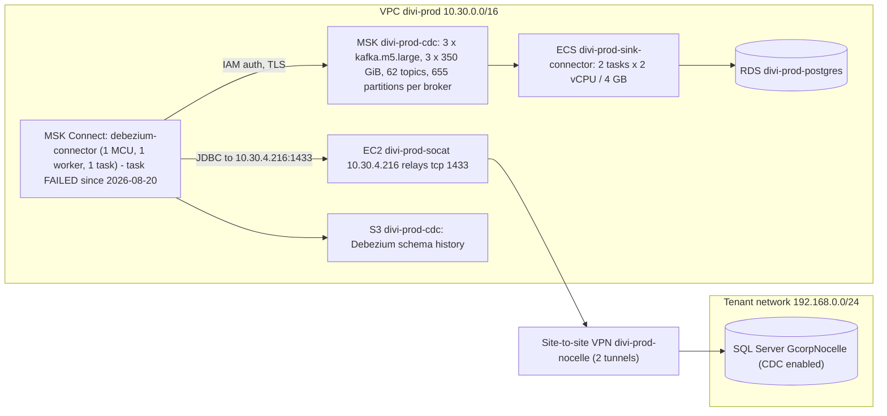

# Deep dive: AWS-WA-103, the tenant CDC pipeline (Debezium → MSK → sink → PostgreSQL)

| | |
|---|---|
| **Account** | 832569409513 (divi-ai-prod) · profile `divi-ai-prod-readonly` · ap-southeast-2 |
| **Prepared (UTC)** | 2026-11-12T15:27Z, as a follow-up to [2026-11-12T0853Z-divi-ai-prod-review.md](../reviews/2026-11-12T0853Z-divi-ai-prod-review.md) |
| **Findings** | [AWS-WA-103](../findings.md#aws-wa-103) (updated) · [AWS-WA-110](../findings.md#aws-wa-110) (updated) · [AWS-WA-101](../findings.md#aws-wa-101) (updated) · [AWS-WA-128](../findings.md#aws-wa-128) (new) · [AWS-WA-129](../findings.md#aws-wa-129) (new) |
| **Method** | Read-only AWS API calls checked by the skill's guard; all timestamps in UTC. No secret values or connector password fields were read. At the owner's explicit request, one narrowly scoped log read was made: the connector's own log stream, 20 Aug 08:45–10:15 UTC, ERROR and exception lines only (Section 5). |
| **Status** | For review and discussion with the owners. Nothing in the account was changed. |

> **Erratum (2026-11-13T03:44Z, live re-check).** The body below is kept as issued; the register holds the corrected record for AWS-WA-103.
> 1. **The task is restarted about every two hours; it was not left alone.**
>    - The connector log shows **992 task starts** between 2026-08-20 10:54 UTC and 2026-11-13 02:46 UTC, 11–13 a day.
>    - The gap between starts grew from 31 minutes to about 2 h 4 min and has stayed there.
>    - CloudTrail shows no MSK Connect write call since 15 Aug, so nobody restarted the task through the API. The back-off pattern points to MSK Connect's own recovery (not confirmed).
>    - `TaskStartupAttemptsTotal` reads 0 throughout and does not reflect these starts. The statements in Sections 1 and 3 that the task was never restarted, with "zero startup attempts", are wrong.
> 2. **Since 10:54 UTC on 20 Aug the cause is different.**
>    - The CDC tables were back by then. Every start reads SQL Server's oldest available change position, which advances daily (`00240B8F…` on 20 Aug, `0024A6C4…` today), so CDC and its cleanup job are running on `GcorpNocelle`.
>    - The connector's saved position (`00240b86:00021c58:00dd`, from before the outage) is older than that oldest position. Each start therefore ends within seconds (median 0.5 s; 985 of 992 under 2 s; longest 31 s) with `DebeziumException: The connector is trying to read change stream starting at … but this is no longer available on the server. Reconfigure the connector to use a snapshot mode when needed.` (`snapshot.mode=initial`).
>    - The `Invalid object name` errors stopped after 10:08 on 20 Aug (0 since).
> 3. **What that changes.**
>    - Re-enabling CDC on the tenant (Sections 1 and 6) is no longer the blocker: CDC was off from 09:17 and back by 10:54 on 20 Aug (18:47–20:24 Adelaide).
>    - A restart alone still fails, as 992 attempts show. Recovery needs a fresh snapshot, either by reconfiguring the connector with `snapshot.mode=when_needed` or by creating a new connector with fresh offsets. The sizing limits in Sections 6 and 7 still apply (AWS-WA-101, AWS-WA-129).
>    - Ask nocelle what was done in that window and confirm all 53 tables have capture instances.
> 4. **Scope of the re-check.** All read-only:
>    - Logs Insights over the connector stream, 20 Aug 10:15 UTC to now, task start, death and position lines only, ~1.36 GB scanned.
>    - `filter-log-events` on the connector stream: the last hour, and the 20 Aug death lines.
>    - `kafkaconnect` list and describe, state fields only.
>    - CloudWatch task metrics.
>    - CloudTrail `lookup-events` for the kafkaconnect source.

> **Erratum (2026-11-15, follow-up).** The register holds the corrected record for AWS-WA-129 and AWS-WA-101.
> - **The "~26 GB read from the tenant" was three snapshot attempts.** Two died when the brokers ran out of disk; each restart re-read everything. The completed snapshot copied about 33.5 million rows, about 8.7 GB over the VPN, in 3 h 36 min (16 Aug 00:57–04:33 UTC).
> - **Most of the ~703 GB written to PostgreSQL is two sink log tables:** `source_sync.cdc_audit_log` (about 326 GB) and `source_sync.sync_log` (about 241 GB). The mirrored ERP tables are small. These figures come from PostgreSQL's autovacuum log.
> - **The NAT instances were not on the load path.** The data came over the VPN to the relay and stayed inside the VPC.

> **Confidential.** Contains account, network and tenant-database identifiers. No credentials or data values are included.

## 1. Summary in plain terms

**What the pipeline is for.** It copies changes from the nocelle tenant's ERP database (SQL Server `GcorpNocelle`, 53 tables: general ledger, sales,
purchasing, stock, production, customers, suppliers, users) into the Divi PostgreSQL database, continuously. Debezium reads SQL Server's change
tables and publishes every row change to Kafka (MSK). A sink service reads Kafka and writes into PostgreSQL.

**What "the connector is in an error state" means.** A Kafka Connect connector has two layers:
- **Connector:** a coordinator, reported as `RUNNING`.
- **Task:** the worker thread that actually reads the database.

The one task **failed at 09:17 UTC on 20 August 2026** and has stayed failed for **84 days**. MSK Connect does not restart failed tasks, and nobody
restarted it: zero startup attempts since then. The console still says `RUNNING` because that refers to the coordinator, so it looks healthy while doing
nothing.

**Why it failed (confirmed from the connector's own error log).** At 09:17:37 UTC (18:47 Adelaide) SQL Server answered
`Invalid object name 'GcorpNocelle.cdc.lsn_time_mapping'`, and then `... 'GcorpNocelle.cdc.change_tables'`. Those are SQL Server's built-in Change
Data Capture tables, and they disappear when **CDC is disabled on the database**, or when the database is **restored or rebuilt without CDC**. So the
pipeline broke because of a change on the **tenant's side**, not in AWS. It cannot work again until CDC is re-enabled on `GcorpNocelle` and its 53
tables, followed by a fresh snapshot.

**What that costs.** The whole path (Kafka cluster, connector capacity, sink service, socat relay host, site-to-site VPN) costs about
**$1,010 a month, 58% of the account's bill**. About **$2,740 has been spent since the task failed**, for no data delivered.

**What else turned up.**
- **Tenant credentials (AWS-WA-128, new):** the tenant database password is almost certainly stored as plain text in the connector configuration, where any read-only console user can see it.
- **Design amplifies data (AWS-WA-129, new):** the August initial load turned ~26 GB read from the tenant into **463 GB in Kafka and ~703 GB in PostgreSQL**. That one load is most of why the database is 82% full (AWS-WA-101), and a repeat of it would not fit.
- **Possibly stale tenant data (question):** nothing has read from the tenant network since 20 August, yet the nocelle forecasting pipelines "succeed" every night. If nocelle data has no other route in, those forecasts have been computed on data frozen on 20 August.

**What to do first.**
1. Ask nocelle (or their ERP provider) what changed on `GcorpNocelle` on 20 Aug around 18:45 Adelaide time: CDC disabled, database restored or
   migrated, or an ERP upgrade. Ask whether that was deliberate, for example to move to the "nocelle middleware" whose role was created on 17 Aug but has
   never been used.
2. Confirm whether nocelle's data in the platform is current.
3. Decide whether to repair, right-size, replace or retire the path (Section 7).

Do **not** just restart the connector: it will fail the same way until CDC exists again on the source (Section 6), and a fresh snapshot with today's
design would fill the database.

## 2. How the pipeline is built

| Component | Configuration (observed) | Basis |
|---|---|---|
| Connector | `io.debezium.connector.sqlserver.SqlServerConnector`, plugin `debezium-sqlserver-3.5.2.Final-with-s3`, Kafka Connect 3.7.x, 1 MCU / 1 worker, `tasks.max=1`, created 2026-08-14 10:50 UTC (replaced an earlier connector that ran 27 Jul – 14 Aug) | [Confirmed] kafkaconnect describe-connector (non-secret fields only), log-stream metadata |
| Source | `database.hostname=10.30.4.216` (the socat host), port 1433, `database.names=GcorpNocelle`, 53 tables in `table.include.list`, `snapshot.mode=initial`, `database.encrypt=true`, `database.trustServerCertificate=true` | [Confirmed] |
| Error handling | `errors.tolerance=none`, `errors.retry.timeout=300000` (5 min), `errors.log.enable=true`, `errors.log.include.messages=true`, dead-letter-queue settings present | [Confirmed] |
| Format | `JsonConverter` for key and value with `schemas.enable=true` on both; `ExtractNewRecordState` unwrap; topics renamed `mssql.dbo.TABLE`; `topic.creation.default.partitions=10`, replication factor 3 | [Confirmed] |
| Secrets | Config keys include `database.user` and `database.password`; no custom worker configuration attached | [Confirmed] keys only |
| Kafka cluster | 3 × kafka.m5.large, Kafka 3.9.x (upgraded 2026-09-22), default MSK configuration (7-day retention), IAM auth, TLS, private | [Confirmed] |
| Relay | divi-prod-socat, t3.medium, single instance in ap-southeast-2a, SG 1433/22 open to 0.0.0.0/0 (AWS-WA-106) | [Confirmed] |
| Sink | ECS service with an nginx health sidecar, still running two tasks; its role was used minutes before inspection (it keeps polling Kafka) | [Confirmed] |
| Logs | Broker and connector logs both go to `/msk/divi/prod/cdc`: ~22 MB/day, 1.7 GB stored, 180-day retention | [Confirmed] logs metadata and AWS/Logs metrics |

## 3. What "errored" means here, and why it stayed broken

- **Connector vs task.**
  - Kafka Connect reports the *connector* as RUNNING when its coordinator is alive.
  - The *task* is the thread that polls SQL Server.
  - CloudWatch shows `RunningTaskCount = 0` and `ErroredTaskCount = 1` every hour since 2026-08-20 10:00 UTC [Measured].
- **No automatic recovery.**
  - `TaskStartupAttemptsTotal = 0` for all 84 days [Measured]: MSK Connect never tried to start the task again.
  - Monthly MSK security patching (8 Sep, 8 Oct, 3 Nov, 8 Nov) and a Kafka version upgrade (22 Sep) caused worker rebalances, but rebalances do not restart a failed task.
- **Fail-fast configuration.**
  - `errors.tolerance=none` means the first bad record, or any error that keeps failing beyond the 5-minute `errors.retry.timeout`, stops the task permanently.
  - That is a defensible choice for data integrity, but only with an alarm and a restart procedure. Neither exists (AWS-WA-108).
- **Dead letter queue has no effect.** The `errors.deadletterqueue.*` settings do nothing for a *source* connector: Kafka Connect's dead letter queue applies to sink connectors [Kafka Connect behaviour, not re-verified in this session].

## 4. Timeline (UTC)

| When | What happened | Evidence |
|---|---|---|
| 2026-07-27 | MSK cluster, Debezium plugin, connector and sink roles created; a first connector runs until 14 Aug 09:55 | IAM CreateDate, plugin creation time, log-stream metadata |
| 2026-08-14 10:50 | Current connector created; **initial snapshot** starts | connector creation, SourceRecordPollRate up to 8,549 records/s |
| 2026-08-14 → 16 | Snapshot moves **25.3 GB** over the VPN (8.6 / 7.8 / 8.8 GB per day) and produces **461 GB** into Kafka (193 / 107 / 161 GB per day). Broker storage is expanded three times (14 Aug 10:03, 15 Aug 18:10, 16 Aug 00:36) and still reaches 95.5%. The sink scales to 19 tasks. PostgreSQL writes average 66 MB/s on 16 Aug | AWS/VPN, AWS/Kafka, cluster operations, ECS/ContainerInsights, AWS/RDS |
| 2026-08-13 → 17 | PostgreSQL free space falls from **988 GB to 295 GB** | AWS/RDS FreeStorageSpace |
| 2026-08-16 18:00 and 08-19 17:00 | Both VPN tunnels down for part of the hour; the task survives | AWS/VPN TunnelState |
| 2026-08-17 → 20 | Streaming phase: about 1.5–2 changes per second, ~130 MB/day over the VPN | SourceRecordPollRate, TunnelDataIn |
| **2026-08-20 09:17:37** | **Source CDC tables disappear:** `Invalid object name 'GcorpNocelle.cdc.lsn_time_mapping'`; 12 "Producer failure" errors in 0.3 s; Debezium marks the error retriable and restarts | connector error log (authorised read) |
| 2026-08-20 09:17:48 → 10:08:40 | Each restart fails with `Unable to get last available log position`, caused by `Invalid object name 'GcorpNocelle.cdc.change_tables'`. "Task is being killed and will not recover until manually restarted" is logged at 09:17, 09:21, 09:37, 09:52 and 10:08. RunningTaskCount is 0 from the 10:00 hour. VPN tunnels were **up** throughout | connector error log; hourly metrics |
| 2026-08-21 → now | VPN carries only keepalives (~0.6 MB/day, falling to ~40 KB/day); socat ~1 MB/day; Kafka data expires under the 7-day retention (disk 10% on 27 Aug, ~0% since) | AWS/VPN, AWS/EC2, KafkaDataLogsDiskUsed |
| 2026-11-12 | Connector RUNNING with 1 errored task; worker still writing ~22 MB/day of logs; sink still running 2 tasks against empty topics | describe-connector, AWS/Logs, ECS |

The failure happened at 18:47 Adelaide time (ACST in August), on a weekday evening, which is a typical window for planned database maintenance.

## 5. Why it failed: confirmed from the connector's error log

**What the log says** (stream `debezium-connector-d4aa088c-5bb0-4d63-a681-397d042aa9fe-2`, read at the owner's request; record contents redacted):

| Time (UTC) | Log line (exception headline) |
|---|---|
| 09:17:37 | `ERROR [debezium-connector\|task-0] Producer failure (io.debezium.pipeline.ErrorHandler)` ×12 |
| 09:17:37 | `com.microsoft.sqlserver.jdbc.SQLServerException: Invalid object name 'GcorpNocelle.cdc.lsn_time_mapping'.` |
| 09:17:37 | `org.apache.kafka.connect.errors.RetriableException: An exception occurred in the change event producer. This connector will be restarted.` |
| 09:17:48 | `io.debezium.DebeziumException: Unable to get last available log position`, caused by `SQLServerException: Invalid object name 'GcorpNocelle.cdc.change_tables'.` |
| 09:17:48, 09:21:42, 09:37:40, 09:52:41, 10:08:40 | `WorkerSourceTask{id=debezium-connector-0} Task threw an uncaught and unrecoverable exception. Task is being killed and will not recover until manually restarted` |

**What it means.**
- **These are SQL Server's CDC system tables.** `cdc.lsn_time_mapping` and `cdc.change_tables` are created when CDC is enabled on a database, and removed when it is disabled.
- **"Invalid object name" means they no longer existed** in `GcorpNocelle`. That is a missing object, not a permission or network error.
- **Possible tenant-side causes** [Inferred; to confirm with nocelle]:
  1. CDC was disabled on the database (`sys.sp_cdc_disable_db`).
  2. The database was restored or re-created, for example during an ERP upgrade or server migration. A restore drops CDC unless it is restored with `KEEP_CDC`.
  3. The relay now points at a different SQL Server or database copy that has no CDC.
- **Two loose ends:**
  - The `divi-prod-nocelle-middleware-task` role was created on 17 Aug, three days earlier, and has never been used. Was CDC switched off deliberately in favour of a new integration that never went live?
  - From 21 Aug the VPN carries only keepalives, so nothing on the AWS side has read from the tenant since.

**Ruled out** [Measured]:
- **Network outage at the time:** both VPN tunnels were up from 05:00 to 12:00 UTC on 20 Aug.
- **MSK maintenance:** no cluster operation between 16 Aug and 8 Sep.
- **Worker resource exhaustion:** worker CPU about 1.7%, memory about 77% that day.
- **The AWS side in general:** the error came back from the tenant's SQL Server.

**Log-read scope.** Two read-only `logs filter-log-events` calls, both limited to the connector's stream:
- 08:45–10:15 UTC, lines containing "ERROR": 17 events.
- 09:15–09:23 UTC, lines containing "Exception" or "Caused by": 33 events.

The raw output stays in the session scratchpad. Only exception headlines are reproduced here; no record contents or credentials appeared in the lines shown. The skill's guard blocks log reads by default (to protect data), so these calls were made outside the guard wrapper, on the owner's explicit instruction.

## 6. Why "just restart it" is not the fix

- **The source has no CDC.**
  - Until nocelle re-enables CDC on `GcorpNocelle` and on each of the 53 captured tables, any restart fails exactly as on 20 Aug.
- **The stored position is meaningless.**
  - Debezium resumes from its stored offset (an LSN from 20 Aug).
  - Re-enabling CDC starts a new change history.
  - SQL Server's CDC cleanup keeps change rows for only **72 hours by default** anyway.
  - A **new snapshot** is therefore certain.
- **A new snapshot does not fit today.** The August snapshot needed:
  - Kafka: 461 GB of producer data, about 1.4 TB on broker disks with three replicas under 7-day retention. Today's 3 × 350 GiB can hold about 1.1 TB.
  - PostgreSQL: about **703 GB**. Only ~181 GiB is free and storage autoscaling is off (AWS-WA-101).

  Unless the sink overwrites rather than appends — not visible from AWS — a repeat would fill the database and stop every tenant's writes.
- **`snapshot.mode=initial` will not re-snapshot by itself** while offsets exist. The owners would need a snapshot mode or offset reset per the Debezium SQL Server documentation, which was not re-verified in this session.
- **Other problems would remain.** The password problem (AWS-WA-128) and the missing alarms (AWS-WA-108) would still be there.

## 7. The cost of the idle path, and the options

**Monthly cost of the path** (October 2026: 744 hours; Sydney list prices)

| Component | Monthly | Basis |
|---|---|---|
| MSK brokers, 3 × kafka.m5.large | $587.02 | [Measured] Cost Explorer `APS2-Kafka.m5.large` (3 × $0.263/h × 744 h) |
| MSK broker storage, 3 × 350 GiB | $126.00 | [Measured] `APS2-Kafka.Storage.GP2` ($0.12/GB-month). Expanded during the snapshot; **MSK storage cannot be reduced** |
| MSK Connect, 1 MCU | $102.67 | [Measured] `APS2-Kafka.mcu.general`. Billed hourly whether or not the task runs |
| Sink service, 2 × (2 vCPU, 4 GB) | ≈ $114 | [Estimated] one on-demand task ≈ $88 + one Spot task ≈ $26 |
| socat relay, t3.medium + 25 GiB | ≈ $42 | [Measured] $39.28 compute + [Estimated] $2.40 storage |
| Site-to-site VPN | $37.20 | [Measured] `APS2-VPN-Usage-Hours:ipsec.1`. Only keepalives since 20 Aug |
| Logs `/msk/divi/prod/cdc` | < $1 | [Estimated] |
| **Total** | **≈ $1,010** | **58% of October's $1,741.58** |

- **Since the failure:** about **$2,740** (84 days × the October rate) [Estimated].
- **Why it costs so much for so little:** the cluster and the sink were sized for the snapshot peak (2.2 MB/s into Kafka on average on 14 Aug, with three replicas). In normal streaming the feed was about **2 row changes per second**. Broker storage was grown to 350 GiB each to survive the snapshot and can never shrink. The MCU and the brokers bill by the hour whether data flows or not.

**Options**

| Option | What it involves | Run cost / month | Saving vs today | Main risks |
|---|---|---|---|---|
| **A. Repair as is** | Find the cause, re-snapshot, grow PostgreSQL by ~700 GB first | ≈ $1,010 + ≈ $97 extra database storage | none (cost rises) | Re-snapshot may fill Kafka and the database; the plaintext password and missing alarms remain |
| **B. Repair and right-size** | Fix AWS-WA-128/-129 first (schemas off or a compact format, 1 partition per table topic, upsert sink). New 3 × kafka.t3.small cluster with ~100 GiB each (≈ 140 partitions fit t3.small's 300 guidance). Sink 0.5 vCPU / 1 GB. Keep socat and VPN | ≈ $366 [Estimated] | ≈ $640 | Migration and re-snapshot; t3 brokers have CPU-credit and throughput limits |
| **C. Replace Kafka with direct CDC** | AWS DMS (SQL Server CDC → PostgreSQL) or Debezium Server writing to PostgreSQL from one small task; keep socat and VPN | ≈ $80 (socat + VPN) + one small Fargate task ≈ $20–40, or a DMS replication instance (not priced) | ≈ $890–910 (Debezium Server); DMS not priced | Re-architecture; loses the Kafka buffer and replay |
| **D. Retire** | Only if nocelle data arrives another way or is no longer needed | $0 (≈ $37 if the VPN is kept) | ≈ $970–1,010 | Confirm no consumer first; keep the schema history and offsets until the decision is final |

Option D is already the de-facto state, just still being paid for. If the business needs live nocelle data, **B or C** is the sensible
choice. Kafka only earns its cost when several consumers read the same change stream, and here there is one.

## 8. Additional findings and observations

| ID | Severity | Finding | Summary |
|---|---|---|---|
| [AWS-WA-128](../findings.md#aws-wa-128) | HIGH (potential) | Tenant database password appears to be plain text in the MSK Connect configuration | Config key `database.password` exists and no custom worker configuration is attached. MSK Connect resolves Secrets Manager references only through config providers defined in a worker configuration, so the value must be literal. It is visible to anyone allowed `kafkaconnect:DescribeConnector`, including the read-only SSO role. Also `trustServerCertificate=true` (no certificate validation) and `errors.log.include.messages=true` (record contents in logs kept for 180 days) |
| [AWS-WA-129](../findings.md#aws-wa-129) | MEDIUM | The CDC design multiplies data roughly 18× in Kafka and 27× in PostgreSQL | 25.7 GB read over the VPN became 463 GB of Kafka producer data and ~703 GB of PostgreSQL storage. JSON with embedded schemas on every key and value, and 10 partitions per table topic. Accounts for most of the database's used space and blocks any re-snapshot |

**Which tenants use the Kafka path** (checked 2026-11-12 ~16:00 UTC):

| Account | Connector | Source database | Consumer group | State |
|---|---|---|---|---|
| prod | debezium-connector | `GcorpNocelle` (nocelle), through socat 10.30.4.216 and the site-to-site VPN | divi-cdc-sink-connector (52 `mssql.dbo.*` topics) | task failed 2026-08-20 09:17 UTC |
| staging | debezium-connector | `GcorpNocelle`, the **same tenant database**, through staging's socat 10.20.4.177 | divi-cdc-sink-connector | task failed **in the same hour**, 2026-08-20 09:00 UTC |
| staging | debezium-dug | `dug_uat` on an RDS SQL Server in ap-southeast-1 that is not in the staging account | divi-cdc-sink-connector-dug | ran 21–26 Oct; failed 2026-10-27 16:00 UTC (cause not examined) |

- **Production.** **nocelle is the only tenant on Kafka.**
  - One connector; one consumer group; topics only for nocelle's tables, plus MSK's own canary topic.
  - Only the connector role (`divi-prod-cdc`) and the sink role (`divi-prod-sink-connector-task`) have Kafka data permissions. Admin roles and the IaC role can manage the cluster.
  - intrim reaches the platform by a different route: the nightly `divi-prod-intrim-byod-sync` state machine, which succeeds. dug has only a secret (`divi-prod-dug-middleware`) in prod and no pipeline.
- **Staging** runs Kafka for nocelle and dug, and both connectors are failed.
- **The cause is confirmed independently.** Two separate connectors in two accounts read `GcorpNocelle` and stopped in the same hour. That confirms the cause sat in the tenant database (CDC removed), not in either AWS account.
- **Topic naming.** `transforms.routeTable` strips the database name (`mssql.GcorpNocelle.dbo.X` → `mssql.dbo.X`), so a second SQL Server tenant on the same cluster would collide on topic names. In staging, dug avoids that only through its own consumer group and sink, not through separate topic names.

Other observations (no separate finding):
- **nocelle data freshness (question for the owners).**
  - The VPN has carried only keepalives since 20 Aug.
  - The `divi-prod-nocelle-middleware-task` role (created 17 Aug) has never been used.
  - The nocelle pipelines still succeed nightly (24 of 25), running 1.5–3 hours.
  - Unless nocelle data reaches PostgreSQL by another route (for example an internet-facing middleware API through NAT), nocelle's outputs since 20 Aug are based on frozen source data.
  - Check: the most recent change timestamp in the nocelle landing tables.
- **Personal data scope.** The captured tables include CUSTOMERS, SUPPLIERS and USERS. Tenant personal data is replicated into this account, which is relevant to AWS-WA-105 (no audit trail) and to data-retention obligations.
- **Earlier connector.** A previous connector instance ran from 27 Jul to 14 Aug; its log stream remains. A legacy Step Functions role (`StepFunctions-divi-prod-nocelle-role-…`, last used 18 Oct) also remains. Both are cleanup candidates (AWS-WA-126).
- **Sink still running.** The sink service runs two tasks against topics with no data (≈ $114/month), and its public host rule stays on the ALB (AWS-WA-114).
- **Access gaps.**
  - The read-only role cannot list connector operations (`kafkaconnect:ListConnectorOperations` denied) or Kafka topics (`kafka-cluster:Connect` denied), so topic names and partition details come from the configuration and metrics, not a listing.
  - One call that would have listed the sink task's environment variable names was blocked by the skill's guard by design.

## 9. Recommended next steps (in order)

1. **This week (owner):**
   - Ask nocelle what happened to CDC on `GcorpNocelle` on 20 Aug (disabled, restore or migration), and whether it was deliberate.
   - Confirm whether nocelle data in the platform is current.
   - Decide among options A–D.
2. **Whatever the decision:**
   - Move the tenant password to Secrets Manager through a config provider, then **rotate it on the tenant side** (AWS-WA-128).
   - Add alarms: `ErroredTaskCount > 0`; `SourceRecordPollRate = 0` for several hours during the tenant's business day; VPN `TunnelDataIn` below the keepalive baseline (AWS-WA-108).
3. **If repairing (A/B/C):**
   - Fix the format and partitioning first (AWS-WA-129).
   - Make room and enable storage autoscaling in PostgreSQL (AWS-WA-101).
   - Plan the snapshot with the tenant, since it adds load on their SQL Server.
   - Write a restart runbook.
   - Consider moving socat to an Auto Scaling group of one (AWS-WA-115).
4. **If retiring (D), decommission in this order:**
   1. Scale the sink to 0.
   2. Delete the connector.
   3. Delete the cluster, once no consumer remains.
   4. Remove the socat host and its security group.
   5. Remove the VPN, if nothing else needs the tenant link.
   6. Remove the secrets, roles, S3 schema history and log group, after any retention period the owners require.

## 10. Evidence and commands (read-only)

All calls used `--profile divi-ai-prod-readonly`, ran with `TZ=UTC`, and were checked by the guard's `check_aws` before execution.

- **Connector:**
  - `kafkaconnect list-connectors`.
  - `kafkaconnect describe-connector`, projected to state, capacity, VPC, plugin, log delivery, `keys(connectorConfiguration)` and about 45 named non-secret settings. Password and user values were not selected.
  - `kafkaconnect describe-custom-plugin`.
  - `kafkaconnect list-connector-operations`: denied.
- **Cluster:** `kafka list-clusters-v2`, `describe-cluster-v2`, `list-cluster-operations-v2`, `get-bootstrap-brokers` (endpoint types only); `kafka list-topics`: denied.
- **Network:** `ec2 describe-security-groups`, `describe-subnets`.
- **IAM:** `iam get-role` (RoleLastUsed); `iam get-account-authorization-details` (from the collector run, RoleLastUsed only).
- **Logs:**
  - `logs describe-log-groups`, `describe-log-streams` (metadata).
  - With the owner's explicit approval, two `logs filter-log-events` calls on the connector stream only (ERROR lines 08:45–10:15 UTC; Exception/Caused-by lines 09:15–09:23 UTC on 2026-08-20). Raw output is kept in the scratchpad; only redacted headlines are reproduced.
- **Metrics:** `cloudwatch list-metrics` and `get-metric-data`, daily for 2026-08-12 → 11-12 and hourly for 2026-08-17 → 08-22 and 2026-11-05 → 11-12:
  - AWS/KafkaConnect: ErroredTaskCount, RunningTaskCount, TaskStartupAttemptsTotal, SourceRecordPollRate, SourceRecordWriteRate, SourceProducerByteRate, CpuUtilization, MemoryUtilization, RebalanceCompletedTotal, WorkerCount.
  - AWS/Kafka: BytesInPerSec per broker.
  - AWS/VPN: TunnelState, TunnelDataIn, TunnelDataOut.
  - AWS/EC2: socat NetworkIn/Out.
  - AWS/Logs: IncomingBytes, IncomingLogEvents.
  - ECS/ContainerInsights: sink.
  - AWS/RDS: FreeStorageSpace, WriteThroughput.
- **Prices and spend:** Cost Explorer by usage type (October 2026, from the review's collector run); Sydney list prices from the AWS Price List API (2026-11-12).
- **Raw evidence:** saved under the session scratchpad (`aws-wa/2026-11-12T0853Z-divi-ai-prod/manual/cdc/`). It is not persistent.

## 11. References

- MSK Connect config providers: config providers are defined in a worker configuration; they keep credentials out of plain text. https://docs.aws.amazon.com/msk/latest/developerguide/msk-connect-config-provider.html
- MSK Connect metrics (ErroredTaskCount and others): https://docs.aws.amazon.com/msk/latest/developerguide/mkc-monitoring-overview.html
- MSK best practices (partitions per broker: 1,000 for m5.large, 300 for t3.small): https://docs.aws.amazon.com/msk/latest/developerguide/bestpractices.html
- MSK broker storage can be increased, not decreased: https://docs.aws.amazon.com/msk/latest/developerguide/manually-expand-storage.html
- SQL Server `sys.sp_cdc_add_job`: CDC cleanup retention defaults to 4,320 minutes (72 hours). https://learn.microsoft.com/sql/relational-databases/system-stored-procedures/sys-sp-cdc-add-job-transact-sql
