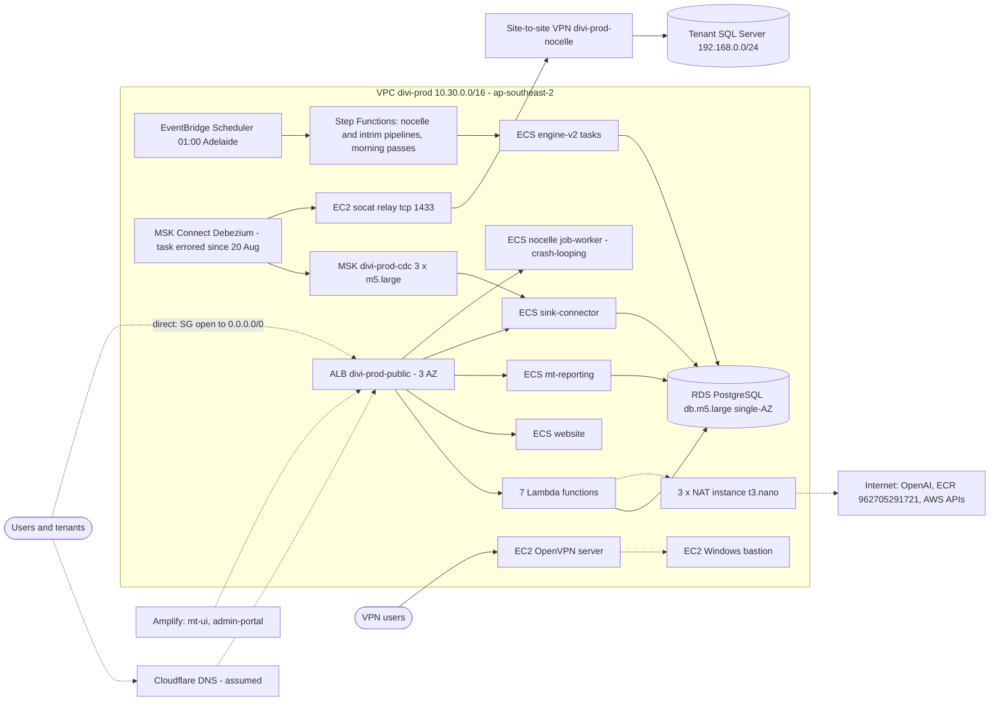

# AWS Well-Architected Review — divi-ai-prod (832569409513)

| | |
|---|---|
| **Report status** | Final |
| **Assessment date (UTC)** | 2026-11-12 |
| **Inspection started / finished (UTC)** | 2026-11-12T08:53:01Z / 2026-11-12T09:39:07Z |
| **Reviewer** | Claude Code, `aws-well-architected-review` workflow (read-only) |
| **Findings register** | [`../findings.md`](../findings.md) (production register, IDs from 101; the staging register is separate) |

> **Time zone note.** The AWS CLI prints CloudWatch and ECS timestamps in the reviewer's local time (UTC+05:30). Every hour-of-day figure in this
> report was converted to UTC. The same mistake was found in the staging review; staging findings 002 and 013 were corrected in the staging
> register on 2026-11-12 (see Section 10).

> **Erratum (2026-11-12, after follow-up checks).** The register holds the corrected records; the body of this report is kept as issued.
> 1. **The intrim pipeline failures were notified, not silent (AWS-WA-102, AWS-WA-108).** Its `Notify-Middleware-Failure` step publishes every failure to
>    SNS `divi-prod-cloudwatch`: 28 e-mails were delivered in 14 days to that topic's only subscriber, one address at the external DevOps provider. The gap is
>    who receives the alerts and who owns them, not missing detection. Statements below that the pipeline failed "unnoticed" or that "nothing alerted" apply to
>    the CDC connector (AWS-WA-103) and the crash-looping worker (AWS-WA-112), not to the intrim pipeline.
> 2. **Cause of the intrim failures (AWS-WA-102).** The prod middleware runs the August `divi-middleware:v1.0.1` image, which has no mapping files for intrim.
>    It is still failing: 14 of 14 runs to 12 Nov.
> 3. **Cause of the CDC failure (AWS-WA-103):** the tenant database's CDC tables disappeared at 09:17 UTC on 20 Aug. Two new findings followed:
>    AWS-WA-128 (plain-text tenant password in the connector configuration) and AWS-WA-129 (data amplification). See `../deep-dives/`.
> 4. **AWS-WA-103, re-check on 2026-11-13.** CDC was back on the tenant by 10:54 UTC on 20 Aug. Since then the task has been restarted automatically
>    about every two hours (992 times), and every start fails because the connector's saved source position no longer exists. Recovery needs a fresh
>    snapshot, not CDC re-enabled.

## 1. Executive Summary

**Account details**

| Account ID | Alias | Profile | Environment | Identity (role) | Regions assessed | Inspected (UTC) |
|---|---|---|---|---|---|---|
| 832569409513 | none (named divi-ai-prod after the profile) | divi-ai-prod-readonly | Production, real tenant data and users (user, 2026-11-12) | AWSReservedSSO_ReadOnlyAccess (IAM Identity Center) | ap-southeast-2, ap-southeast-1, us-east-1 + global services | 2026-11-12 08:53–09:39 |

**Scope:** one account; the three Regions the owner named (read-only counts in all 17 enabled Regions found workloads only in ap-southeast-2, plus the
Terraform lock table and two stacks in us-east-1); depth *deep* with 90-day metrics and Cost Explorer data. Out of scope: application code, Terraform
source, GitHub settings, Cloudflare, the management account (892166101996), the image-registry account (962705291721), tenant networks, the
Sustainability pillar.
**Evidence:** collected 2026-11-12 08:55–08:58 UTC by `collect.py` 1.0.0 (287 read-only calls: 261 ok, 25 not configured, 1 denied, including
8 Cost Explorer requests, about $0.08), plus about 100 targeted read-only calls in Phase 3. Each targeted call was checked by the skill's read-only
guard function before it ran. Raw evidence stayed in the session scratchpad.
**Since the last review:** first review of this account. The staging account was reviewed earlier the same day; comparisons are noted as "staging NNN".
**Owner confirmations:** the account owner accepted assumptions A1–A16 (Section 10) on 2026-11-12.

**Workloads assessed**

| Workload | What it does (as understood) | Tier / RTO / RPO (assumed, A1) |
|---|---|---|
| Divi API (mt stack, admin portal) | 7 Lambda functions behind the internet-facing ALB `divi-prod-public` (host-based routing on *.diviglobal.ai): auth, config, financials, performance tracking, tracker, admin back end, AI report generator (OpenAI). Front ends `divi-prod-mt-ui` and `divi-prod-admin-portal` on Amplify | Tier 2 · 4 h · 1 h |
| Tenant pipelines (nocelle, intrim) | EventBridge Scheduler (01:00 Adelaide) starts Step Functions pipelines and morning passes that run engine-v2 tasks on ECS Fargate; intrim BYOD sync at 00:00 Adelaide | Tier 2 · 8 h · 24 h |
| Tenant CDC | Debezium on MSK Connect reads the tenant's SQL Server through the socat relay and the site-to-site VPN, writes to MSK `divi-prod-cdc`; the sink connector on ECS writes to PostgreSQL | Tier 2 · 8 h · 24 h |
| Platform database | `divi-prod-postgres`, PostgreSQL 17.9 on db.m5.large, 1,000 GiB gp3, single-AZ; shared by everything above | Tier 2 · 4 h · 1 h |
| Website and reporting | ECS services `divi-prod-website` (diviglobal.ai) and `divi-prod-mt-reporting` | Tier 1–2 · 24 h · 24 h |
| Remote access | OpenVPN server, Windows bastion (EC2) | supporting |

**Overall architectural assessment**
Production is a smaller, cleaner copy of the staging design. Lambda and Fargate span three AZs behind one ALB, NAT instances are zonal, the database
has deletion protection, MSK uses IAM authentication and TLS, deployments run through GitHub OIDC roles, and nobody holds IAM user keys. Traffic is
light (5,600 requests a day, about 4,200 Lambda invocations in 90 days) and the bill is modest at $1,742 a month.
The main problem is that **production is failing silently**:
- the intrim tenant's pipeline has never succeeded;
- the CDC connector has been errored for twelve weeks;
- a worker service has been crash-looping for three weeks.

None of this raised an alert, because alerting covers ECS CPU and memory only and the database alarms are broken. The foundations are thin: no audit
trail or threat detection, a deploy role with administrator-level rights that any repository in the GitHub organisation can assume, and admin ports
open to the VPN and a tenant network. Nearly half of the spend goes to a Kafka path that carries no data. Most fixes are configuration and process
work, and the cost savings more than pay for the reliability and security additions.

| Pillar | Rating | One-line summary |
|---|---|---|
| Operational Excellence | Weak | Three production failures ran for weeks undetected; manual hosts; good IaC and orchestration foundations |
| Security | Weak | No audit trail or threat detection; deploy role open to the whole GitHub organisation; admin ports reachable from VPN and tenant networks; probable secrets in Lambda configuration |
| Reliability | Needs improvement | Database 82% full with no autoscaling; backups never leave the account; CDC path broken; zonal NAT instances without self-healing |
| Performance Efficiency | Adequate | Light load, fast API responses; short nightly CPU bursts; Java cold starts |
| Cost Optimization | Needs improvement | About half the bill buys an idle Kafka path; Fargate over-reserved; no budgets or commitments |

*Rating scale:* **Strong**: meets or exceeds the workload's needs · **Adequate**: meets current needs with moderate gaps · **Needs improvement**: material gaps · **Weak**: serious gaps or exposure · **Not assessed**.

**Findings at a glance**

| Severity | New | Existing (still open) | Resolved this review | Total open |
|---|---|---|---|---|
| CRITICAL | 0 | 0 | 0 | 0 |
| HIGH | 9 | 0 | 0 | 9 |
| MEDIUM | 8 | 0 | 0 | 8 |
| LOW | 10 | 0 | 0 | 10 |
| INFORMATIONAL | 0 | 0 | 0 | 0 |

**Major concerns**
1. **Silent production failures:**
   - the intrim pipeline has failed 13 of 13 runs (AWS-WA-102);
   - the CDC connector has been errored since 20 Aug (AWS-WA-103);
   - the job worker has been crash-looping since 20 Oct (AWS-WA-112);

   all invisible to alerting (AWS-WA-108).
2. **Database storage:** about 181 GiB is left on the shared database, with no autoscaling and no alarm (AWS-WA-101). One manual load on 6 Nov used 42 GB, and a CDC re-snapshot would not fit.
3. **No audit trail or threat detection** in an account holding tenant data (AWS-WA-105).
4. **Paths to administrator-level access:**
   - any GitHub repository in the organisation can assume the deploy role, which has iam:* (AWS-WA-113);
   - RDP, SSH and 1433 are open to the VPN and the tenant network (AWS-WA-106);
   - probable plaintext secrets sit in Lambda configuration (AWS-WA-109).
5. **Kafka cost:** MSK is 47% of spend for about 20 B/s per broker (AWS-WA-110).

**Highest-priority recommendations**
1. Today: set MaxAllocatedStorage and add alarms/EventBridge rules for storage, Step Functions failures, connector errors and task crash loops (AWS-WA-101, -108). Low complexity, about $5/month.
2. This week: remove the `repo:divi-global@247950803/*` trust entry (AWS-WA-113) and replace 0.0.0.0/0 on the RDP/SSH/1433 rules (AWS-WA-106). Low complexity, no cost.
3. This week: debug the intrim pipeline and the connector, and fix or remove the crash-looping worker (AWS-WA-102, -103, -112).
4. Within a month: organisation-level CloudTrail, GuardDuty, Access Analyzer and flow logs (AWS-WA-105); backups copied out of the account and a timed restore test (AWS-WA-107).
5. Then the cost work: decide on the CDC path, then retire it or rebuild it on a smaller cluster (AWS-WA-110); right-size Fargate (AWS-WA-117); clear the June snapshot (AWS-WA-118). Estimated $700–1,200/month.

## 2. Architecture Overview

**Workload summary**
Tenants and their users reach the Divi application through Amplify-hosted front ends, which call API host names on diviglobal.ai. Those names resolve
outside AWS (Cloudflare is assumed, A8) to the ALB. The ALB forwards by host name to seven Lambda functions and four ECS services. Every component
reads and writes one PostgreSQL instance. Tenant data arrives two ways:
- **Nightly pipelines:** Step Functions pipelines started at 01:00 Adelaide (BYOD sync and middleware tasks).
- **CDC path (meant to be continuous):** Debezium on MSK Connect reaches the tenant's SQL Server through a socat relay and a site-to-site VPN. Kafka carries the changes to a sink connector service, which writes them to PostgreSQL. This path has been idle since 20 Aug.

Administrators connect through an OpenVPN server and a Windows bastion. All outbound traffic leaves through three t3.nano NAT instances, one per AZ.

**Major AWS services in use**

| Domain | Services (counts) | Notes |
|---|---|---|
| Compute | Lambda (7: 6 java21, 1 python3.13, x86_64, VPC), ECS Fargate (1 cluster, 4 services + pipeline tasks), EC2 (6: 3 NAT, VPN, bastion, socat) | Container Insights on; Fargate Spot for most services |
| Data | RDS PostgreSQL 17.9 (1, single-AZ), MSK (1 cluster, 3 brokers), MSK Connect (1 connector), S3 (8 buckets), DynamoDB (Terraform lock, us-east-1) | No ElastiCache, no EFS |
| Integration | Step Functions (7 state machines), EventBridge Scheduler (3), EventBridge rules (3), SES (domain verified) | No SQS/SNS queues for the application |
| Edge and network | ALB (1), VPC 10.30.0.0/16 (3 public + 3 private subnets), site-to-site VPN (1), NAT instances (3), Amplify (2 apps) | No CloudFront, WAF, Route 53 or VPC endpoints |
| Security and governance | IAM Identity Center (Admin, ReadOnly, ViewOnly), Secrets Manager (14), KMS, GitHub OIDC roles, GuardKite third-party role | No CloudTrail, Config, GuardDuty, Security Hub or Access Analyzer |

**Architecture diagram** (solid arrows = [Confirmed]; dashed = [Inferred])

**Component relationships and dependencies**

| From | To | Relationship | Basis |
|---|---|---|---|
| ALB divi-prod-public | 7 Lambda target groups, 4 ECS target groups | Host-header rules on *.diviglobal.ai | [Confirmed] elbv2 describe-rules |
| Lambda, ECS services, pipeline tasks | divi-prod-postgres | JDBC (ROUTER_JDBC_URL), SG 5432 from the VPC CIDR | [Confirmed] env keys, SG |
| EventBridge Scheduler | Step Functions pipelines | 01:00 Adelaide; morning pass triggered on RUNNING | [Confirmed] get-schedule, describe-rule |
| MSK Connect | Tenant SQL Server | Through socat (1433) and the VPN | [Inferred] subnet placement, socat traffic during the snapshot, no RDS replication slot |
| MSK | Sink connector → PostgreSQL | Kafka consumer, writes to the database | [Inferred] naming, the August scale-out of the sink tasks matching MSK traffic |
| Private subnets | NAT instance per AZ | 0.0.0.0/0 route | [Confirmed] route tables |
| Private subnets | Tenant network 192.168.0.0/24 | VGW route | [Confirmed] |
| ECS tasks | ECR in account 962705291721 | Image pulls through NAT | [Confirmed] task definitions; path [Inferred] (no endpoints) |
| Lambda report generator | OpenAI | HTTPS through NAT | [Inferred] variable name, secret |

**Failure paths**
- **Loss of one AZ:** Lambda and Fargate move to the other AZs. That AZ's NAT instance goes with it, but the other AZs keep their own. If the AZ is ap-southeast-2b, the database is lost, and recovery is a point-in-time restore of about 800 GB in another AZ plus repointing the functions, with no rehearsed runbook (AWS-WA-107). If it is ap-southeast-2a, the VPN server, bastion and socat relay are lost, so tenant replication and admin access stop.
- **Database storage-full:** all writes stop for every tenant; no alarm (AWS-WA-101, -108).
- **NAT instance failure:** functions and tasks in that AZ lose Secrets Manager, ECR, S3 and OpenAI until someone rebuilds it (AWS-WA-116).
- **Pipeline or connector failure:** already happening, and nobody is notified (AWS-WA-102, -103, -108).

**Confirmed vs inferred architecture:** request routing, data stores, schedules, network paths and security rules were observed directly. The CDC
source (tenant SQL Server through socat), the role of the bastion and the job worker, and Cloudflare in front of the ALB are inferred and were
accepted by the owner as assumptions (A3, A5, A8, A10).

## 3. Five-Pillar Assessment

### 3.1 Operational Excellence
**Overall assessment:** Weak. The delivery machinery is sound: Terraform state in S3 with locking, GitHub OIDC deploy roles, versioned images,
ECS deployment circuit breakers, Step Functions orchestration and Container Insights. Operating it is weak, though: three production failures have
run for weeks with nobody alerted, and the hosts on the admin and data paths were built by hand.
**Positive observations:**
- Release-tag-scoped OIDC trusts for most repositories, and a tightly scoped base role.
- Circuit breakers on all ECS services.
- Container Insights on.
- Zonal NAT instances rebuilt on 2 Nov from a current AL2023 image.
**Identified gaps:** silent failures (AWS-WA-102, -103, -112); alerting coverage and routing (AWS-WA-108); hand-built hosts (AWS-WA-115); leftovers and log groups without retention (AWS-WA-126).
**Anti-patterns:** AP-26 under-engineering; AP-07 pet instances.
**Recommendations:** AWS-WA-108 first (it makes the others visible), then AWS-WA-102/-103/-112, then AWS-WA-115.

### 3.2 Security
**Overall assessment:** Weak.
**Positive observations:**
- Identity: the root user has no password and no keys; no IAM user has access keys; access goes through IAM Identity Center.
- Data protection: MSK uses IAM auth and TLS in transit; RDS is encrypted and private; every bucket blocks public access.
- Third-party access: the GuardKite role has an ExternalId and a principal condition.

**Identified gaps:**
- Detective controls are missing entirely (AWS-WA-105).
- Over-broad deploy trust (AWS-WA-113).
- Admin ports open to VPN and tenant networks (AWS-WA-106).
- Probable secrets in Lambda environment variables (AWS-WA-109).
- Root MFA (AWS-WA-104).
- ALB edge: direct origin access, no WAF, TLS 1.0/1.1 (AWS-WA-114).
- EBS encryption (AWS-WA-119), S3 account guardrails (AWS-WA-120), dormant IAM principals (AWS-WA-121), unpinned images (AWS-WA-123), secret rotation (AWS-WA-124).

**Anti-patterns:** AP-26 under-engineering (no detective controls).
**Recommendations:** AWS-WA-113 and -106 this week (low effort, high risk reduction); AWS-WA-105 at organisation level; AWS-WA-109 with the next API release.

### 3.3 Reliability
**Overall assessment:** Needs improvement.
**Positive observations:**
- Lambda and Fargate span three AZs; NAT is per AZ.
- The database has deletion protection, 7-day point-in-time recovery and an RPO of about 5 minutes.
- The site-to-site VPN has both tunnels up.
- ECS uses a FARGATE base with Spot.

**Identified gaps:**
- Storage headroom with no autoscaling (AWS-WA-101).
- CDC path broken (AWS-WA-103).
- Backups not isolated and restore untested (AWS-WA-107).
- Crash-looping worker (AWS-WA-112).
- NAT instances do not self-heal (AWS-WA-116).
- Single-task services (AWS-WA-122).

**Anti-patterns:** AP-24 no tested recovery; AP-07 single-instance production (socat, NAT).
**Recommendations:** AWS-WA-101 today; AWS-WA-107 backup copy and restore test this month; AWS-WA-116 gateway endpoint now.

### 3.4 Performance Efficiency
**Overall assessment:** Adequate. The API answers quickly: ALB p95 is mostly 0.01–0.04 s, with brief 0.3 s peaks at 09:00 and 13:00 UTC, and there
are no 5xx bursts. The database runs at an average of about 4% CPU, with short nightly bursts to 100% during the pipelines (hourly average up to
29%, burst balance down to 54%; AWS-WA-111). The Java functions mostly start cold; sign-in p95 is about 3.4 s (AWS-WA-127).
**Positive observations:**
- gp3 at its free 12,000 IOPS / 500 MiB/s baseline.
- Partitions per broker (655) are well under the m5.large guidance of 1,000.
- No throttling.

**Identified gaps:** nightly headroom once intrim runs (AWS-WA-111); cold starts (AWS-WA-127).
**Anti-patterns:** none material.
**Recommendations:** stagger the tenant pipelines before re-enabling intrim; SnapStart for the Java functions.

### 3.5 Cost Optimization
**Overall assessment:** Needs improvement. Spend was $1,742 in October; August was $3,107, during the initial load. MSK costs $819 (47%) for a path
that moves about 20 B/s per broker (AWS-WA-110). Fargate reserves 10–25 times what it uses (AWS-WA-117). A June staging snapshot drives $96 of
backup charges (AWS-WA-118). There are no budgets or commitments (AWS-WA-125).
**Positive observations:**
- NAT instances instead of NAT gateways (cheap at ~170 GB/day).
- Fargate Spot for most tasks.
- Lambda costs are negligible.
- gp3 storage at baseline.

**Anti-patterns:** AP-08 over-provisioned container capacity; AP-30 unnecessary managed-service complexity (a three-broker Kafka cluster for one CDC feed).
**Recommendations:** decide the CDC path's future (AWS-WA-103), then AWS-WA-110; AWS-WA-117 and -118 are quick.

## 4. Architecture Anti-Patterns

### AP-26: Under-engineering of foundations — production running blind (AWS-WA-105, -108, -102, -103, -112 · HIGH · High)
1. **What it is:** production without the minimum controls its data and users need — audit, threat detection, and alerting on the failure modes that actually occur.
2. **Where it exists:** account-wide. No trail, Config, GuardDuty, Security Hub, Access Analyzer or flow logs [Confirmed]. Alarms cover ECS CPU and memory only, and the RDS alarms are broken [Confirmed]. As a result, three failures ran for 3–12 weeks [Measured].
3. **Why it is a problem:** failures and intrusions are found by tenants, or not found at all; incidents cannot be investigated.
4. **Impact:**
   - Operational: late detection.
   - Reliability: stale tenant data.
   - Security: no forensics.
   - Financial: wasted spend on a broken path.
5. **Recommended improvement:** about ten targeted alarms and EventBridge rules routed to on-call; organisation-level CloudTrail and GuardDuty.
6. **Implementation complexity:** Low to Medium.
7. **Trade-offs and risks:** small cost; alerts need an owner.

### AP-30 / AP-08: A Kafka cluster and oversized services for a trickle (AWS-WA-110, -117 · HIGH/MEDIUM · Medium/High)
1. **What it is:** managed streaming and container capacity sized orders of magnitude above the load.
2. **Where it exists:**
   - MSK: three m5.large brokers, 1,050 GiB of storage and 1 MCU, carrying about 20 B/s per broker [Measured].
   - Fargate: the sink connector reserves 2 vCPU / 4 GB per task and uses under 1% [Measured].
3. **Why it is a problem:** about 55% of the bill buys idle capacity, and the Kafka path adds moving parts (connector, relay, sink) that failed silently.
4. **Impact:**
   - Financial: $550–970/month.
   - Operational: more components to monitor.
5. **Recommended improvement:** decide whether continuous CDC is needed. If not, retire the path. If so, right-size it after cutting partitions, or replace Kafka with a direct CDC tool (DMS or Debezium Server).
6. **Implementation complexity:** Medium to High.
7. **Trade-offs and risks:** a re-snapshot is needed in any case; smaller brokers have throughput limits.

### AP-07 / AP-22: Pet instances on the admin and data paths (AWS-WA-115, -116, -106 · MEDIUM · High)
1. **What it is:** single, hand-built EC2 hosts with no self-healing, patch visibility or IaC.
2. **Where it exists:** the VPN server, bastion and socat relay (all in ap-southeast-2a), and three NAT instances outside Auto Scaling [Confirmed].
3. **Why it is a problem:** a failure means a manual rebuild; the internet-facing VPN server's patch level is unknown.
4. **Impact:**
   - Reliability: CDC and admin access depend on one AZ.
   - Security: stale images and open admin ports.
5. **Recommended improvement:** SSM and Patch Manager; Terraform; an ASG of one for socat; consider AWS Client VPN; S3 gateway endpoint.
6. **Implementation complexity:** Medium.
7. **Trade-offs and risks:** rebuilding the VPN server changes client profiles.

### AP-24: No tested recovery (AWS-WA-107 · MEDIUM · Medium)
1. **What it is:** backups exist, but they have never been restored, and every copy shares the account and Region of the database.
2. **Where it exists:** divi-prod-postgres. Automated backups only, plus a June staging snapshot; no AWS Backup plan; no cross-Region or cross-account copy [Confirmed].
3. **Why it is a problem:** restore time is unknown against a 4 h RTO, and a compromised administrator could delete every copy.
4. **Impact:**
   - Reliability: prolonged outage.
   - Security: ransomware or insider resilience.
5. **Recommended improvement:** a cross-account backup copy with vault lock; a timed restore; a runbook that includes repointing the functions.
6. **Implementation complexity:** Medium.
7. **Trade-offs and risks:** storage cost of the copy.

Patterns specifically checked and not found: AP-01 (no EKS), AP-10 (DynamoDB is only a lock table), AP-13 (connection storms: at most 21 database
connections), AP-17 (no NAT gateways), AP-20 (no cross-Region dependencies beyond the Terraform state in us-east-1), AP-28 (in prod, unlike staging,
the environment matches its purpose; but prod was seeded from a staging snapshot, AWS-WA-118).

## 5. Service Selection and Configuration Review

| Component | Service / configuration | Workload requirement | Assessment | Rationale and evidence | Alternative considered | Finding |
|---|---|---|---|---|---|---|
| API compute | Lambda java21 behind ALB, in VPC, x86, no SnapStart | Low, bursty traffic | Appropriate (configuration Questionable) | 4,200 invocations / 90 days: serverless fits; cold starts dominate | SnapStart; arm64 (negligible saving at this volume) | AWS-WA-127 |
| Services | ECS Fargate + Spot, circuit breakers | Small always-on services | Appropriate, Misconfigured sizes | Reservation 10–25× use | Right-size; 2 tasks for the website | AWS-WA-117, -122 |
| Database | RDS PostgreSQL 17.9, db.m5.large, single-AZ, gp3 1,000 GiB | Shared OLTP + batch, Tier 2 | Questionable | No storage autoscaling; backups not isolated; previous-generation class; nightly bursts | Multi-AZ after restore test; m7g/r7g class with the next change | AWS-WA-101, -107, -111 |
| CDC | MSK 3 × m5.large + MSK Connect Debezium + ECS sink | One tenant feed, KB/s | Inappropriate at this scale | 47% of spend for ~20 B/s per broker; broken since 20 Aug | Retire, DMS, Debezium Server, or t3.small cluster | AWS-WA-103, -110 |
| Kafka version | 3.9.x (ZooKeeper) | Supported version | Appropriate | MSK lists 3.9.x as recommended with no end-of-support date; it is the last version supporting ZooKeeper mode. Plan KRaft with any rebuild | — | — |
| Edge | ALB internet-facing, no WAF/CloudFront, TLS policy 2016-08 | Public API and website | Misconfigured | Origin open; TLS 1.0/1.1; no logs | Restrict to Cloudflare ranges or add WAF; TLS 1.2+ policy | AWS-WA-114 |
| Egress | NAT instances (t3.nano, per AZ), no endpoints | Low egress | Appropriate choice, Misconfigured | Cheap and zonal, but no self-healing; no S3 endpoint | S3 gateway endpoint; ASG; NAT gateway later | AWS-WA-116 |
| Remote access | OpenVPN on EC2, Windows bastion, socat relay | Admin and tenant link | Questionable | Hand-built, not in SSM, deprecated AMI | Client VPN, Session Manager/Fleet Manager, ASG for socat | AWS-WA-115 |
| Orchestration | Step Functions + EventBridge Scheduler + ECS RunTask | Nightly per-tenant pipelines | Appropriate | Clear structure; nocelle 96% success | Add failure alerting | AWS-WA-102, -108 |
| Secrets | Secrets Manager (14), env vars for some credentials | Credentials for DB, OpenAI, third parties | Misconfigured | Mixed pattern; no rotation | Runtime retrieval; RDS-managed master secret | AWS-WA-109, -124 |
| Front ends | Amplify (2 apps) | Static SPA hosting | Appropriate | Managed hosting; no S3 website needed | — | — |

The `rds.logical_replication` parameter is on, but no replication slot existed in 92 days. It is harmless, but worth removing if the database is never
a CDC source. The 3,600-second ALB idle timeout should be confirmed as deliberate for long report requests.

## 6. Reliability and Performance Assessment

**Single points of failure and fault isolation:**
- The single-AZ database (ap-southeast-2b).
- The socat relay, the VPN server and the bastion, all single instances in ap-southeast-2a.
- One NAT instance per AZ, not self-healing.
- One task each for the website and the reporting service.
- The site-to-site VPN has two tunnels (good) but a single customer gateway.

**Scaling behaviour and capacity headroom:**
- No ECS service autoscaling.
- Lambda concurrency peaked at 34.
- Database storage has about 181 GiB free and no autoscaling (AWS-WA-101).
- MSK partitions are at 655 per broker, against guidance of 1,000.
- The CPU burst balance falls to 54% during the nightly batch.

**Bottlenecks and saturation:** none during user hours. The database hits 99–100% CPU in short bursts from 14:00 to 16:59 UTC (00:30–03:30
Adelaide) while the nightly pipelines run; the hourly average is 11–29% and DBLoad about 1.6 [Measured · 14 days hourly, converted to UTC].

**Resilience weaknesses:**
- Failures are not surfaced (AWS-WA-108).
- The worker's health sidecar keeps an ALB target registered for a crash-looping service (AWS-WA-112).
- The database endpoint is hard-coded in Lambda environment variables, which slows any restore (AWS-WA-107).

**Backup, recovery and DR:**
- Point-in-time restore gives an RPO of about 5 minutes; the assumed 1 h RPO is met.
- The RTO has never been demonstrated.
- Every copy is in the same account and Region.
- No AWS Backup plan; the EC2 hosts have no backups.

**If demand doubles (2×):** nothing material breaks. Re-enabling intrim (effectively a second batch tenant) is the realistic near-term "2×": the
nightly CPU bursts lengthen, and storage growth roughly doubles.
**If demand grows tenfold (10×):**
- the shared database is the first limit: single-AZ m5.large, I/O burst balance;
- then NAT instance bandwidth (t3.nano baseline 0.032 Gbps);
- then Lambda cold starts on sign-in.

| Area | Observation | Evidence | Risk | Finding |
|---|---|---|---|---|
| Database storage | 82% used, no autoscaling, 42 GB single-day step on 6 Nov | FreeStorageSpace, describe-db-instances | Writes stop for all tenants | AWS-WA-101 |
| Tenant pipelines | intrim 0 of 13 succeeded | AWS/States | Tenant without outputs | AWS-WA-102 |
| CDC | Connector task errored 85 of 92 days | AWS/KafkaConnect, AWS/Kafka, socat traffic | Stale tenant data; re-snapshot needed | AWS-WA-103 |
| Recovery | Single-AZ, non-isolated backups, untested | describe-db-instances, backup | Long or failed recovery | AWS-WA-107 |
| Worker | Crash loop since 20 Oct | describe-tasks, Container Insights | Missing processing, noise | AWS-WA-112 |
| Egress | NAT instances without self-healing | routes, ASG | AZ-wide API loss | AWS-WA-116 |
| Batch headroom | CPU bursts, burst balance 54% | AWS/RDS hourly | Longer runs as tenants grow | AWS-WA-111 |

## 7. Cost Optimization Assessment

**Spend context [Measured · Cost Explorer, UnblendedCost]:**
- Monthly totals: August $3,106.71 (initial load: RDS $1,064 including a larger interim class, ECS $715 with the sink scaled to 7 tasks); September $1,689.01; October $1,741.58.
- October by service: MSK $819.27 (47.0%), RDS $418.16 (24.0%), ECS $195.39 (11.2%), EC2 compute $162.99 (9.4%), VPC $70.72 (VPN $37.20, public IPv4 $33.51), CloudWatch $29.65, ELB $19.02.
- Savings Plans and RI coverage: 0%.

| Finding | Resource(s) | Current config | Utilisation | Current spend | Proposed | Est. saving / month | Basis | Risks | Complexity |
|---|---|---|---|---|---|---|---|---|---|
| AWS-WA-110 | divi-prod-cdc, debezium-connector (+ sink, socat) | 3 × m5.large, 3 × 350 GiB, 1 MCU | ~20 B/s per broker, CPU ~5% | $819 (+ ~$151) | Retire, or t3.small cluster after partition cleanup | $550–970 | [Estimated] Sydney list prices 2026-11-12 | Re-snapshot sizing; migration | Medium–High |
| AWS-WA-117 | sink, reporting, website services | 2×(2/4), 1/2, 0.5/1 vCPU/GB | CPU < 2%, memory 2–8% | ≈ $177 | 0.5/1, 0.5/1, 0.25/0.5 | $100–120 (≈ $30 if the CDC path is retired) | [Estimated] Fargate list prices | OOM if peaks missed | Low |
| AWS-WA-118 | June staging snapshot | 1,000 GiB allocated | — | $96.39 charged backup | Delete or export | $50–96 | [Estimated] $0.095/GB-month | Irreversible | Low |
| AWS-WA-115 | Windows bastion t3.large | 24×7 | CPU 3.4% | $99.10 | Fleet Manager / stop when idle | up to $97 | [Estimated] | Find its other uses first | Medium |
| AWS-WA-112 | crash-looping worker | 0.5/1 on FARGATE | 0 useful tasks | ≈ $21 | Fix or remove | up to $21 | [Estimated] | Confirm purpose | Low |

**Waste (idle/unused):**
- The Kafka path (AWS-WA-110).
- The crash-looping worker (AWS-WA-112).
- The staging snapshot (AWS-WA-118).
- Log groups without retention (AWS-WA-126).

**Over-provisioning:** Fargate (AWS-WA-117); the bastion (AWS-WA-115).
**Inefficient service choices:** Kafka for one low-volume CDC feed (AWS-WA-110).
**Data transfer:**
- About 170 GB/day leaves through the NAT instances. Instances charge no processing fee, so the cost is low today; a NAT gateway would add about $300/month at this volume.
- Data transfer was $7.42 in October.
- Public IPv4 is $33.51/month: three NAT instances, the VPN server and three ALB addresses.

**Pricing model:** no commitments. After rightsizing, a 1-year RDS reservation and a Compute Savings Plan for the steady Fargate base (AWS-WA-125).
**Governance:** no budgets or anomaly detection (AWS-WA-125).
**Total opportunity** (non-overlapping) [Estimated]:
- *Retire the CDC path:* ≈ $970 + ≈ $30 (Fargate, excluding the sink) + $50–96 (snapshot) + up to $97 (bastion) + up to $21 (worker) = **≈ $1,050–1,210/month** (60–70% of spend).
- *Keep Kafka, right-size it:* ≈ $550 + $100–120 + $50–96 + up to $97 + up to $21 = **≈ $700–880/month** (40–50% of spend).
- *Excluded overlaps:* the sink tasks and the socat relay are counted once, inside AWS-WA-110 retirement.

**Recommended increases** [Estimated, not priced in detail]:
- Off-account backup copy: roughly $80–150/month.
- Detective controls: a few tens of dollars a month.
- WAF: about $10–20/month, if used.
- Alarms: under $5/month.
- Multi-AZ: $318/month, only if the restore test misses the RTO.

**Considered but not recommended:**
- NAT gateways now: they would cost more until the crash loop's traffic is gone.
- MSK m7g.large in place: saves only about $18/month.
- MSK Serverless: costs more at this size.
- Provisioned concurrency for Lambda: SnapStart is cheaper.
- Shortening backup retention: a reliability loss.

## 8. Consolidated Findings Register

| ID | Severity | Pillar | Account | Region | Service | Finding | Status |
|---|---|---|---|---|---|---|---|
| AWS-WA-101 | HIGH | Reliability | 832569409513 | ap-southeast-2 | RDS for PostgreSQL | Production database is 82% full, cannot grow automatically and has no storage alarm | Open |
| AWS-WA-102 | HIGH | Operational Excellence | 832569409513 | ap-southeast-2 | Step Functions, ECS, EventBridge Scheduler | The intrim tenant pipeline has failed on every run since it was deployed, unnoticed | Open |
| AWS-WA-103 | HIGH | Reliability | 832569409513 | ap-southeast-2 | MSK Connect, Amazon MSK | The CDC connector has been in an errored state since 20 August and the Kafka path carries no data | Open |
| AWS-WA-105 | HIGH | Security | 832569409513 | all assessed | CloudTrail, Config, GuardDuty, Security Hub, Access Analyzer, Flow Logs | No audit trail or threat detection in the production account | Open |
| AWS-WA-106 | HIGH | Security | 832569409513 | ap-southeast-2 | EC2 / VPC | RDP, SSH and SQL Server open to 0.0.0.0/0 on hosts reachable from the VPN and a tenant network | Open |
| AWS-WA-108 | HIGH | Operational Excellence | 832569409513 | ap-southeast-2 | CloudWatch, SNS, EventBridge | Alerting misses the failures that are happening; the database alarms can never fire | Open |
| AWS-WA-109 | HIGH | Security | 832569409513 | ap-southeast-2 | Lambda | Database passwords and API keys appear to be plain Lambda environment variables | Open |
| AWS-WA-110 | HIGH | Cost Optimization | 832569409513 | ap-southeast-2 | Amazon MSK, MSK Connect | Kafka (MSK) is 47% of spend for a pipeline that moves about 20 bytes per second | Open |
| AWS-WA-113 | HIGH | Security | 832569409513 | global | IAM | The deploy role with iam:* trusts every repository in the GitHub organisation | Open |
| AWS-WA-104 | MEDIUM | Security | 832569409513 | global | IAM, Organizations | The production root user has no MFA | Open |
| AWS-WA-107 | MEDIUM | Reliability | 832569409513 | ap-southeast-2 | RDS for PostgreSQL | Single-AZ database whose backups never leave its account and Region, with no tested restore | Open |
| AWS-WA-112 | MEDIUM | Reliability | 832569409513 | ap-southeast-2 | ECS on Fargate | The nocelle job-worker service has been crash-looping since 20 October | Open |
| AWS-WA-114 | MEDIUM | Security | 832569409513 | ap-southeast-2 | Elastic Load Balancing | The public load balancer is reachable directly, without WAF, on TLS 1.0/1.1, and publishes internal endpoints | Open |
| AWS-WA-115 | MEDIUM | Operational Excellence | 832569409513 | ap-southeast-2 | EC2 | Three hand-built EC2 hosts sit outside Terraform and Systems Manager, one of them internet-facing | Open |
| AWS-WA-116 | MEDIUM | Reliability | 832569409513 | ap-southeast-2 | EC2 (NAT instances) / VPC | All egress depends on one t3.nano NAT instance per AZ, with no VPC endpoints | Open |
| AWS-WA-117 | MEDIUM | Cost Optimization | 832569409513 | ap-southeast-2 | ECS on Fargate | ECS Fargate tasks reserve 10–25 times the CPU and memory they use | Open |
| AWS-WA-118 | MEDIUM | Cost Optimization | 832569409513 | ap-southeast-2 | RDS | About $96 a month of backup storage, most likely a June snapshot of the staging database | Open |
| AWS-WA-111 | LOW | Performance Efficiency | 832569409513 | ap-southeast-2 | RDS for PostgreSQL | Nightly pipelines push the database to 100% CPU in bursts and use half its I/O burst balance | Open |
| AWS-WA-119 | LOW | Security | 832569409513 | all assessed | EBS | EBS encryption by default is off; five of six volumes are unencrypted | Open |
| AWS-WA-120 | LOW | Security | 832569409513 | global | S3 | S3 public-access protection is per bucket only; no lifecycle or access logging | Open |
| AWS-WA-121 | LOW | Security | 832569409513 | global | IAM | Unused IAM users and roles, one with a privilege-escalation policy | Open |
| AWS-WA-122 | LOW | Reliability | 832569409513 | ap-southeast-2 | ECS on Fargate | The website and reporting services run as single tasks | Open |
| AWS-WA-123 | LOW | Security | 832569409513 | ap-southeast-2 | ECS on Fargate | Task definitions pull unpinned sidecar images from public registries | Open |
| AWS-WA-124 | LOW | Security | 832569409513 | ap-southeast-2 | Secrets Manager | Fourteen secrets never rotate; two look orphaned | Open |
| AWS-WA-125 | LOW | Cost Optimization | 832569409513 | global | Budgets, Savings Plans, RIs | No budgets, cost alerts or commitments | Open |
| AWS-WA-126 | LOW | Operational Excellence | 832569409513 | all assessed | Step Functions, CloudWatch Logs, VPC | Unused and never-run components remain deployed | Open |
| AWS-WA-127 | LOW | Performance Efficiency | 832569409513 | ap-southeast-2 | Lambda | Java API functions start cold most of the time (login p95 about 3.4 s) | Open |

*Full finding records:* [`../findings.md`](../findings.md)
**Changes in this review:** New: AWS-WA-101 to AWS-WA-127 · Updated: none · Resolved: none · Re-opened: none · Not re-assessed: none (first review).
**Calibration:** 9 of 27 findings are HIGH (33%). Each was challenged by an independent reviewer working only from the evidence. That review lowered
root MFA (no root password exists), the single-AZ database (deletion protection on; host failures self-heal) and the nightly CPU bursts (a time-zone
correction showed short night-time bursts, not daytime saturation). It raised the OIDC trust after GitHub's immutable subject format was verified.

## 9. Prioritized Remediation Roadmap

Score = severity weight × confidence ÷ complexity (framework §10). All changes are for the account owners to make; none were made by this review.

| Horizon | ID | Action (containment or fix) | Score | Why now | Complexity | Dependencies | Benefit / risk reduced |
|---|---|---|---|---|---|---|---|
| **Immediate (0–7 days)** | AWS-WA-101 | Set MaxAllocatedStorage; alarm on FreeStorageSpace | 4.0 | 181 GiB left; any bulk load or re-snapshot could fill it | Low | — | Avoids a full outage |
| | AWS-WA-108 | Fix RDS alarms; add rules for Step Functions failures, connector errors, task crash loops, 5xx; route to on-call | 4.0 | Three failures are running unseen | Low | — | Detection |
| | AWS-WA-113 | Remove `repo:divi-global@247950803/*` from the deploy role trust | 4.0 | Admin-equivalent role open to every org repository | Low | List of repos that deploy | Closes escalation path |
| | AWS-WA-106 | Replace 0.0.0.0/0 on 3389/22/1433 with specific sources | 3.2 | Admin ports reachable from VPN and tenant networks | Low | Confirm legitimate sources | Lateral-movement risk |
| | AWS-WA-102 | Debug and fix the intrim pipeline (after the alert rule) | 3.2 | Live tenant without outputs | Low–Medium | AWS-WA-111 stagger | Tenant service |
| **Short term (1–4 weeks)** | AWS-WA-112 | Fix or remove the crash-looping worker and its ALB rule | 3.0 | Continuous failure, NAT load | Low | Purpose confirmed | Noise, cost, exposure |
| | AWS-WA-116 | S3 gateway endpoint; plan NAT self-healing | 3.0 | Free, removes image pulls from NAT | Low | — | Egress resilience |
| | AWS-WA-117 | Right-size Fargate services | 3.0 | Steady waste | Low | AWS-WA-110 decision for the sink | ≈ $30–120/month |
| | AWS-WA-104 | Centralised root access (or root MFA) | 2.4 | Account-takeover path through e-mail recovery | Low | Management account | Root protection |
| | AWS-WA-114 | Restrict ALB origin or add WAF; TLS 1.2+ policy; access logs; remove internal host rules | 2.4 | Internet-facing edge | Low | Confirm Cloudflare proxying | Edge hardening |
| | AWS-WA-118 | Decide on the June staging snapshot | 2.4 | $96/month | Low | Owner decision | ≈ $50–96/month |
| | AWS-WA-111 | Stagger tenant pipelines before intrim returns | 2.0 | Headroom | Low | AWS-WA-102 | Batch stability |
| | AWS-WA-105 | Organisation trail, GuardDuty, Access Analyzer, flow logs | 2.0 | No audit trail in production | Medium | Management account | Detection, forensics |
| | AWS-WA-103 | Diagnose the connector; repair (re-snapshot) or retire | 1.6 | 12 weeks of missing changes | Medium | AWS-WA-101 headroom first | Data freshness |
| | AWS-WA-109 | Verify Lambda variables; move to runtime secret retrieval; rotate | 1.6 | Credentials visible to read-only users | Medium | Next API release | Credential exposure |
| **Medium term (1–3 months)** | AWS-WA-110 | Retire the CDC path or rebuild on a smaller cluster | 2.6 | Largest cost | Medium–High | AWS-WA-103 decision | ≈ $550–970/month |
| | AWS-WA-115 | SSM, Terraform, Client VPN / Fleet Manager for the three hosts | 1.5 | Unmanaged hosts on key paths | Medium | AWS-WA-106 | Patching, recovery |
| | AWS-WA-107 | Cross-account backup copy; timed restore; Multi-AZ decision | 1.2 | Recovery unproven | Medium | Runbook | Recovery assurance |
| | AWS-WA-119, -120, -121, -123, -124, -125, -126 | Hygiene package: EBS default encryption, S3 account BPA and lifecycle, delete dormant IAM principals, pin images, rotation, budgets, leftovers | 1.6–2.0 | Low risk, low effort | Low | — | Guardrails |
| **Long term (3+ months)** | AWS-WA-127, -122 | SnapStart with versioned aliases; second task for website and reporting | 1.6 | User experience | Low–Medium | AWS-WA-117 | Latency, availability |
| | AWS-WA-125 | Commitments (RDS reservation, Compute Savings Plan) | 2.0 | After rightsizing settles | Low | AWS-WA-107, -110, -117 | Price |

Work packages:
- **Alerting:** AWS-WA-108 plus the alert parts of -101, -102, -103 and -112.
- **Access:** AWS-WA-113, -106, -104 and -121.
- **CDC decision:** AWS-WA-103, -110, and the sink part of -117.
- **Network egress:** AWS-WA-116 and -112.

## 10. Assessment Limitations

**Access ledger (missing permissions / unavailable services)**

| Area | API / permission | Result | Assessment impact |
|---|---|---|---|
| Trusted Advisor | trustedadvisor list-recommendations | AccessDeniedException | No TA checks; no impact on findings |
| AWS Health | health describe-events | SubscriptionRequiredException (no Business support) | Scheduled maintenance/health events not reviewed |
| Organizations features | iam list-organizations-features | Not callable from a member account | Centralised root access unknown (AWS-WA-104) |
| Security Hub | securityhub describe-hub | Not subscribed | Confirms the gap in AWS-WA-105 |
| IAM credential report | iam get-credential-report | None exists; generating one is a write action, not done | Root and user details taken from account summary and per-user calls |
| Application logs, execution history | logs, stepfunctions get-execution-history | Not read by design (may contain data) | Causes of AWS-WA-102, -103, -112 not determined |
| Lambda variable values | lambda get-function-configuration (values) | Not read by design | AWS-WA-109 remains a potential concern |

**Unavailable metrics:** EC2 memory (no CloudWatch agent); per-bucket S3 sizes; CDC topic-level lag.
**Missing workload context:** owner could not answer the questionnaire; assumptions A1–A16 below were accepted on 2026-11-12.
**Unavailable cost data:** none; private pricing and credits unknown (A14).

**Assumptions made** (accepted by the owner, 2026-11-12)

| # | Assumption | Effect |
|---|---|---|
| A1 | Production with real tenant data; platform DB and API Tier 2 (RTO 4 h / RPO 1 h); pipelines RTO 8 h / RPO 24 h | Severity of AWS-WA-101, -107, -108 |
| A2 | Users work Australian business hours (Adelaide time) | Performance judgement (AWS-WA-111) |
| A3 | The Kafka CDC path is meant to be live | AWS-WA-103 rated as a reliability failure; AWS-WA-110 options |
| A4 | intrim is a live tenant | AWS-WA-102 HIGH |
| A5 | The job-worker service is meant to run | AWS-WA-112 |
| A6 | Root user unused; centralised root access not enabled | AWS-WA-104 |
| A7 | Secret-named Lambda variables hold literal values | AWS-WA-109 |
| A8 | Cloudflare provides DNS (and possibly proxying) for diviglobal.ai | AWS-WA-114 |
| A9 | VPN users, the tenant network and the rest of the VPC are not fully trusted | AWS-WA-106 HIGH |
| A10 | VPN server, bastion and socat are still needed; NAT instances are deliberate | No deletion advice (AWS-WA-115, -116) |
| A11 | IAM users app-admin and readonly are leftovers | AWS-WA-121 |
| A12 | No organisation-level CloudTrail/GuardDuty/Security Hub; GuardKite is a scanner | AWS-WA-105 |
| A13 | No other monitoring tool watches the account | AWS-WA-108 |
| A14 | Sydney list prices, no private discounts, no Business Support | Cost estimates |
| A15 | Out of scope: Sustainability, code, Terraform source, GitHub, Cloudflare, management and registry accounts | Limitations |
| A16 | Separate production register with IDs from 101; staging files unchanged in place | File layout |

**Areas requiring manual verification:**
- Causes of the intrim failures, the connector error and the worker exit code (Step Functions console, MSK Connect logs, task logs).
- Lambda variable values.
- Cloudflare proxy settings.
- Root e-mail ownership and centralised root access in the management account.
- What the bastion is used for (the 6 Nov data load).
- Whether the June staging snapshot is still needed.

**Coverage and sampling:** all resources in the three Regions; no collector caps hit; read-only resource counts in all 17 enabled Regions.

| Pillar / area | Assessed | Partially (why) | Not assessed (why) |
|---|---|---|---|
| Operational Excellence | Yes | Runbooks and on-call process not visible | |
| Security | Yes | GitHub-side protections and Cloudflare not visible | |
| Reliability | Yes | Restore behaviour inferred (no test evidence) | |
| Performance Efficiency | Yes | Memory on EC2 not measured | |
| Cost Optimization | Yes | | |
| Sustainability | | | Out of scope unless requested |

**Corrections to the staging review recorded during this review:**
1. Staging finding 002: the hour-of-day analysis read local-time CLI timestamps (UTC+05:30) as UTC. The staging peak is 14:00–17:00 UTC plus daytime load, and its backup window does not overlap; the backup-window advice was withdrawn.
2. Staging finding 013 (the same OIDC wildcard as AWS-WA-113): re-rated from MEDIUM to HIGH.

Both corrections are in the staging register's history, and the staging report carries an erratum.

**Method limits:** this is a point-in-time, read-only snapshot. The skill's `PreToolUse` hook was not active, because the workflow was run directly
from the desktop app rather than through the slash command. Instead, every targeted call went through a wrapper that applies the same guard
function (`check_aws`) before execution. The session role was AWS ReadOnlyAccess, which is the strongest control. The guard cannot prove the role
was read-only.

## 11. Sources and References

- AWS Well-Architected Framework — https://docs.aws.amazon.com/wellarchitected/latest/framework/welcome.html
- RDS storage autoscaling — https://docs.aws.amazon.com/AmazonRDS/latest/UserGuide/USER_PIOPS.Autoscaling.html
- RDS storage (gp3 baseline 12,000 IOPS / 500 MiB/s at ≥ 400 GiB) — https://docs.aws.amazon.com/AmazonRDS/latest/UserGuide/CHAP_Storage.html
- RDS automated backups and free backup allowance — https://docs.aws.amazon.com/AmazonRDS/latest/UserGuide/USER_WorkingWithAutomatedBackups.html
- RDS Multi-AZ (single standby) — https://docs.aws.amazon.com/AmazonRDS/latest/UserGuide/Concepts.MultiAZSingleStandby.html
- RDS events — https://docs.aws.amazon.com/AmazonRDS/latest/UserGuide/USER_Events.Messages.html
- MSK best practices (partitions per broker) — https://docs.aws.amazon.com/msk/latest/developerguide/bestpractices.html
- MSK storage cannot be decreased — https://docs.aws.amazon.com/msk/latest/developerguide/manually-expand-storage.html
- MSK supported Kafka versions — https://docs.aws.amazon.com/msk/latest/developerguide/supported-kafka-versions.html
- MSK Connect metrics — https://docs.aws.amazon.com/msk/latest/developerguide/mkc-monitoring-overview.html
- MSK recommended alarms — https://docs.aws.amazon.com/msk/latest/developerguide/bestpractices-cw-alarms.html
- Step Functions metrics — https://docs.aws.amazon.com/step-functions/latest/dg/procedure-cw-metrics.html
- Step Functions events in EventBridge — https://docs.aws.amazon.com/eventbridge/latest/ref/events-ref-states.html
- IAM best practices (root MFA) — https://docs.aws.amazon.com/IAM/latest/UserGuide/best-practices.html
- Centralised root access — https://docs.aws.amazon.com/IAM/latest/UserGuide/id_root-enable-root-access.html
- GitHub Actions OIDC subject formats — https://docs.github.com/en/actions/reference/security/oidc
- ALB security policies — https://docs.aws.amazon.com/elasticloadbalancing/latest/application/describe-ssl-policies.html
- ALB attributes — https://docs.aws.amazon.com/elasticloadbalancing/latest/APIReference/API_LoadBalancerAttribute.html
- Lambda environment variables (use Secrets Manager for credentials) — https://docs.aws.amazon.com/lambda/latest/dg/configuration-envvars.html
- Secrets Manager in Lambda — https://docs.aws.amazon.com/secretsmanager/latest/userguide/retrieving-secrets_lambda.html
- Lambda SnapStart — https://docs.aws.amazon.com/lambda/latest/dg/snapstart.html
- ECS task CPU/memory combinations — https://docs.aws.amazon.com/AmazonECS/latest/developerguide/task-cpu-memory-error.html
- Fargate image pull behaviour — https://docs.aws.amazon.com/AmazonECS/latest/developerguide/fargate-pull-behavior.html
- ECR VPC endpoints (layers in S3) — https://docs.aws.amazon.com/AmazonECR/latest/userguide/vpc-endpoints.html
- S3 gateway endpoints — https://docs.aws.amazon.com/vpc/latest/privatelink/gateway-endpoints.html
- CloudTrail security best practices — https://docs.aws.amazon.com/awscloudtrail/latest/userguide/best-practices-security.html
- GuardDuty with Organizations — https://docs.aws.amazon.com/guardduty/latest/ug/guardduty_organizations.html
- Disaster recovery strategies — https://docs.aws.amazon.com/whitepapers/latest/disaster-recovery-workloads-on-aws/disaster-recovery-workloads-on-aws.html
- Prices: AWS Price List API, Sydney, retrieved 2026-11-12 (RDS, MSK, EC2, Fargate as cited in the findings)

## 12. Overall Conclusion

Production has a reasonable shape for its size. Serverless and container compute span three AZs, deployments run through IaC and OIDC, there are no
long-lived user keys, and the Kafka cluster and database are private and encrypted. What it lacks is the operating layer:
- nobody is told when things break;
- nothing records who changes what;
- the most valuable copy of tenant data has no tested way back.

That gap is already costing: one tenant's pipeline has never succeeded, the CDC feed stopped twelve weeks ago, and nearly half the bill pays for
the stopped feed.

The three changes that most improve risk and efficiency:
1. Alerting on the real failure modes, plus storage autoscaling (AWS-WA-108, -101).
2. Closing the access paths: the GitHub deploy trust, the admin ports and the root user (AWS-WA-113, -106, -104).
3. A decision on the CDC path, which settles AWS-WA-103 and unlocks most of the $700–1,200/month in savings (AWS-WA-110).

Re-assess after these land (about one to two months), and at the latest before onboarding the next tenant.

## Appendix B — Evidence and commands (read-only; no secrets)

- **Collector:** `collect.py` 1.0.0, profile divi-ai-prod-readonly, expected account 832569409513, Regions ap-southeast-2, ap-southeast-1, us-east-1, `--with-metrics --metrics-days 90 --with-cost --cost-months 3`; status complete; 287 calls (261 ok, 25 absent, 1 denied); no caps. Digest: 36 signals, 8 high-impact.
- **Region probe:** resource counts in 17 enabled Regions (EC2, Lambda, RDS, ECS, EKS, DynamoDB, ELB, NAT, VPC, SQS, API Gateway, MSK, ElastiCache, EBS, CloudFormation) and S3 bucket Regions.
- **Phase 3 deep dives** (each validated by the guard's `check_aws` before execution):
  - RDS: describe-db-instances, events, snapshots and parameters.
  - MSK: list-clusters-v2, describe-cluster-v2, list-kafka-versions; kafkaconnect list-connectors.
  - ECS: describe-services, describe-task-definition (fields projected; no environment values), list-tasks and describe-tasks (stop codes and exit codes only).
  - ALB: elbv2 load balancers, attributes, listeners, rules and target health.
  - Network: ec2 security groups, routes, VPN, customer gateways, NACLs, endpoints, subnets, instance attributes, images.
  - IAM: list-access-keys, get-access-key-last-used (key IDs truncated), list-mfa-devices, get-login-profile, get-account-summary, get-user-policy, get-role, list-attached-role-policies.
  - Lambda: list-functions (variable names only), get-function-concurrency.
  - Orchestration and other services: stepfunctions, scheduler, events, glue, amplify, sesv2, sns list-subscriptions, budgets, cloudformation, dynamodb describe-table, ecr, backup.
  - CloudWatch: get-metric-data (135 daily/hourly queries; timestamps converted from local time to UTC).
  - Pricing: get-products (Sydney prices).
- **Independent checks:** a documentation subagent verified 19 claims against AWS and GitHub documentation, and a second subagent tried to refute the HIGH findings from local evidence only. Its corrections were applied: the time zone, root password state, storage trend, snapshot source and per-broker throughput.
- **Quality gates:** `register.py check ../findings.md` → 0 problems; `register.py lint-review` on this file → 0 errors.
