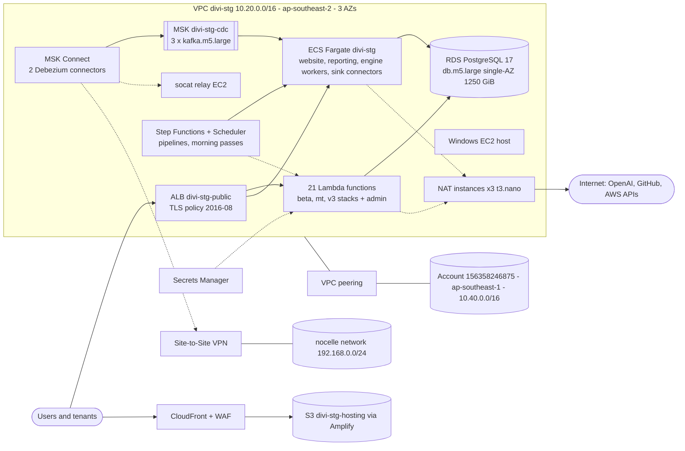

# AWS Well-Architected Review — divi-ai-stg (398437580121)

| | |
|---|---|
| **Report status** | Final |
| **Assessment date (UTC)** | 2026-11-12 |
| **Inspection started / finished (UTC)** | 2026-11-12T06:37:38Z / 2026-11-12T07:23:24Z |
| **Reviewer** | Claude Code, `aws-well-architected-review` workflow (read-only) |
| **Findings register** | [`../findings.md`](../findings.md) |

> **Erratum (2026-11-12, recorded during the production review).** The register holds the corrected records; the body of this report is kept as issued.
> 1. **AWS-WA-002: wrong hours.** The AWS CLI printed CloudWatch timestamps in the reviewer's local time (UTC+05:30), and they were read as UTC. The
>    database peak is **14:00–16:59 UTC (00:30–03:30 Adelaide, during the nightly pipelines)**, with hourly CPU maxima of 87–100% also at 04:00–05:59
>    and 08:00–10:59 UTC, not 19:00–21:00 UTC. The backup window (19:01–19:31 UTC) does **not** overlap the peak, so the advice to move it
>    (Sections 1, 6 and 9) is withdrawn. Severity is unchanged (HIGH). Day-level dates, such as the 14–17 August storage-full event, are not affected.
> 2. **AWS-WA-013: re-rated MEDIUM → HIGH (Confirmed issue).** GitHub's documentation confirms the immutable subject format
>    (`repo:OWNER@OWNER_ID/REPO@REPO_ID:…`). It is the default for repositories created after 15 July 2026, so the wildcard admits every
>    repository in the organisation.
> 3. **AWS-WA-004: re-rated HIGH → MEDIUM.** The partition count did not grow by ~6.8 a day. It stepped from 758 to 1,369 on 21–22 Oct, when the dug
>    connector created its topics, and has been flat since; that single step had been averaged over 90 days. No early-December breach is expected unless
>    new topics are added.
> 4. **New findings from the CDC follow-up** (register only):
>    - AWS-WA-024: the nocelle connector has been failed since 20 Aug 09:17 UTC, because the tenant database lost its CDC tables.
>    - AWS-WA-025: the dug connector failed on 27 Oct before ever completing its snapshot.
>    - AWS-WA-026: both connectors appear to store database passwords in plain text, one of them for the tenant's production ERP.
>
> Open findings are now 11 HIGH, 9 MEDIUM, 5 LOW and 1 INFORMATIONAL; the tables below show the original counts.

## 1. Executive Summary

**Account details**

| Account ID | Alias | Profile | Environment | Identity (role) | Regions assessed | Inspected (UTC) |
|---|---|---|---|---|---|---|
| 398437580121 | none (named divi-ai-stg after the profile) | divi-ai-stg-readonly | Staging that holds real data and users — rated like production (user, 2026-11-12) | AWSReservedSSO_ReadOnlyAccess (IAM Identity Center) | ap-southeast-2, ap-southeast-1, us-east-1 + global services | 2026-11-12 06:37–07:23 |

**Scope:** one account; the three Regions that hold resources (read-only counts in all 17 enabled Regions found nothing elsewhere); depth *deep* with 90-day metrics and Cost Explorer data. Out of scope: application code, Terraform source, GitHub configuration, the management account (892166101996), the peered account (156358246875), tenant networks, the Sustainability pillar.
**Evidence:** collected 2026-11-12 06:45–06:48 UTC by `collect.py` 1.0.0 (338 read-only calls: 312 ok, 25 not configured, 1 denied), plus about 70 targeted read-only calls and 90-day CloudWatch metrics. Raw evidence stayed in the session scratchpad.
**Since the last review:** first review of this account.

**Workloads assessed**

| Workload | What it does (as understood) | Tier / RTO / RPO (assumed, A9) |
|---|---|---|
| Divi API (`beta`, `mt`, `v3` stacks + admin portal, alert, client onboarding) | 21 Lambda functions behind the internet-facing ALB `divi-stg-public`; auth, config, financials, performance tracking, tracker, AI report generation (OpenAI) | Tier 2 · 4 h · 1 h |
| Tenant data pipelines (intrim, nocelle, dug) | Debezium CDC from tenant databases (Site-to-Site VPN, socat relay) via MSK Connect into MSK; sink connectors and engine workers on ECS Fargate; Step Functions pipelines and morning passes triggered by EventBridge Scheduler | Tier 2 · 8 h · 24 h |
| Platform database `divi-stg-postgres` | PostgreSQL 17.9 on db.m5.large, 1,250 GiB gp3, single-AZ; shared by all stacks and pipelines | Tier 2 · 4 h · 1 h |
| Website and static hosting | ECS service `divi-stg-website`; CloudFront + WAF in front of S3 (`divi-stg-hosting`, Amplify) | Tier 1 · 24 h · 24 h |

**Overall architectural assessment**
The platform has a sensible serverless/container core: Lambda and Fargate across three AZs behind one ALB, Step Functions orchestration, Terraform deployed
through GitHub OIDC roles, ECS deployment circuit breakers and Container Insights. It is run cheaply (NAT instances, Fargate Spot). The weaknesses
concentrate where production commitments meet staging-grade foundations: one undersized, single-AZ PostgreSQL instance carries every workload and already
suffered a four-day storage-full event; the account has no audit trail or threat detection; alerting does not cover the failures that occur; an
old administrator access key, internet-wide security-group rules reachable from a peered account and a tenant network, and probable plaintext secrets
in Lambda configuration widen the attack surface. The MSK cluster, the largest cost, is approaching its partition limit. None of this is exotic:
most fixes are configuration and process, and the most important ones are cheap.

| Pillar | Rating | One-line summary |
|---|---|---|
| Operational Excellence | Needs improvement | Good IaC and orchestration foundations; alerting broken where it matters; manual hosts and leftovers |
| Security | Weak | No audit trail or threat detection; stale admin key; broad network rules; probable plaintext secrets; TLS 1.0 |
| Reliability | Weak | Single-AZ database that has already filled up; MSK nearing its partition limit; self-managed NAT; no tested restore |
| Performance Efficiency | Needs improvement | Database saturated 2–3 h daily; long synchronous Lambda calls; Java cold starts |
| Cost Optimization | Adequate | Lean overall (~$1.9k/month); ECS over-provisioned; MSK 41% of spend; no budgets or commitments |

*Rating scale:* **Strong** — meets or exceeds the workload's needs · **Adequate** — meets current needs with moderate gaps · **Needs improvement** — material gaps · **Weak** — serious gaps or exposure · **Not assessed**.

**Findings at a glance**

| Severity | New | Existing (still open) | Resolved this review | Total open |
|---|---|---|---|---|
| CRITICAL | 0 | 0 | 0 | 0 |
| HIGH | 9 | 0 | 0 | 9 |
| MEDIUM | 8 | 0 | 0 | 8 |
| LOW | 5 | 0 | 0 | 5 |
| INFORMATIONAL | 1 | 0 | 0 | 1 |

**Major concerns**
1. The shared PostgreSQL database was storage-full for four days in August and still cannot grow automatically (AWS-WA-001); it saturates every morning (AWS-WA-002) and has no standby or tested restore (AWS-WA-003).
2. No CloudTrail trail, GuardDuty, Security Hub, Config or flow logs in an account that holds tenant data (AWS-WA-005).
3. Admin-level access paths: RDP/SSH/SQL Server open to 0.0.0.0/0 on hosts reachable from a peered account and a tenant network (AWS-WA-006); a 407-day-old administrator access key (AWS-WA-007); probable plaintext secrets in Lambda configuration (AWS-WA-009).
4. Alerting cannot see these failures — the two database alarms can never fire (AWS-WA-008).
5. MSK brokers hold 1,369 partitions each (recommended ~1,000) and the update limit of 1,500 is about three weeks away at the current growth rate (AWS-WA-004).

**Highest-priority recommendations**
1. Raise the database's maximum storage threshold and add storage/memory/latency alarms (AWS-WA-001, -008) — Low complexity, no cost.
2. Enable deletion protection, move the backup window out of the 19:00–21:00 UTC peak, deactivate the `app-admin` key (AWS-WA-003, -002, -007) — Low complexity, no cost.
3. Replace 0.0.0.0/0 on the RDP/SSH/1433 rules with the specific sources (AWS-WA-006) — Low complexity.
4. Alarm on MSK PartitionCount and start topic/partition hygiene before early December (AWS-WA-004).
5. Turn on audit and threat detection (organisation-level if possible) (AWS-WA-005); then tune and right-size the database and decide on Multi-AZ (AWS-WA-002, -003).

## 2. Architecture Overview

**Workload summary** — Tenants and internal users reach the Divi web application (CloudFront + S3/Amplify) and the API (ALB → Lambda). Tenant source
databases stream changes through Debezium/MSK into PostgreSQL via sink connectors on ECS. Each morning (around 05:30–07:30 Adelaide time) Step Functions
pipelines and "morning passes" run engine workers on ECS and read heavily from PostgreSQL to produce tracking, financial and AI-generated reports.

**Major AWS services in use**

| Domain | Services (counts) | Notes |
|---|---|---|
| Edge | CloudFront (1, with WAF), ALB `divi-stg-public` (1, 3 AZs) | ALB has no WAF; TLS policy 2016-08 |
| Compute | Lambda 21 (ap-southeast-2) + 1 (ap-southeast-1); ECS Fargate cluster `divi-stg` (7 services, 10 tasks); EC2 7 (3 NAT instances, OpenVPN, Windows host, socat relay, stopped test host) | 16 Java 21 functions, none with SnapStart |
| Data | RDS PostgreSQL 17.9 (1); MSK `divi-stg-cdc` (3 brokers) + MSK Connect (2 Debezium connectors); DynamoDB `terraform-state-lock` (us-east-1); S3 10 buckets | Single database for all workloads |
| Integration | Step Functions 14 state machines; EventBridge 6 rules; EventBridge Scheduler 4 schedules | Morning-pass and pipeline orchestration |
| Network | VPC `divi-stg` 10.20.0.0/16 (3 public + 3 private subnets); NAT instances per AZ; Site-to-Site VPN (nocelle, both tunnels up); VPC peering to account 156358246875 (10.40.0.0/16, ap-southeast-1); no VPC endpoints | Default VPCs present in all three Regions |
| Security / identity | IAM Identity Center (4 permission sets); 2 IAM users; 150 roles; GitHub OIDC deploy roles; Secrets Manager 15 secrets; GuardKite cross-account role (created 2026-11-09) | No CloudTrail trail, GuardDuty, Security Hub, Config |

**Architecture diagram** (solid arrows = [Confirmed]; dashed = [Inferred])

**Component relationships and dependencies**

| From | To | Relationship | Basis |
|---|---|---|---|
| ALB divi-stg-public | 21 Lambda functions, 7 ECS services | Lambda and IP target groups | [Confirmed] |
| Lambda (18 in VPC), ECS tasks | divi-stg-postgres | SQL connections (up to 286) | [Inferred] from environment variable names and connection metrics |
| MSK Connect (Debezium) | Tenant databases via VPN and socat (tcp/1433) | CDC source | [Inferred] from connectors, VPN routes, relay rules |
| ECS sink connectors | MSK → PostgreSQL | Kafka consumers writing to the database | [Inferred] from names and topology |
| EventBridge Scheduler / rules | Step Functions → ECS tasks | Daily pipelines 01:00 Adelaide; morning passes | [Confirmed] schedules; [Inferred] task targets |
| Private subnets | NAT instance in the same AZ | Default route | [Confirmed] |
| Private subnets | Peered VPC 10.40.0.0/16; tenant network 192.168.0.0/24 | Routes via peering and VPN | [Confirmed] |

**Failure paths**
- *Database storage fills or the instance fails:* every API stack and pipeline stops; recovery is a manual restore of 1,250 GiB (hours) [Inferred]; it has already happened once (August, four days).
- *Loss of ap-southeast-2b:* the database (single-AZ in 2b) is unavailable; Lambda, ECS and MSK continue in the other AZs but cannot do useful work.
- *NAT instance in one AZ fails:* functions and tasks in that AZ lose access to Secrets Manager, S3 and OpenAI until the instance recovers; about a third of requests fail [Inferred].
- *MSK passes 1,500 partitions per broker under load:* CDC stalls and the cluster cannot be resized while overloaded.
- *Morning-pass peak:* database CPU and I/O saturate for 2–3 hours; API calls slow down or time out.

**Confirmed vs inferred architecture:** resources, routes, security groups, target groups, schedules and metrics are directly observed. Data flows between
services are inferred from names, environment-variable names, routes and metrics; application behaviour was not inspected.

## 3. Five-Pillar Assessment

### 3.1 Operational Excellence
**Overall assessment:** Needs improvement. Infrastructure is mostly Terraform delivered by GitHub Actions through OIDC roles, ECS services use deployment
circuit breakers and Container Insights, and workflows are orchestrated with Step Functions. But the alerting that exists watches idle ECS tasks while the
database and pipelines fail unseen, and several hosts were built by hand.
**Positive observations:** Terraform state in a versioned bucket with a lock table; OIDC instead of static CI keys; Step Functions for pipelines; circuit breakers; Container Insights; RDS Performance Insights enabled.
**Identified gaps:** broken database alarms and no symptom alarms (AWS-WA-008); manual EC2 hosts outside IaC and SSM (AWS-WA-015); leftovers (AWS-WA-021); three parallel stacks (AWS-WA-023); logs without retention; no runbooks or restore tests visible (AWS-WA-003).
**Anti-patterns:** AP-26 under-engineering (operations); AP-27 duplication; AP-29 environment drift (manual hosts).
**Recommendations:** fix and extend alarms first; bring or retire manual hosts; write the database restore runbook.

### 3.2 Security
**Overall assessment:** Weak for an account holding tenant data. Human access through IAM Identity Center and OIDC deploy roles are good foundations, but
detection is absent and several access paths are broader than needed.
**Positive observations:** IAM Identity Center permission sets; root user has no password and no access keys; IMDSv2 required on all instances; RDS encrypted and private; MSK with IAM auth and TLS; CloudFront with WAF; HTTP redirected to HTTPS; GuardKite trust uses an ExternalId.
**Identified gaps:** no audit trail or threat detection (AWS-WA-005); world-open admin ports reachable from peer and tenant networks (AWS-WA-006); stale admin key (AWS-WA-007); probable plaintext secrets (AWS-WA-009); TLS 1.0/1.1 accepted (AWS-WA-012); broad deploy-role trust (AWS-WA-013); EBS encryption default off (AWS-WA-019); S3 account-level Block Public Access off (AWS-WA-020).
**Anti-patterns:** AP-28 poor separation of environments (AWS-WA-014).
**Recommendations:** contain network exposure and the admin key now; turn on organisation-level detection; move secrets to runtime retrieval; tighten deploy roles.

### 3.3 Reliability
**Overall assessment:** Weak. The stateless tiers span three AZs, but the single database is a single point of failure that has already failed on capacity,
and recovery has never been rehearsed.
**Positive observations:** Lambda, ECS and MSK across three AZs; per-AZ NAT routing (no cross-AZ egress dependency); Site-to-Site VPN with both tunnels up; Kafka replication factor 3; 7-day point-in-time recovery on the database.
**Identified gaps:** storage cap (AWS-WA-001); single-AZ database and untested recovery (AWS-WA-003); MSK partition limit (AWS-WA-004); timeouts and 5xx on synchronous APIs (AWS-WA-010); self-managed NAT without self-healing (AWS-WA-011); pipeline failures without alerting (AWS-WA-008).
**Anti-patterns:** AP-09 database configuration not matching the workload; AP-22 single point of failure; AP-24 untested recovery; AP-15 long synchronous chains.
**Recommendations:** storage headroom and alarms now; deletion protection and restore rehearsal; then the Multi-AZ decision after right-sizing.

### 3.4 Performance Efficiency
**Overall assessment:** Needs improvement. Most tiers have ample headroom (often far too much), but the one shared database is saturated every morning and the
API does long, batch-like work synchronously.
**Positive observations:** current-generation runtimes (Java 21, Python 3.12/3.13); gp3 storage; Fargate Spot for workers.
**Identified gaps:** database class limits CPU, memory and I/O (AWS-WA-002); no SnapStart; long synchronous calls (AWS-WA-010); NAT instances on t3.nano with exhausted credits (AWS-WA-011).
**Anti-patterns:** AP-09, AP-06 (Lambda used for long synchronous work), AP-15.
**Recommendations:** Performance Insights-led tuning, backup window move, then right-size; SnapStart; asynchronous report generation.

### 3.5 Cost Optimization
**Overall assessment:** Adequate. Spend is modest ($1,824.87–$2,631.37 per month over August–October) and some choices are deliberately frugal (NAT instances,
Fargate Spot). Over-provisioned Fargate tasks, an MSK cluster sized by partition count, manual hosts and the absence of budgets and commitments are the main levers.
Several reliability recommendations in this report increase cost, and those increases are larger than the savings — the trade-offs are stated per finding.
**Positive observations:** NAT instances instead of NAT gateways (≈ $115/month saved [Estimated]); Fargate Spot capacity provider; gp3 storage; Lambda for spiky APIs.
**Identified gaps:** ECS over-provisioning (AWS-WA-016); MSK cost structure (AWS-WA-017); manual hosts (AWS-WA-015); old snapshots (AWS-WA-018); no budgets, Compute Optimizer or commitments (AWS-WA-022).
**Anti-patterns:** AP-08 over-provisioned container capacity.
**Recommendations:** right-size ECS; keep MSK at its current size through partition hygiene; budgets and Compute Optimizer; commitments after right-sizing.

## 4. Architecture Anti-Patterns

### AP-28: Poor separation of environments — production data in a staging-built account (AWS-WA-014 · MEDIUM · High)
1. **What it is:** production workloads and data run in an environment designed, named and governed as non-production.
2. **Where it exists:** account 398437580121 — `divi-stg-*` resources, test-branch deployments (intrim-test-stg, nocelle-test-stg), three parallel API stacks, real tenant CDC links [Confirmed].
3. **Why it is a problem:** production commitments rest on staging-grade controls: no audit trail, single-AZ database, broad deploy roles, manual hosts.
4. **Impact:** security and reliability (most HIGH findings trace back here); operational (testing and production changes share one blast radius).
5. **Recommended improvement:** decide what is production; move it to a dedicated account with a production baseline, or formally re-classify this account and apply the baseline; keep a separate staging with synthetic data.
6. **Implementation complexity:** High.
7. **Trade-offs and risks:** a second environment costs money and migration effort; re-classifying in place is cheaper but leaves experiments next to production.

### AP-09: One undersized database for OLTP, CDC ingestion and batch analytics (AWS-WA-001, -002, -003 · HIGH)
1. **What it is:** a database configuration that does not match the combined workload placed on it.
2. **Where it exists:** `divi-stg-postgres` (db.m5.large, single-AZ) serves three API stacks, five sink-connector tasks and the morning-pass batch [Confirmed resources; Inferred flows].
3. **Why it is a problem:** the morning batch reads up to 482 MB/s against an 81 MB/s sustained instance limit, saturating CPU, memory and I/O for everyone; storage growth is unmanaged.
4. **Impact:** reliability (storage-full outage, single point of failure); performance (daily saturation, API timeouts); cost (pressure to over-scale).
5. **Recommended improvement:** tune the batch queries, move the backup window, separate analytical reads (read replica or reporting store), right-size on Graviton, then add Multi-AZ.
6. **Implementation complexity:** Medium.
7. **Trade-offs and risks:** higher database cost; a read replica adds lag; tuning may remove the need to scale.

### AP-15 / AP-06: Long-running work inside synchronous HTTP requests (AWS-WA-010 · MEDIUM · High)
1. **What it is:** batch-like operations (AI report generation, financial calculations) executed in Lambda functions behind an ALB while the client waits.
2. **Where it exists:** report-generator, financials and tracker functions of all three stacks; ALB idle timeout raised to 3,600 s [Confirmed].
3. **Why it is a problem:** requests reach the 75–300 s timeouts, errors reach 14% for one function, Java cold starts add latency.
4. **Impact:** reliability and user experience (3,518 5xx responses in 90 days, p99 up to 38.5 s); database sessions held longer.
5. **Recommended improvement:** asynchronous job pattern (SQS/Step Functions + status polling); SnapStart; realistic timeouts.
6. **Implementation complexity:** Medium–High (API contract change).
7. **Trade-offs and risks:** clients must handle job status; more moving parts.

### AP-26: Under-engineering of foundations (AWS-WA-005, -008, -015 · HIGH/MEDIUM)
1. **What it is:** missing baseline controls for the workload's criticality.
2. **Where it exists:** no CloudTrail trail, GuardDuty, Security Hub, Config or flow logs; alarms that cannot fire; hand-built hosts without SSM [Confirmed].
3. **Why it is a problem:** incidents can be neither detected nor investigated.
4. **Impact:** security and operations.
5. **Recommended improvement:** organisation-level detective controls, symptom alarms, hosts in Terraform and SSM.
6. **Implementation complexity:** Low–Medium.
7. **Trade-offs and risks:** small recurring cost; alert tuning effort.

### AP-27: Duplicated stacks and leftovers (AWS-WA-021, -023 · LOW/INFORMATIONAL)
1. **What it is:** parallel copies of the same services and resources left over from other products and experiments.
2. **Where it exists:** `beta`, `mt`, `v3` stacks (beta nearly idle); ten empty target groups (three still on the ALB); Glue triggers without jobs; unattached open security groups; Achieve-AI Lambda in Singapore [Confirmed].
3. **Why it is a problem:** triples deployment and configuration work; clutter hides real issues.
4. **Impact:** operational; minor security.
5. **Recommended improvement:** retire the beta stack if confirmed unused; consolidate v3 into mt over time; clean up leftovers.
6. **Implementation complexity:** Low (cleanup) / High (stack consolidation).
7. **Trade-offs and risks:** tenant migration between stacks.

**Checked and not found:** Kubernetes or EKS (none), Lambda recursion loops (no event source mappings), single NAT serving several AZs (per-AZ routing confirmed), public databases (RDS private), cross-Region runtime dependencies (the Singapore peering is a network path, not a runtime dependency observed in this review).

## 5. Service Selection and Configuration Review

| Component | Service / configuration | Workload requirement | Assessment | Rationale and evidence | Alternative considered | Finding |
|---|---|---|---|---|---|---|
| API compute | Lambda (Java 21, 512 MB–2 GB) behind ALB | Spiky request traffic, 471k requests / 90 days | Appropriate but misconfigured | Lambda suits the traffic shape; no SnapStart and long synchronous work hurt | ECS for long-running endpoints | AWS-WA-010 |
| Workers and connectors | ECS on Fargate (+ Spot) | Always-on consumers and batch workers | Appropriate but misconfigured | Right service; tasks reserve 10–20× their use | — | AWS-WA-016 |
| Database | RDS PostgreSQL 17.9, db.m5.large, single-AZ, 1,250 GiB gp3 | OLTP + CDC writes + morning batch reads; real data | Appropriate service, misconfigured | Class too small for I/O and memory; storage capped; no standby | Aurora PostgreSQL (I/O-heavy, fast failover) — evaluate only after tuning | AWS-WA-001/002/003 |
| CDC transport | MSK (3 × kafka.m5.large) + MSK Connect (Debezium) + custom sink connectors on ECS | Change capture from several tenant databases into PostgreSQL | Questionable (needs owner input) | 41% of spend at ~6% CPU; partition count drives size | AWS DMS CDC straight into PostgreSQL if Kafka replay/fan-out is unused | AWS-WA-004, -017 |
| Orchestration | Step Functions Standard + EventBridge Scheduler | Daily per-tenant pipelines | Appropriate | Managed, observable workflows; failures need alerting | — | AWS-WA-008 |
| Egress | NAT instances (t3.nano, one per AZ) | Internet/AWS API egress for VPC Lambdas and tasks | Appropriate for cost, misconfigured | Cheap and AZ-aligned; no self-healing, credits exhausted, no S3 endpoint | NAT gateways (≈ +$115/month); gateway endpoint (free) | AWS-WA-011 |
| Remote access | OpenVPN on EC2 + Site-to-Site VPN + Windows host + socat relay | Admin access; tenant DB connectivity | Questionable | Hand-built, not in SSM; broad rules | Session Manager / Fleet Manager; AWS Client VPN; security-group-scoped relay | AWS-WA-006, -015 |
| Static web | CloudFront + WAF + S3 (Amplify) | Public website | Appropriate | Standard pattern; bucket policy lacks source conditions | — | AWS-WA-020 |
| Public website bucket | S3 website hosting, public-read | Public strategy map (assumed) | Questionable | Public bucket instead of CloudFront + OAC | CloudFront + OAC | AWS-WA-020 |
| Secrets | Secrets Manager (15 secrets, no rotation) + Lambda environment variables | Credentials for DB and third parties | Misconfigured (probable) | Secrets exist but values appear copied into function configuration | Runtime retrieval with the Lambda extension | AWS-WA-009 |
| IaC state | S3 + DynamoDB lock table (us-east-1) | Terraform state | Appropriate | Bucket versioned; lock table has no PITR (acceptable for locks) | — | — |

**Multiple-component justification:** one database for everything is the opposite of sprawl and is the main concentration risk; the three API stacks are
duplication awaiting a product decision (AWS-WA-023); one MSK cluster for all tenants is reasonable if partitions are managed.

## 6. Reliability and Performance Assessment

**Single points of failure and fault isolation:** the database (single-AZ, ap-southeast-2b) is the platform's single point of failure; NAT instances are
per-AZ single points; Lambda, ECS, ALB and MSK are multi-AZ. The website runs as a single Fargate task (acceptable for Tier 1).
**Scaling behaviour and capacity headroom:** Lambda (account concurrency 1,000; peak function concurrency 59) and Fargate have large headroom. MSK is limited
by partitions per broker (1,369 of ~1,000 recommended, 1,500 update maximum). Database storage has ~415 GB free with autoscaling blocked.
**Bottlenecks and saturation:** database CPU 99.5–99.8% and read throughput up to 482 MB/s at 19:00–21:00 UTC daily [Measured · 7 days]; EBS burst balance 0%;
swap 2.9 GB; DB load 89 on 2 vCPUs; NAT instance CPU credits 0.
**Resilience weaknesses:** synchronous long calls with timeouts at their limits; 3,518 ALB 5xx in 90 days; Step Functions failures and aborts (dug pipelines
failing most runs) without alerting; no retries visible to clients on report generation.
**Backup, recovery and DR:** 7-day PITR in the same account and Region; no AWS Backup plan; one manual snapshot copy in Singapore (July); no evidence of
restore tests; assumed RTO 4 h is unlikely to be met by a manual restore of 1,250 GiB plus reconfiguration.
**If demand 2×/10×:** at 2× the morning batch would extend the saturation window and push API latency further (database first); at 10× the database and
the MSK partition count fail first; Lambda and Fargate would scale.

| Area | Observation | Evidence | Risk | Finding |
|---|---|---|---|---|
| Database capacity | 0 GB free for 4 days in August; cap = allocated | FreeStorageSpace; MaxAllocatedStorage 1250 | Outage | AWS-WA-001 |
| Database performance | Daily saturation 19:00–21:00 UTC | CPU, ReadThroughput, EBSByteBalance% | Slow APIs, batch overrun | AWS-WA-002 |
| Database availability | Single-AZ, no deletion protection | rds describe-db-instances | Hours of outage | AWS-WA-003 |
| Streaming capacity | 1,369 partitions per broker, +6.8/day | AWS/Kafka PartitionCount | CDC outage, blocked updates | AWS-WA-004 |
| API resilience | Timeouts at limit; 5xx | Lambda and ALB metrics | User-visible errors | AWS-WA-010 |
| Egress | Standalone t3.nano NAT per AZ | Routes, CPUCreditBalance | Partial outage | AWS-WA-011 |
| Detection | Alarms blind to the above | describe-alarms | Late detection | AWS-WA-008 |

## 7. Cost Optimization Assessment

**Spend context** [Measured · Cost Explorer, UnblendedCost, list prices]: August $2,631.37 (includes $152 Business Support+ and higher EC2/ECS),
September $1,824.87, October $1,938.72. October by service: MSK $800.32 (41.3%), RDS $487.03 (25.1%), ECS $289.07 (14.9%), EC2 compute $195.31 (10.1%),
VPC $70.71 (3.6%: Site-to-Site VPN $37.20, public IPv4 $33.50), CloudWatch $42.29 (2.2%). Savings Plans and RI coverage 0%. Trusted Advisor unavailable
(support level); Compute Optimizer not enrolled.

| Finding | Resource(s) | Current config | Utilisation | Current spend | Proposed | Est. saving / month | Basis | Risks | Complexity |
|---|---|---|---|---|---|---|---|---|---|
| AWS-WA-016 | ECS divi-stg services | ≈ 13 vCPU / 26 GB reserved | CPU avg 0.1–0.5% | $283.78 Fargate | ≈ 5 vCPU / 10 GB | $100–170 | Estimated | Kafka Connect memory | Low |
| AWS-WA-015 | socat relay | t3.medium | CPU avg 0.1% | $39.28 | t3.nano | ≈ $34 | Estimated | peak needs | Low |
| AWS-WA-015 | Windows host | t3.large Windows | bursty, credits 0 | $99.10 | retire or schedule | up to ≈ $97 | Estimated | owner decision | Low |
| AWS-WA-018 | manual snapshots | 1,000 GB + 450 GB | — | $130.76 backup storage | delete if unneeded | up to $18.24 + part of $112.52 | Measured / Not quantified | irreversible | Low |
| AWS-WA-017 | MSK brokers | 3 × kafka.m5.large | CPU avg 6% | $587.02 brokers | kafka.m7g.large | ≈ $17.50 | Estimated | rolling update | Low |
| AWS-WA-017 | CDC pipeline | MSK + Connect + sinks | — | ≈ $800 + sink tasks | DMS (PoC) | Not quantified | — | semantics change | High |
| AWS-WA-022 | account | no commitments | 24×7 DB and Fargate | — | RI / Savings Plan after right-sizing | Not quantified | — | lock-in | Low |

**Waste (idle/unused):** stopped r5a.2xlarge with volumes, idle socat host, empty target groups, Glue triggers, Singapore Lambda (small amounts).
**Over-provisioning:** ECS task sizes (largest lever). **Inefficient service choices:** possibly the CDC stack (AWS-WA-017). **Data transfer:** $45.52
(internet egress and regional), not a driver. **Pricing model:** no commitments, no budgets. **Governance:** no budgets or anomaly detection.

**Total opportunity** (non-overlapping, Estimated): ≈ $170–335 per month (9–17% of October spend) from AWS-WA-016, -015, -018 (Singapore part) and -017 (m7g).
**Cost increases recommended for reliability and security** (Estimated, list prices): database right-size +$161–239/month; Multi-AZ +$353/month on the
current class (more on a larger class); NAT hardening ≈ +$32/month; detective controls usage-based (not quantified). Net, implementing the HIGH reliability
items costs more than the identified savings — that is the price of running production data.
**Considered but not recommended:** replacing NAT instances with NAT gateways purely for convenience (≈ +$115/month; harden instead unless availability needs rise);
scheduling platform shutdown out of hours (real users, A10); MSK Serverless (per-partition pricing at 1,369 partitions); buying commitments before right-sizing.

## 8. Consolidated Findings Register

| ID | Severity | Pillar | Account | Region | Service | Finding | Status |
|---|---|---|---|---|---|---|---|
| AWS-WA-001 | HIGH | Reliability | 398437580121 | ap-southeast-2 | RDS for PostgreSQL | Postgres was storage-full for 4 days and storage still cannot grow automatically | Open |
| AWS-WA-002 | HIGH | Performance Efficiency | 398437580121 | ap-southeast-2 | RDS for PostgreSQL | Postgres saturates every morning: the db.m5.large class caps CPU, memory and I/O | Open |
| AWS-WA-003 | HIGH | Reliability | 398437580121 | ap-southeast-2 | RDS for PostgreSQL | Single-AZ database with real tenant data, no deletion protection and untested recovery | Open |
| AWS-WA-004 | HIGH | Reliability | 398437580121 | ap-southeast-2 | Amazon MSK | MSK brokers host 1,369 partitions each and grow toward the 1,500 update limit | Open |
| AWS-WA-005 | HIGH | Security | 398437580121 | all three | CloudTrail, Config, GuardDuty, Security Hub | No audit trail or threat detection in the account | Open |
| AWS-WA-006 | HIGH | Security | 398437580121 | ap-southeast-2 | EC2 / VPC | RDP, SSH and SQL Server open to 0.0.0.0/0 on hosts reachable from a peered account and a tenant network | Open |
| AWS-WA-007 | HIGH | Security | 398437580121 | global | IAM | IAM user app-admin has AdministratorAccess and a 407-day-old active access key | Open |
| AWS-WA-008 | HIGH | Operational Excellence | 398437580121 | ap-southeast-2 | CloudWatch | Alerting misses the failures that matter; the database alarms can never fire | Open |
| AWS-WA-009 | HIGH | Security | 398437580121 | ap-southeast-2, ap-southeast-1 | Lambda | Database passwords and API keys appear to be plain Lambda environment variables | Open |
| AWS-WA-010 | MEDIUM | Reliability | 398437580121 | ap-southeast-2 | Lambda, ELB | Long-running synchronous Lambda APIs time out and return 5xx | Open |
| AWS-WA-011 | MEDIUM | Reliability | 398437580121 | ap-southeast-2 | EC2 / VPC | Egress depends on one t3.nano NAT instance per AZ with exhausted CPU credits and no VPC endpoints | Open |
| AWS-WA-012 | MEDIUM | Security | 398437580121 | ap-southeast-2 | Elastic Load Balancing | Public load balancer accepts TLS 1.0/1.1 and keeps no access logs | Open |
| AWS-WA-013 | MEDIUM | Security | 398437580121 | global | IAM | Deploy role with iam:* trusts a wildcard and non-main test branches | Open |
| AWS-WA-014 | MEDIUM | Security | 398437580121 | ap-southeast-2 | Account structure | Real tenant data and users run in an account built and governed as staging | Open |
| AWS-WA-015 | MEDIUM | Operational Excellence | 398437580121 | ap-southeast-2 | EC2 | Manually built EC2 hosts outside Terraform and Systems Manager | Open |
| AWS-WA-016 | MEDIUM | Cost Optimization | 398437580121 | ap-southeast-2 | ECS on Fargate | ECS Fargate tasks reserve 10–20 times the CPU and memory they use | Open |
| AWS-WA-017 | MEDIUM | Cost Optimization | 398437580121 | ap-southeast-2 | Amazon MSK | MSK is 41% of spend for a CDC pipeline running at about 6% CPU | Open |
| AWS-WA-018 | LOW | Cost Optimization | 398437580121 | ap-southeast-2, ap-southeast-1 | RDS | Old manual database snapshots add to $131/month of backup storage | Open |
| AWS-WA-019 | LOW | Security | 398437580121 | all three | EBS | EBS encryption by default is off; six volumes are unencrypted | Open |
| AWS-WA-020 | LOW | Security | 398437580121 | global | S3 | S3 public-access controls rely on per-bucket settings | Open |
| AWS-WA-021 | LOW | Operational Excellence | 398437580121 | all three | ELB, Glue, EC2, Lambda | Leftover resources from earlier experiments and another product | Open |
| AWS-WA-022 | LOW | Cost Optimization | 398437580121 | global | Budgets, Compute Optimizer | No budgets, cost recommendations or commitments | Open |
| AWS-WA-023 | INFORMATIONAL | Operational Excellence | 398437580121 | ap-southeast-2 | Lambda, Step Functions | Three parallel API stacks (beta, mt, v3) run side by side | Open |

*Full finding records:* [`../findings.md`](../findings.md)
**Changes in this review:** New: AWS-WA-001 to AWS-WA-023 · Updated: none · Resolved: none · Re-opened: none · Not re-assessed: none (first review).

## 9. Prioritized Remediation Roadmap

Score = severity weight × confidence ÷ complexity (framework §10).

| Horizon | ID | Action (containment or fix) | Score | Why now | Complexity | Dependencies | Benefit / risk reduced |
|---|---|---|---|---|---|---|---|
| **Immediate (0–7 days)** | AWS-WA-001 | Raise MaxAllocatedStorage; storage alarm | 4.0 | outage already happened | Low | — | prevents storage-full outage |
| | AWS-WA-007 | Deactivate `app-admin` key (containment), then delete user | 4.0 | full-admin static key | Low | owner check | removes takeover path |
| | AWS-WA-008 | Recreate RDS alarms; add database, ALB 5xx, Step Functions, MSK alarms | 4.0 | failures go unseen | Low | — | detection |
| | AWS-WA-004 | PartitionCount and disk alarms; freeze unnecessary new captures | 4.0 | ~3 weeks to 1,500 | Low | — | avoids blocked cluster |
| | AWS-WA-006 | Replace 0.0.0.0/0 on 3389/22/1433 with specific sources (containment) | 3.2 | admin ports reachable from outside networks | Low | who connects from where | closes lateral path |
| | AWS-WA-003 | Enable deletion protection (containment) | 1.6 | one-call deletion | Low | — | prevents accidental loss |
| | AWS-WA-002 | Move backup window out of 19:00–21:00 UTC (quick win) | 2.0 | overlaps daily peak | Low | — | less contention |
| **Short term (1–4 weeks)** | AWS-WA-005 | Organisation-level CloudTrail, GuardDuty, Security Hub, Config; flow logs | 1.6 | no audit evidence | Medium | management-account owners | detection, forensics |
| | AWS-WA-004 | Partition hygiene (include lists, delete stale topics) | 2.0 | growth trend | Medium | tenant owners | stays on current brokers |
| | AWS-WA-009 | Verify and move secrets to runtime retrieval; rotate | 1.6 | credentials exposure | Medium | code changes | protects DB and OpenAI keys |
| | AWS-WA-011 | S3 gateway endpoint; NAT self-healing | 3.0 | egress single points | Low/Medium | — | partial-outage risk |
| | AWS-WA-012 | TLS 1.2+ policy; access and connection logs | 3.0 | deprecated TLS | Low | client check | compliance |
| | AWS-WA-016 | Right-size ECS tasks | 3.0 | quick saving | Low | — | ≈ $100–170/month |
| | AWS-WA-010 | SnapStart on Java functions | 3.0 | cold starts | Low | published versions/aliases | latency |
| | AWS-WA-018, -019, -021, -022 | Snapshots, EBS default encryption, leftovers, budgets and Compute Optimizer | 1.6–2.0 | hygiene | Low | owner confirmation | cost, clarity |
| **Medium term (1–3 months)** | AWS-WA-002 | Performance Insights tuning, then right-size (Graviton) | 2.0 | daily saturation | Medium | backup window moved | performance headroom |
| | AWS-WA-003 | Restore runbook + rehearsal; Multi-AZ or cross-account backups decision | 1.6 | RTO unproven | Medium | right-sizing first | recoverability |
| | AWS-WA-015 | Bring manual hosts into Terraform + SSM or retire them | 1.5 | drift, patching | Medium | owners | control |
| | AWS-WA-013 | Narrow OIDC trust; split deploy roles | 1.2 | broad admin path | Medium | GitHub settings | least privilege |
| | AWS-WA-020 | CloudFront + OAC, then account-level BPA | 1.6 | guardrail | Low | content check | exposure |
| **Long term (3+ months)** | AWS-WA-014 | Production/non-production account separation | 1.0 | structural | High | org decisions | blast radius |
| | AWS-WA-010 | Asynchronous report/financials APIs | 1.0 | structural | High | client changes | resilience |
| | AWS-WA-017 | DMS proof of concept vs MSK | 0.8 | largest cost | High | pipeline owners | cost and simplicity |
| | AWS-WA-023 | Retire beta stack, consolidate v3 into mt | 0.3 | duplication | High | product decision | operability |

Work packages: **database package** (AWS-WA-001/002/003/008 database alarms), **access package** (AWS-WA-006/007/009/013/015), **detection package**
(AWS-WA-005/008/012), **streaming package** (AWS-WA-004/017), **efficiency package** (AWS-WA-016/018/021/022). All changes are for the account owners to make;
none were made by this review.

## 10. Assessment Limitations

**Access ledger (missing permissions / unavailable services)**

| Area | API / permission | Result | Assessment impact |
|---|---|---|---|
| Trusted Advisor | trustedadvisor:ListRecommendations | AccessDenied (support level) | no Trusted Advisor checks |
| AWS Backup | backup:ListBackupPlans (ap-southeast-2) | AccessDenied | backup plans inferred from list-protected-resources (empty) |
| Compute Optimizer | get-recommendation-summaries | not opted in | no AWS rightsizing recommendations |
| Security Hub | describe-hub | not subscribed (all three Regions) | treated as "not enabled" |
| IAM credential report | get-credential-report | report existed | no gap |

**Unavailable metrics:** EC2 memory and disk (no CloudWatch agent); Lambda memory use (not collected); MSK per-topic throughput (default monitoring); 10 days only for the NAT instances (relaunched 2026-11-02); 21–23 days for recently created ECS services.
**Missing workload context:** the user could not answer the questionnaire; the review uses assumptions A1–A15 (below), confirmed by the user before analysis.
**Unavailable cost data:** private pricing/discounts unknown (A14); savings are list-price estimates.
**Assumptions made:**

| # | Assumption | Effect |
|---|---|---|
| A1 | Lambda secret-named variables hold literal values | AWS-WA-009 potential, HIGH |
| A2 | divi-strategy-map-s3 is an intentional public website | AWS-WA-020 LOW |
| A3 | Manual hosts are still owned by someone | no deletion advice |
| A4 | Peer account and tenant VPN network not fully trusted | AWS-WA-006 HIGH |
| A5 | No organisation-level CloudTrail/GuardDuty/Security Hub | AWS-WA-005 HIGH |
| A6 | `app-admin` not needed day to day | AWS-WA-007 deactivation advice |
| A7 | Target groups, Glue triggers, SGs, Singapore Lambda are leftovers | AWS-WA-021 LOW |
| A8 | August storage-full was a real write outage; growth continues | AWS-WA-001 HIGH |
| A9 | Tiers and RTO/RPO as in Section 1 | AWS-WA-003 HIGH |
| A10 | Platform must run 24×7 | no shutdown scheduling |
| A11 | beta, mt, v3 all in use | AWS-WA-023 INFORMATIONAL |
| A12 | Test branches and the OIDC wildcard less controlled than main | AWS-WA-013 potential |
| A13 | Support below Business; Compute Optimizer off | data gaps noted |
| A14 | List prices, no private discounts | estimates |
| A15 | Sustainability out of scope | not assessed |

**Areas requiring manual verification:** Lambda variable contents (without printing values); purpose and data on the Windows host; contents of `divi-strategy-map-s3`;
organisation-level controls in the management account; GitHub branch protection and OIDC subject format; who uses the peering and VPN paths; application
query patterns behind the morning peak; actual replication factor per topic (default configuration implies 3).
**Coverage and sampling:** all resources in the three Regions were inventoried (no collector caps hit); CloudWatch metrics for all running EC2, RDS, NAT,
ALB, Lambda, ECS, MSK brokers and state machines.

| Pillar / area | Assessed | Partially (why) | Not assessed (why) |
|---|---|---|---|
| Operational Excellence | yes | runbooks and processes outside AWS not visible | |
| Security | yes | application-level security and GitHub settings not visible | |
| Reliability | yes | restore tests and DR documents not visible | |
| Performance Efficiency | yes | no query-level analysis (Performance Insights data not pulled) | |
| Cost Optimization | yes | Trusted Advisor and Compute Optimizer unavailable | |
| Sustainability | | | Out of scope unless requested |

**Assessment coverage (final progress tracker)**

| Stage | Status | Notes |
|---|---|---|
| 1 Scope confirmation, register check | Done | register empty (first review) |
| 2 Collector run | Done | 338 calls; first run lost 6 AWS Config calls to a collector bug (CLI name `configservice`), fixed and re-run in full |
| 3 Digest, workload map, questionnaire | Done | 44 signals; questionnaire answered with assumptions A1–A15 |
| 4 Re-verification of open findings | Skipped | no prior findings |
| 5 Targeted deep dives | Done | MSK/Connect, VPN, Step Functions, Glue, ALB, S3 policies, SnapStart, RDS, ECS sizes, NACLs, budgets, prices, 90-day metrics |
| 6 Analysis | Done | |
| 7 Validation gate | Done | AWS documentation checked for MSK partitions, ALB TLS policies, Lambda SnapStart, RDS storage autoscaling; calibration check: 9 of 23 HIGH, each re-examined — concentration explained by AWS-WA-014 |
| 8 Reporting | Done | register check 0 problems; review lint |

**Method limits:** point-in-time, read-only snapshot. The skill's read-only guard hook was **not active** in this session because the workflow was run
directly rather than launched with `/aws-well-architected-review`; all AWS calls were nevertheless read-only (collector policy check, literal read-only
commands) and the session used the ReadOnlyAccess permission set, which AWS enforces. Cost Explorer was called 16 times (≈ $0.16) because the
collection was re-run once after a bug fix.

## 11. Sources and References

- AWS Well-Architected Framework — https://docs.aws.amazon.com/wellarchitected/latest/framework/welcome.html
- RDS storage autoscaling (threshold rules, storage-full behaviour) — https://docs.aws.amazon.com/AmazonRDS/latest/UserGuide/USER_PIOPS.Autoscaling.html
- RDS event messages (RDS-EVENT-0221, -0224) — https://docs.aws.amazon.com/AmazonRDS/latest/UserGuide/USER_Events.Messages.html
- RDS storage — https://docs.aws.amazon.com/AmazonRDS/latest/UserGuide/CHAP_Storage.html
- RDS Multi-AZ — https://docs.aws.amazon.com/AmazonRDS/latest/UserGuide/Concepts.MultiAZ.html
- MSK best practices (partitions per broker) — https://docs.aws.amazon.com/msk/latest/developerguide/bestpractices.html
- MSK recommended CloudWatch alarms — https://docs.aws.amazon.com/msk/latest/developerguide/bestpractices-cw-alarms.html
- ALB security policies (2016-08 protocols; recommended TLS13-1-2-Res-PQ-2025-09) — https://docs.aws.amazon.com/elasticloadbalancing/latest/application/describe-ssl-policies.html
- Lambda SnapStart — https://docs.aws.amazon.com/lambda/latest/dg/snapstart.html
- Timeouts, retries and backoff (Builders' Library) — https://aws.amazon.com/builders-library/timeouts-retries-and-backoff-with-jitter/
- Gateway endpoints — https://docs.aws.amazon.com/vpc/latest/privatelink/gateway-endpoints.html · NAT gateway pricing — https://docs.aws.amazon.com/vpc/latest/userguide/nat-gateway-pricing.html · Regional NAT gateways — https://docs.aws.amazon.com/vpc/latest/userguide/nat-gateways-regional.html
- CloudTrail security best practices — https://docs.aws.amazon.com/awscloudtrail/latest/userguide/best-practices-security.html
- GuardDuty with Organizations — https://docs.aws.amazon.com/guardduty/latest/ug/guardduty_organizations.html · Security Hub administrator account — https://docs.aws.amazon.com/securityhub/latest/userguide/designate-orgs-admin-account.html
- IAM best practices — https://docs.aws.amazon.com/IAM/latest/UserGuide/best-practices.html
- Organizing your AWS environment — https://docs.aws.amazon.com/whitepapers/latest/organizing-your-aws-environment/organizing-your-aws-environment.html
- Disaster recovery strategies — https://docs.aws.amazon.com/whitepapers/latest/disaster-recovery-workloads-on-aws/disaster-recovery-workloads-on-aws.html
- AWS Backup — https://docs.aws.amazon.com/aws-backup/latest/devguide/whatisbackup.html · S3 Block Public Access — https://docs.aws.amazon.com/AmazonS3/latest/userguide/access-control-block-public-access.html
- ECS best practices — https://docs.aws.amazon.com/AmazonECS/latest/bestpracticesguide/intro.html · Savings Plans — https://docs.aws.amazon.com/savingsplans/latest/userguide/what-is-savings-plans.html · Compute Optimizer — https://docs.aws.amazon.com/compute-optimizer/latest/ug/what-is-compute-optimizer.html
- Prices: AWS Price List API (`pricing get-products`), Asia Pacific (Sydney), retrieved 2026-11-12.

## 12. Overall Conclusion

The divi-ai-stg account runs a reasonably modern platform — serverless and container tiers across three AZs, Terraform with OIDC, managed orchestration —
at a modest cost. Its maturity, however, matches its name rather than its use: it carries real tenant data with staging-grade foundations. The one shared
PostgreSQL instance is the clearest example: it has already been storage-full for four days, saturates every morning, has no standby and no rehearsed
recovery, and nothing would alert anyone. Security detection is absent, and a few broad access paths (admin ports reachable from outside networks, an old
admin key, probable plaintext secrets) are the kind of gaps that turn a small incident into a large one.

The three changes that most improve risk: (1) give the database storage headroom, deletion protection and working alarms this week, then tune, right-size and
decide on Multi-AZ; (2) contain the access paths (security-group sources, `app-admin` key, secrets) and turn on organisation-level audit and threat detection;
(3) bring MSK partitions under control before the 1,500 limit. Cost savings of roughly $170–335/month are available, but the reliability fixes will cost more
than that; budget for them deliberately. The longer-term question is structural: separate production from staging (AWS-WA-014).

Re-assess in about 4–6 weeks, after the Immediate and Short-term items, re-running each finding's read-only re-check.

## Appendix B — Evidence and commands (read-only; no secrets)

Collector `collect.py` 1.0.0 with `--with-metrics --metrics-days 90 --with-cost` for ap-southeast-2, ap-southeast-1, us-east-1 (global calls via us-east-1):
338 calls — 312 ok, 25 not configured, 1 denied. Digest: 44 signals, 0 errors. Additional read-only calls: `kafka list-clusters-v2`, `kafkaconnect list-connectors`,
`ec2 describe-vpn-connections`, `ec2 describe-vpn-gateways`, `ec2 describe-customer-gateways`, `ec2 describe-network-acls`, `ec2 describe-instance-types`,
`stepfunctions list-state-machines`, `glue get-jobs/get-triggers/get-crawlers`, `scheduler list-schedules/get-schedule`, `batch describe-compute-environments`,
`elbv2 describe-load-balancer-attributes/describe-listeners`, `s3api get-bucket-policy/get-bucket-website`, `lambda list-functions` (projected),
`rds describe-db-instances/describe-db-instance-automated-backups/describe-db-proxies`, `ecs describe-task-definition` (cpu/memory only),
`kafka describe-cluster-v2`, `cloudwatch get-metric-data/get-metric-statistics`, `budgets describe-budgets`, `pricing get-products`. Region discovery: read-only
resource counts across all 17 enabled Regions.
